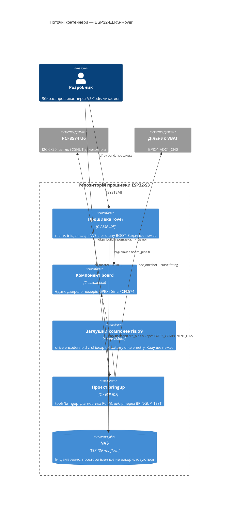

# Architecture map — ESP32-ELRS-Rover

> **Поточна** архітектура (що існує сьогодні), створена скілом `survey`. Оновлюється повторним `survey`, коли репозиторій розходиться з `reflects_commit`. Авторське джерело вимог — `docs/02-FIRMWARE-CONTEXT.md` (авторитетне, узгоджується нижче, не замінюється). Фази прошивки 0–7 **ще не почато**; існують лише діагностичні прошивки P0–P3.

## Stack

- Мова / середовище: C, ESP-IDF v6.1 (`CLAUDE.md`, `.vscode/settings.json:2`), FreeRTOS. Ціль `esp32s3`, плата YD-ESP32-S3 N16R8 (`sdkconfig.defaults:1`).
- Конфігурація заліза: 16 МБ флешу, octal PSRAM 8 МБ, консоль USB-Serial-JTAG, task WDT 5 с, `FREERTOS_HZ=1000` (`sdkconfig.defaults:2-10`).
- Збірка: `source ~/.espressif/tools/activate_idf_v6.1.sh && idf.py build` у корені; кореневий `CMakeLists.txt:1-4` (CMake ≥ 3.22, `project(rover)`).
- Прошивка й монітор: лише користувач через розширення ESP-IDF у VS Code (`CLAUDE.md`, розділ «Команди»); `.vscode/` у `.gitignore`.
- Тести: хостовий раннер на звичайному gcc **запланований** (`test/host/`, порожньо); раннера ще немає. Лінтер не налаштований.

## C4 — system as it is

## Module inventory

| Модуль | Шлях | Шари | Підключено в | Відповідальність |
|---|---|---|---|---|
| main (точка входу) | `main/` | застосунок + чиста логіка (`app_states`) | `main/CMakeLists.txt:1-3` (`REQUIRES board nvs_flash esp_timer`) | `app_main`: ініціалізація NVS, лог стану BOOT |
| board | `components/board/` | лише заголовок | `components/board/CMakeLists.txt:1` | `PIN_*`, `IOEXP_BIT_*`, `PCF8574_ADDR` (`include/board_pins.h`) |
| drive, encoders, pid, crsf, ioexp, tof, battery, ui, telemetry | `components/<name>/` | заглушка: `CMakeLists.txt` + `include/.gitkeep`, без `.c` | `components/<name>/CMakeLists.txt:2` | Заплановані в `docs/02-FIRMWARE-CONTEXT.md` §6.4; кожен має отримати `<name>_core.c` + `<name>_hal.c` |
| bringup | `tools/bringup/` | окремий проєкт IDF | `tools/bringup/CMakeLists.txt:2-5` (`EXTRA_COMPONENT_DIRS ../../components`) | Діагностичні прошивки P0–P3 (P4–P7 ще не написані) |
| хостові тести | `test/host/` | порожньо | — | Запланований gcc-раннер для `*_core.c` |
| залізо | `kicad-rover/` | проєкт KiCad (не прошивка) | — | `kicad-rover.net` — джерело істини про піни |

## Conventions (cited — the rules a new feature must match)

- **Підключення / реєстрація модулів:** `idf_component_register(SRCS … INCLUDE_DIRS … REQUIRES …)` у кожного компонента; `REQUIRES` оголошується в CMake споживача — `main/CMakeLists.txt:1-3`. Заглушки реєструють лише каталоги заголовків — `components/drive/CMakeLists.txt:2`.
- **Номери GPIO:** існують лише в `components/board/include/board_pins.h` (`:5-53`); літерал піна будь-де ще — дефект (пункт 2 конституції, `CLAUDE.md`).
- **Розділення core/HAL (обовʼязкове):** `<name>_core.c` без заголовків ESP-IDF, `<name>_hal.c` з драйверами; core тестується на хості, HAL перевіряється на залізі, без моків (`CLAUDE.md`, пункт 6; `docs/02-FIRMWARE-CONTEXT.md` §6.4). Найближчий наявний файл чистої логіки: `main/app_states.h:1`, `main/app_states.c:3` (лежить у `main/`, ще не компонент).
- **Обробка помилок:** `ESP_ERROR_CHECK` на викликах драйверів — `tools/bringup/main/main.c:53`, `main/main.c:14`.
- **Логування:** `static const char *TAG`, `ESP_LOGI`, повідомлення з префіксом фази — `main/main.c:5`, `tools/bringup/main/main.c:23`.
- **Ідентифікатори / іменування:** ідентифікатори англійською; `PIN_*`, `IOEXP_BIT_*`, `APP_STATE_*` — `main/app_states.h`; коментарі й коміти українською (пункт 9 конституції).
- **Драйвери:** лише нові драйвери ESP-IDF (`esp_adc`, `i2c_master`, `gptimer`, `pulse_cnt`); застарілих заголовків у v6.1 немає — `tools/bringup/main/main.c:42-53,139-148` (i2c_master, adc_oneshot).
- **Збереження даних / доступ до БД:** лише NVS з очищенням при пошкодженні — `main/main.c:9-14`.
- **Міграції:** немає (БД немає; NVS без схеми).
- **Тести:** ще немає; запланований раннер на звичайному gcc у `test/host/`; приймання HAL — перевірка на залізі, записана в `docs/measured.md`.
- **Міжмодульна взаємодія:** не реалізована. План: задачі FreeRTOS + черги `q_rc`, `q_tof`, `q_ui`, `q_tel` і мʼютекси `m_i2c`, `m_state` (`docs/02-FIRMWARE-CONTEXT.md` §6.1–6.2).
- **Виміряні константи:** йдуть у `docs/measured.md`, ніколи не вигадуються; `PCF8574_ADDR` уже перенесено в `board_pins.h:45`.
- **UI / стилі:** немає (фронтенду немає).

## Datastores

| Сховище | Рушій | Доступ через | Примітки |
|---|---|---|---|
| NVS | ESP-IDF `nvs_flash`, типова таблиця розділів | `main/main.c:9-14` | Лише ініціалізовано; заплановано зберігати калібрування VBAT (`VBAT_SCALE`, `VBAT_OFFSET`) |

## Frontend / UI foundation

<!-- N/A: no frontend -->

## Where things live / closest precedents

- Новий апаратний компонент (drive, encoders, …) → `components/<name>/` як `<name>_core.c` + `<name>_hal.c` + `include/`, піни з `board_pins.h`; справжнього прецеденту ще немає, найближчі — драйвери з bring-up: `tools/bringup/main/main.c:42` (I²C) і `:139` (ADC).
- Нове діагностичне вимірювання → функція `test_pN_*` із гілкою `BRINGUP_TEST` у `tools/bringup/main/main.c:17,185-191`, результат у `docs/measured.md`.
- Нова частина машини станів → чиста логіка поряд з `main/app_states.c`, стани за `docs/02-FIRMWARE-CONTEXT.md` §6.3.
- Нова фаза прошивки → одна SDD-фіча з власним слагом і специфікацією в `docs/specs/` (`CLAUDE.md`, «Порядок роботи»).

## Constraints & known tech-debt

- **Інваріанти безпеки** (`CLAUDE.md`, пункт 7): STBY піднімається лише в ARMED; втрата CRSF > 500 мс → ШІМ 0 і STBY вниз; перша операція по I²C — запис `0x00` у PCF8574; ШІМ ≤ 0.75 до фази 5; VBAT < 6.0 В → мотори не запускаються. Будь-яка нова фіча мусить їх зберігати.
- **Фіксоване залізо** (`docs/02-FIRMWARE-CONTEXT.md` §2, §4): усі 4 блоки PCNT зайняті, LEDC 8 каналів лише low-speed, одна шина I²C на 100 кГц (не піднімати).
- **Невідомі константи** («?» у §9): `ENC_PULSES_PER_REV`, `ENC_DIR_SIGN`, `ENC_NEEDS_PULLUP`, `VBAT_SCALE/OFFSET` (P3 очікує), геометрія коліс — специфікації, що від них залежать, не пишуться (пункти 3–4 конституції).
- **Заглушки без `REQUIRES` і без коду**; коли фаза стартує, треба додати вихідні файли й залежності.
- **`app_states` лежить у `main/`**, а не в компоненті, хоча це чиста логіка, яка має тестуватись на хості.
- **Лінтера й хостового раннера ще немає**; єдина перевірка — `idf.py build` без нових попереджень (пункт 8 конституції).
- **Прошивка вручну** на машині користувача (через VS Code); агент лише збирає.

## Reconciliation with the authored architecture doc

`docs/02-FIRMWARE-CONTEXT.md` §6.4 — авторський план; ця карта відображає реальне дерево і збігається з ним, з такими відмінностями: `docs/architecture.md` і `docs/pinout.md` з §6.4 не існують; `main/app_states.h` існує понад план; 9 із 10 компонентів — заглушки без файлів `_core/_hal` (фази не почато); `tools/bringup/` зібраний як один проєкт із перемикачем `BRINGUP_TEST` (за §7.0.2), а не окремими проєктами на фазу, як спершу сказано в §7.0. `kicad-rover.net` лишається авторитетом щодо заліза.
