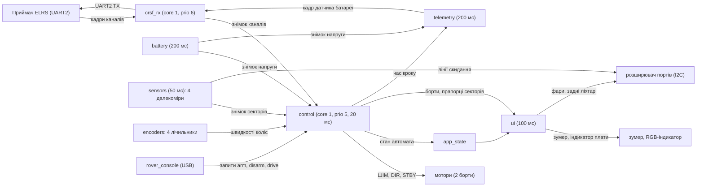
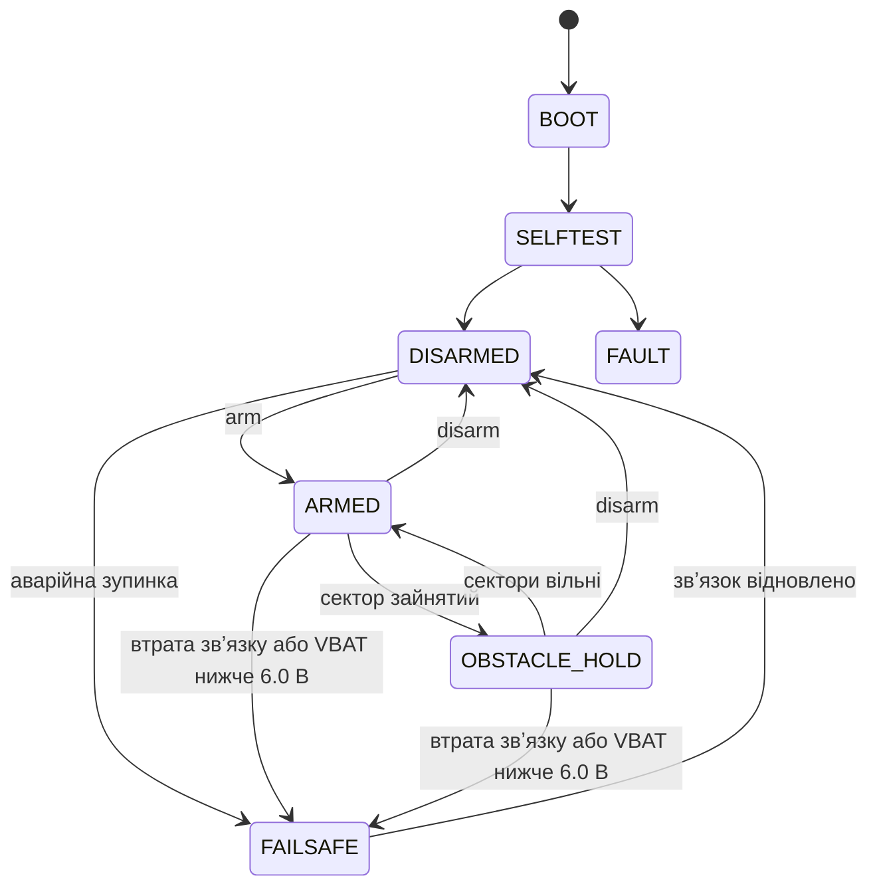

# Архітектура прошивки

Блок-схема задач і потоків даних. Опис компонентів: `docs/02-FIRMWARE-CONTEXT.md` §6; рішення — `docs/features/<фаза>/adr/`.

## Задачі й потоки даних

## Автомат станів

Таблиця дозволених переходів має 12 пар із 49 (`components/app_state/app_state_core.c`, `test/host/test_app_state.c`). Діаграма
показує основні шляхи; повна таблиця — у коді.

## Індикація утримання

OBSTACLE_HOLD: подвійний біп на вході та на виході в ARMED; індикатор плати жовтий; передній сектор зайнятий — блимають фари;
задній — задні ліхтарі. Рішення: `docs/features/phase7-telemetry/adr/`.
