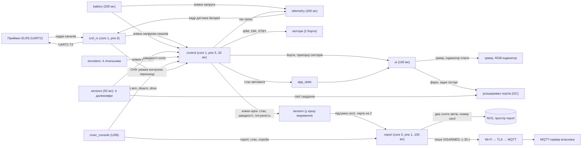
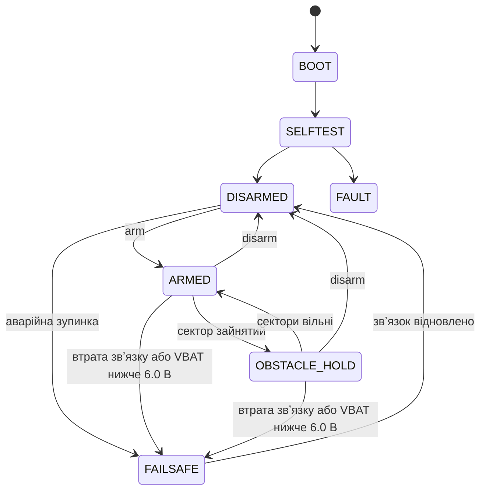

# Архітектура прошивки

Блок-схема задач і потоків даних. Опис компонентів: `docs/02-FIRMWARE-CONTEXT.md` §6; рішення — `docs/features/<фаза>/adr/`.

## Задачі й потоки даних

## Автомат станів

Таблиця дозволених переходів має 12 пар із 49 (`components/app_state/app_state_core.c`, `test/host/test_app_state.c`). Діаграма
показує основні шляхи; повна таблиця — у коді.

## Індикація утримання

OBSTACLE_HOLD: подвійний біп на вході та на виході в ARMED; індикатор плати жовтий; передній сектор зайнятий — блимають фари;
задній — задні ліхтарі. Рішення: `docs/features/phase7-telemetry/adr/`.

## Звіт сесії (phase8-session-report)

`control` наприкінці кожного кроку викликає `session_hal_step`: `session_core` веде межі сесії, напругу, утримання, час із вимкненим
контролем, пробіг і швидкості бортів і при завершенні кладе підсумок у чергу з двох елементів без очікування. Задача `report`
(core 0, пріоритет 1, опитування стану раз на 100 мс) у стані без руху переводить підсумки у JSON і пише їх в NVS (один `nvs_commit`),
а на вході в DISARMED із непорожньою чергою піднімає Wi-Fi, публікує звіти від найстаршого (QoS 1) і вимикає Wi-Fi. Озброєння, стан
не DISARMED або 30 с перериває спробу. У BOOT, SELFTEST, ARMED, OBSTACLE_HOLD, FAILSAFE і FAULT радіо вимкнене. Рішення:
`docs/features/phase8-session-report/adr/`.

## Режим контролю перешкод

CH9 → `crsf_tof_control_effective` → `drive_core`: вимкнений режим знімає зайнятість секторів (обмеження тяги й утримання не діють;
OBSTACLE_HOLD виходить у ARMED), інваріанти п. 7 без змін. `ui` показує зеленуватий індикатор за режимом і охороною.
