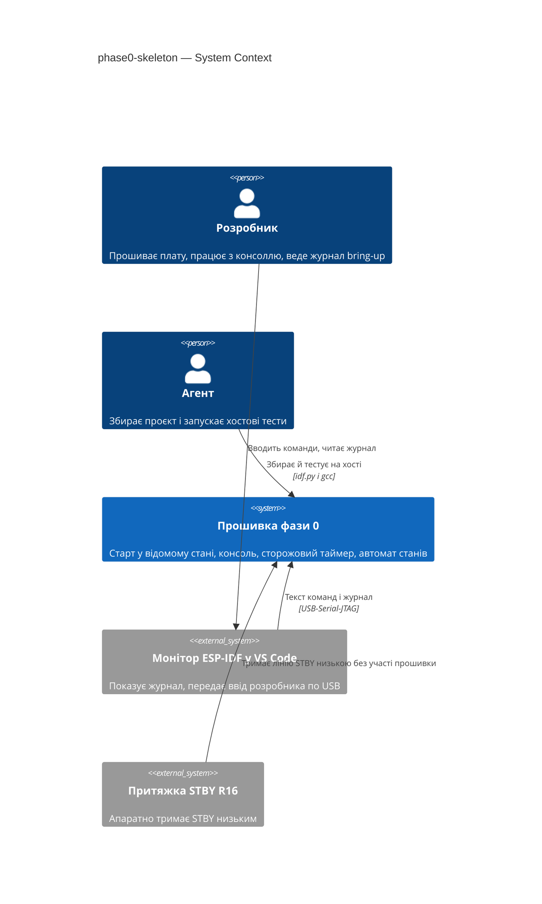
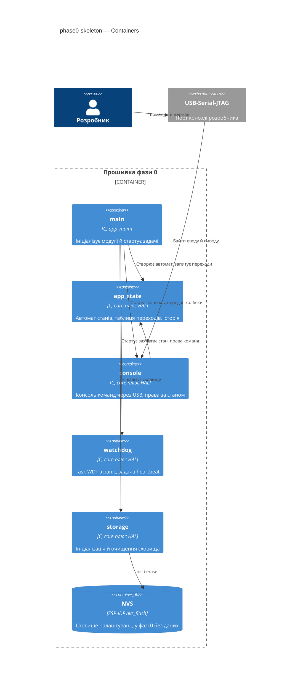
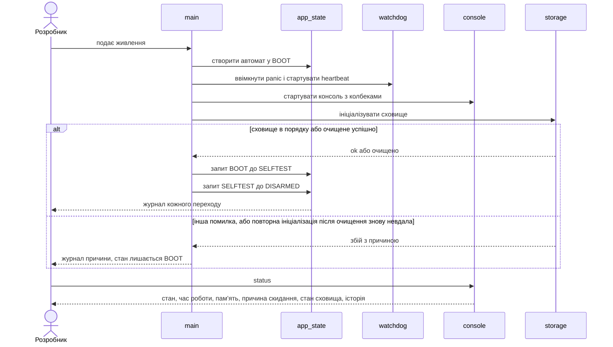
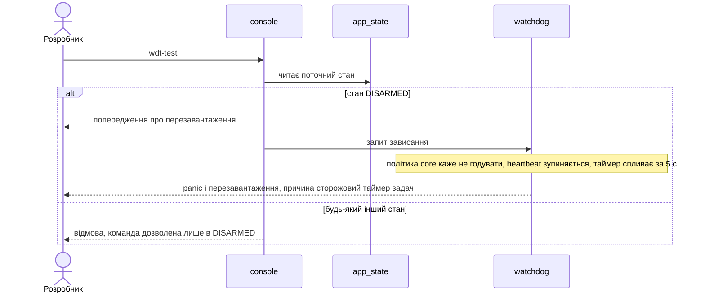

# Software Architecture Document — phase0-skeleton

## 1. Introduction and goals

**Intent.** Фаза 0 дає ровереру мінімальну безпечну основу прошивки: старт у відомому стані, текстова консоль через USB, перевірений сторожовий таймер і автомат станів із повною таблицею переходів, що перевіряється на хості без плати. Мотори, світло, радіо й датчики не задіяні (spec §2, §3).

**Top-3 quality goals (повні сценарії — §10):**

1. Безпека виходів: прошивка фази 0 не здатна привести ровер у рух (жодних ліній ШІМ/напрямку/STBY як виходів).
2. Перевірюваність: таблиця переходів і логіка консолі тестуються на хості без плати (49 з 49 пар).
3. Живучість: зависання службової задачі ловиться сторожовим таймером і дає самостійне перезавантаження з названою причиною.

**Stakeholders.**

| Role | Interest | Sign-off owner? |
|---|---|---|
| Розробник | Прошиває плату, читає консоль, заносить приймання в журнал bring-up | Yes |
| Агент | Збирає проєкт і запускає хостові тести чистої логіки | No |

<!-- Decision overrides (¶4) — populated by the critic resolution loop, empty otherwise. -->

## 2. Constraints

**Technical.**
- C (gnu17 за замовчуванням IDF), ESP-IDF v6.1, FreeRTOS, ціль `esp32s3`, плата YD-ESP32-S3 N16R8 (флеш 16 МБ, octal PSRAM 8 МБ).
- Консоль — USB-Serial-JTAG (`CONFIG_ESP_CONSOLE_USB_SERIAL_JTAG=y`); Task WDT 5 с, перевірка ядра 1 (idle), `FREERTOS_HZ=1000`.
- Тільки нові драйвери ESP-IDF (пункт 5 конституції); у фазі 0 використовуються лише USB-Serial-JTAG, `esp_task_wdt`, `nvs_flash`, `esp_timer`, FreeRTOS.
- Хостові тести — звичайний gcc, лише для `*_core.c` без заголовків ESP-IDF і FreeRTOS (AC-09).

**Organisational.**
- Один розробник і один агент; прошивання лише розробником через VS Code (`CLAUDE.md`).
- Фаза 0 — крок 0 у `docs/roadmap.md`; без жорсткого терміну.

**Conventions.**
- `CLAUDE.md` і `docs/constitution.md`: номери GPIO лише в `board_pins.h` (п. 2), поділ core/HAL (п. 6), `idf.py build` без нових попереджень (п. 8), коментарі й коміти українською (п. 9), захищені файли (п. 10), `kicad-rover/` не редагується (п. 11), періодичні задачі через `vTaskDelayUntil` (п. 14).
- Іменування: ідентифікатори англійською, `app_state_t`/`APP_STATE_*` (існуючі), `static const char *TAG` + `ESP_LOGI`, `ESP_ERROR_CHECK` лише там, де збій справді фатальний (див. ADR-0004).

**Regulatory / external.**
- N/A: немає мережі, персональних даних і регуляторних вимог (spec §6.1).

## 3. Context and scope

Розробник підключає плату USB-кабелем, прошиває її з VS Code й працює з консоллю в моніторі. Агент збирає проєкт і запускає хостові тести. Прошивка фази 0 не торкається моторів, світла, пульта, датчиків і шини між мікроконтролером та периферією.

<!-- brownfield: прошивка має лише main/ (NVS-ініціалізація, лог BOOT) і main/app_states.[ch] (імена станів); 9 компонентів-заглушок; test/host/ порожній. Карта — docs/architecture-map.md (reflects_commit e35e99f, ще актуальна для цих файлів). -->

**External systems (in / out):**

| Actor or system | Type | Interaction |
|---|---|---|
| Розробник | Person | Вводить команди консолі, читає журнал, прошиває плату, перевіряє STBY мультиметром |
| Агент | Person | Збирає проєкт (`idf.py build`), запускає хостові тести; не прошиває й не комітить без вказівки |
| Монітор ESP-IDF у VS Code | System (external) | Відображає журнал і передає введений текст через USB-Serial-JTAG |
| Апаратна притяжка STBY (R16) | System (hardware) | Тримає лінію STBY низькою без участі прошивки (ADR-0003) |

**C4 Context (L1):**



## 4. Solution strategy

**Target surface:** `cli` — єдиний зовнішній інтерфейс прошивки фази 0 — текстова консоль; інших поверхонь (UI, мережа) немає. Вбудованої прошивки в таксономії немає, тож `cli` — найближчий контейнер (рішення в журналі припущень, не ADR).

**Top strategic choices (насіння ADR):**

1. **Чиста логіка окремо, HAL тонкий** — кожен компонент ділиться на `_core.c` (стани, переходи, розбір рядка, права команд, політика сховища) і `_hal.c` (FreeRTOS, USB, NVS, TWDT). Хостові тести покривають усю логіку, HAL перевіряється на залізі (пункт 6 конституції). Нові компоненти `app_state`, `console`, `watchdog`, `storage` замість розміщення в `main/` (ADR-0002).
2. **Захист від зависання перевіряється, а не лише вмикається** — окрема heartbeat-задача підписана на Task WDT; команда `wdt-test` припиняє її годування; перезавантаження з причиною «сторожовий таймер задач» забезпечує програмне ввімкнення panic-режиму під час старту, без правки захищеного `sdkconfig.defaults` (ADR-0001).
3. **Безпека виходів за побудовою** — код фази 0 не налаштовує жодної лінії мотора: STBY лишається неналаштованим і низьким лише завдяки R16, ШІМ і напрямку немає, шина периферії не використовується. Це свідомий виняток із документа 02 §4.5 до фази 1 (ADR-0003).
4. **Чесний стан старту** — DISARMED означає «старт завершено». Якщо сховище не ініціалізувалося, автомат лишається в BOOT, консоль працює й показує причину; ні `abort()`, ні циклу перезавантажень (ADR-0004).

Тактичні рішення нижче мають простежуватися до цих чотирьох.

**Журнал припущень design (рівень easy; на вето Розробника):**

- `target_surfaces: [cli]` — вбудованої прошивки в таксономії немає, єдиний зовнішній інтерфейс — консоль.
- Назви компонентів `app_state`, `console`, `watchdog`, `storage`; ідентифікатори `app_state_t`/`APP_STATE_*` не перейменовуються.
- Задачі: `console` (core 0, пріоритет 1, блокується на вводі) і `heartbeat` (core 0, 1000 мс через `vTaskDelayUntil`); `wdt-test` піднімає прапорець, політика `watchdog_core` перестає годувати, heartbeat зупиняє себе.
- Максимальна довжина рядка консолі — 64 символи; довший рядок відкидається повністю (закриває spec OQ-7).
- Історія переходів — кільце на 16 записів; core не блокується, мʼютекс `m_state` лише в `app_state_hal`.
- `main` передає консолі структуру колбеків (стан сховища, запит зависання, перезавантаження), тож консоль не залежить від `watchdog` і `storage`.
- З FAILSAFE і FAULT виходів немає, крім перезапуску плати (закриває spec OQ-2; на залізі стани недосяжні).
- Команда `wdt-test` лишається в основній прошивці, дозволена лише в DISARMED (закриває spec OQ-5).

## 5. Building block view

Стиль — шари «чиста логіка → тонкий HAL → `app_main`»: залежності йдуть від `main` до компонентів, між компонентами лише від `console` до `app_state`. Дії, потрібні консолі від інших модулів (сховище, сторожовий таймер), передає `main` структурою колбеків — консоль не залежить від `watchdog` і `storage`.

**Internal decomposition:**

```
main/
└── main.c                 app_main: ініціалізація й старт задач (без логіки)
components/
├── board/                 board_pins.h (без змін, жодних нових літералів пінів)
├── app_state/             автомат станів
│   ├── app_state_core.c   enum, імена, таблиця 7x7, запит переходу, кільце історії (16 записів)
│   ├── app_state_hal.c    мʼютекс m_state, час старту, журнал переходів
│   └── include/app_state.h
├── console/               консоль через USB
│   ├── console_core.c     збирання рядка (ліміт 64), розбір, права команд за станом
│   ├── console_hal.c      задача console (core 0, пріоритет 1), читання/запис USB, виконання команд
│   └── include/console.h
├── watchdog/              сторожовий таймер
│   ├── watchdog_core.c    політика годування: годувати, доки не запитано зависання (`wdt-test`)
│   ├── watchdog_hal.c     esp_task_wdt_reconfigure(panic), задача heartbeat (1000 мс, vTaskDelayUntil), причина скидання
│   └── include/watchdog.h
└── storage/               сховище налаштувань
    ├── storage_core.c     рішення «ініціалізувати / очистити / відмовити» за результатом і стан сховища (ok / очищено / недоступне з причиною) для `status`
    ├── storage_hal.c      nvs_flash_init / nvs_flash_erase
    └── include/storage.h
test/host/                 хостовий раннер gcc: тести app_state, console, watchdog, storage (core)
```

`main/app_states.[ch]` переїжджає в `components/app_state/` (імена станів і enum зберігаються).

**C4 Container (L2):**



## 6. Runtime view

**Critical flow 1: старт до DISARMED (US-01, AC-01, AC-12)** — консоль і сторожовий таймер стартують до сховища, щоб збій сховища був діагностований (ADR-0004).



**Critical flow 2: навмисне зависання (US-03, AC-04, AC-05)**



Решту потоків (reboot, помилки вводу, відмова переходу) покриє стадія `sequences`.

## 7. Deployment view

Один вузол: плата YD-ESP32-S3 N16R8. Образ збирає Агент (`idf.py build`), прошиває Розробник через розширення ESP-IDF у VS Code; віддаленого розгортання й реплік немає. Задачі FreeRTOS: `console` (core 0, пріоритет 1, блокується на вводі) і `heartbeat` (core 0, період 1000 мс через `vTaskDelayUntil`, годує Task WDT; після запиту зависання не годує, а зупиняє себе через `vTaskSuspend`). Основна задача `app_main` після старту завершується.

**Monitoring:**
- Журнал монітора: переходи автомата, збій сховища, причина скидання (команда `status`).
- Метрики приймання: час відгуку `wdt-test` (секундомір за часовими мітками журналу), вільна внутрішня пам'ять після старту (запис у `docs/measured.md`).
- Tracing: N/A.

**Scaling thresholds:**
- N/A для фази 0: одна плата, навантаження відсутнє.
- Поріг вільної внутрішньої пам'яті — окреме відкрите питання OQ-1 специфікації (baseline 393135 байт).

## 8. Crosscutting concepts

| Concept | Convention | Where defined |
|---|---|---|
| Logging | `static const char *TAG` на компонент, `ESP_LOGI/W/E`; переходи автомата й відмови друкуються HAL-ом після результату з core | `docs/architecture-map.md` Conventions |
| Error handling | `esp_err_t` перевіряється всюди; `ESP_ERROR_CHECK` лише для справді фатальних збоїв (не для сховища, ADR-0004); `abort()` у штатних сценаріях заборонений | doc 02 §5, ADR-0004 |
| Configuration / protected files | Таймаут і ядра TWDT беруться з Kconfig-макросів; `sdkconfig.defaults`, корінь `CMakeLists.txt` і `.vscode/` не змінюються | constitution п. 10 |
| GPIO numbers | Лише `board_pins.h`; код фази 0 не посилається на піни моторів, STBY і шини | constitution п. 2, ADR-0003 |
| Concurrency | `m_state` (мʼютекс) захищає `app_state` у HAL; core без блокувань; спільні дані між задачами — лише через виклики HAL | doc 02 §6.2 |
| Periodic tasks | `vTaskDelayUntil`; `vTaskDelay` заборонений для періодичних задач | constitution п. 14 |
| Testing | `*_core.c` без заголовків ESP-IDF і FreeRTOS, тести на gcc у `test/host/`; HAL без моків, приймання на залізі в журналі bring-up | constitution п. 6, spec AC-08/09 |
| Console input | Ліміт рядка 64 символи (рядок довший відкидається повністю), регістр розрізняється, зайві аргументи відхиляються | spec AC-03 |
| Transition request | Перехід, якого немає в таблиці (включно з тим самим станом), відхиляється; core повертає результат, HAL друкує відмову з назвами обох станів | spec AC-06 |
| ID strategy / i18n / auth | N/A: одна плата, одна мова журналу, локальний USB-доступ | spec §6.1 |

## 9. Architecture decisions

| # | Title | Status | Section |
|---|---|---|---|
| 0001 | Вмикати перезавантаження сторожового таймера програмно під час старту | Accepted | §4 |
| 0002 | Розбити код фази 0 на компоненти app_state, console, watchdog і storage | Accepted | §4 |
| 0003 | Лишити лінію STBY неналаштованою у фазі 0 | Accepted | §4 |
| 0004 | Лишатися в BOOT з працюючою консоллю, якщо сховище не ініціалізується | Accepted | §4 |

ADR files live under `docs/features/phase0-skeleton/adr/NNNN-<title>.md`.

## 10. Quality requirements

**QG-1. Безпека виходів**
- **When:** прошивка фази 0 працює від старту і під час будь-якої команди консолі, включно з `reboot` і `wdt-test`.
- **Then:** 0 ліній ШІМ/напрямку/STBY налаштовано як виходи; STBY низький 100 % часу (spec §6 NFR «Безпека виходів»).
- **How verify:** мультиметр на STBY та огляд коду під час приймання (немає викликів конфігурації GPIO для ліній мотора і `PIN_STBY` у коді фази 0); запис у журнал bring-up.

**QG-2. Перевірюваність**
- **When:** Агент завершує зміну в межах фази 0.
- **Then:** збірка: 0 помилок, 0 нових попереджень; хостовий прогін ≤ 5 с, 100 % тестів пройдено; покриття таблиці переходів 49 з 49 пар станів (spec §6 NFR).
- **How verify:** вивід `idf.py build` і хостового раннера; тести `app_state_core` перебирають усі 49 пар.

**QG-3. Живучість**
- **When (а):** Розробник вводить `wdt-test` у стані DISARMED.
- **Then (а):** перезавантаження ≤ 6 с (таймаут сторожового таймера 5 с) (spec §6 NFR «Затримка перезавантаження…»).
- **When (б):** прошивка безперервно працює в DISARMED без команд зависання.
- **Then (б):** 0 неочікуваних скидань за 10 хв (spec §6 NFR «Стабільність»).
- **How verify:** (а) секундомір за часовими мітками журналу монітора; (б) журнал монітора 10 хв під час приймання; обидва результати — у журнал bring-up.

## 11. Risks and technical debt

| Risk / debt | Severity | Mitigation | Owner |
|---|---|---|---|
| Читання вводу з USB-Serial-JTAG (драйвер, взаємодія з виводом через VFS) не перевірене на залізі | Medium | Перевірити в першій же задачі приймання консолі; якщо драйвер не сумісний з виводом — змінити спосіб читання у `console_hal`, core не змінюється | Розробник |
| Безпека STBY у фазі 0 залежить від апаратної притяжки R16, програма її наявність не виявляє | Medium | Мультиметр на STBY під час приймання (QG-1); у фазі 1 `drive` виконує §4.5 | Розробник |
| Хостового раннера в `test/host/` ще немає — перша задача мусить його створити без нових залежностей | Medium | Звичайний gcc + прості `assert`-тести, без фреймворку, окрема задача в `tasks` | Агент |
| Відкрите питання OQ-1 специфікації (поріг вільної пам'яті) лишається відкритим до приймання; запуск задач `console` і `heartbeat` зменшує baseline P0 | Low | Виміряти після старту, записати в `docs/measured.md` (spec §7) | Розробник |

**Accepted debt (acceptable in v1, plan to fix later):**
- SELFTEST — заглушка, завжди успішна; FAILSAFE і FAULT недосяжні на залізі до фази 2+ (spec §1).
- Дерево в `docs/02-FIRMWARE-CONTEXT.md` §6.4 розходиться з фактичним (нові `app_state`, `console`, `watchdog`, `storage`); документ треба оновити за окремою вказівкою Розробника.
- STBY неналаштований до фази 1 (ADR-0003).

## 12. Glossary

| Term | Meaning |
|---|---|
| Автомат станів | Набір станів ровера й таблиця дозволених переходів між ними (CONTEXT.md) |
| Консоль | Текстовий канал Розробник↔плата через USB (CONTEXT.md) |
| Захищені файли | Канонічні файли, що не змінюються без згоди Розробника (CONTEXT.md) |
| core / HAL | `_core.c` — логіка без заголовків ESP-IDF і FreeRTOS, тестується на хості; `_hal.c` — виклики драйверів, перевіряється на залізі |
| Task WDT (TWDT) | Сторожовий таймер задач ESP-IDF; тут: таймаут 5 с, panic на спрацюванні |
| Heartbeat | Фонова задача, яку стежить TWDT; її годування припиняє команда `wdt-test` |
| Історія переходів | Кільце останніх 16 переходів автомата від старту; доступне в `status` |
| Виняток §4.5 | Свідома відмова фази 0 опускати STBY через код (ADR-0003) |
