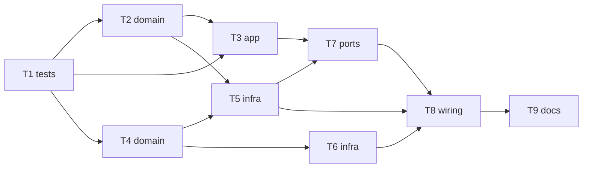

# Epic — phase0-skeleton

> **Spec:** [spec.md](../spec.md) · **Design:** [sad.md](../sad.md) · **ADRs:** [adr/](../adr/) · **Data model:** немає (бази даних немає) · **API:** немає (поверхня `cli`, команди консолі описані в T3)

## Goal

Дати ровереру мінімальну безпечну основу прошивки: старт у відомому стані, консоль через USB, перевірений сторожовий таймер та автомат станів із повною таблицею переходів, що перевіряється на хості (spec §2).

## Scope

- **In:** компоненти `app_state`, `console`, `watchdog`, `storage` (core + HAL), `main.c`, хостовий раннер `test/host/`, чек-лист приймання.
- **Out:** мотори, ШІМ, STBY, розширювач портів і світло, пульт, датчики, енкодери, PID, телеметрія, справжній самотест, прошивання плати Агентом (spec §3).

## Task map

Паралельні гілки: після T1 одночасно T2 і T4; після них одночасно T3, T5 і T6.

## Tasks

See [tracker.md](./tracker.md) for status. Machine contract: [tasks.json](../tasks.json).

| # | Task | Layer | Blocked by | DoD (short) |
|---|---|---|---|---|
| T1 | [Створити хостовий раннер і скрипти перевірок test/host](./t1-host-test-runner.md) | tests | — | `test/host/run_tests.sh` на порожньому наборі повертає ненульовий код; на наборі з тестом — «N тестів, N пройдено» за ≤ 5 с |
| T2 | [Створити компонент app_state: таблиця переходів, запит переходу, історія (core)](./t2-app-state-core.md) | domain | T1 | Хостовий тест підтверджує 49 з 49 перевірених пар (10 дозволених, 39 відхилених) |
| T3 | [Створити console_core: збирання рядка, розбір команд, права за станом](./t3-console-core.md) | app | T1, T2 | Хостові тести AC-02, AC-03, AC-05 проходять |
| T4 | [Створити storage_core і watchdog_core: політика сховища та політика годування](./t4-storage-watchdog-core.md) | domain | T1 | Хостові тести політик проходять (усі гілки рішення сховища) |
| T5 | [Створити app_state_hal і storage_hal: мʼютекс, журнал переходів, ініціалізація NVS](./t5-app-state-storage-hal.md) | infra | T2, T4 | `idf.py build` без помилок і без нових попереджень |
| T6 | [Створити watchdog_hal: програмний panic для TWDT, задача heartbeat, причина скидання](./t6-watchdog-hal.md) | infra | T4 | `idf.py build` без помилок і без нових попереджень |
| T7 | [Створити console_hal: ввід-вивід USB, задача console, виконання команд](./t7-console-hal.md) | ports | T3, T5 | `idf.py build` без помилок і без нових попереджень |
| T8 | [Скласти main.c: послідовність старту, REQUIRES, видалення main/app_states](./t8-main-wiring.md) | wiring | T5, T6, T7 | `idf.py build` без помилок і без нових попереджень; хостовий прогін і три перевірки чисті |
| T9 | [Підготувати чек-лист приймання фази 0 на залізі для журналу bring-up](./t9-acceptance-checklist.md) | docs | T8 | Чек-лист охоплює чотири записи приймання зі spec §7 і виміри з §6 |

## Risks / Hard rules

- Core без заголовків ESP-IDF і FreeRTOS (constitution п. 6); номери GPIO лише в `board_pins.h` (п. 2); захищені файли не чіпати (п. 10); `kicad-rover/` не редагувати (п. 11); `idf.py build` без нових попереджень (п. 8); періодичні задачі через `vTaskDelayUntil` (п. 14).
- Фаза 0 не налаштовує ліній моторів і STBY (ADR-0003); `wdt-test` лише в DISARMED, `reboot` у DISARMED і BOOT (AC-05).
- Відкриті: спосіб відтворити пошкоджене сховище (spec OQ-6); поріг вільної памʼяті (OQ-1).
