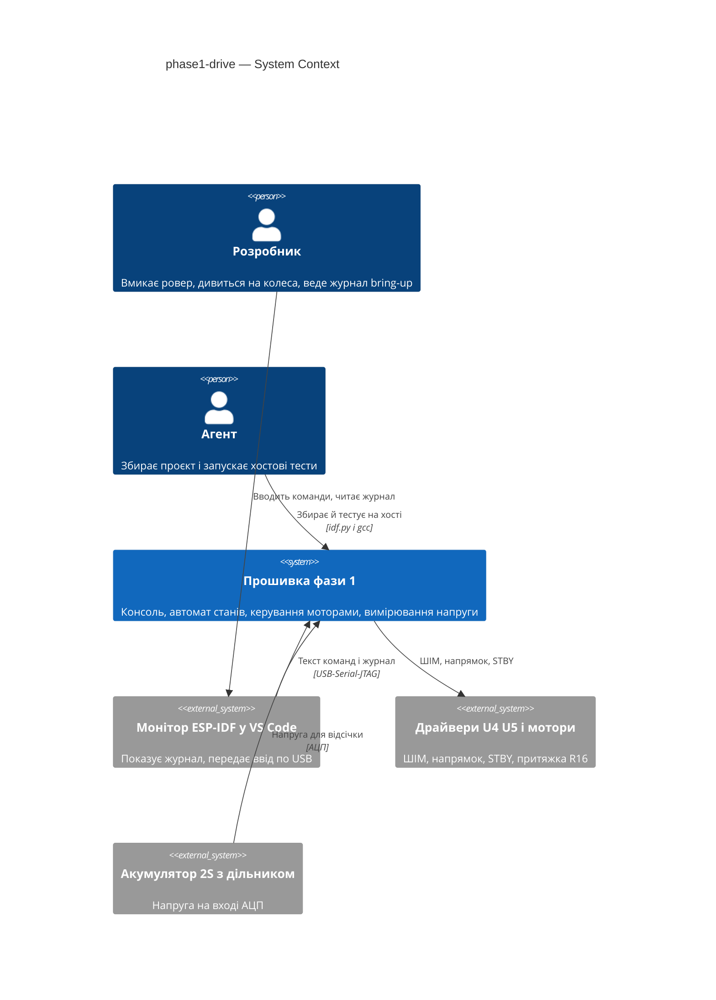
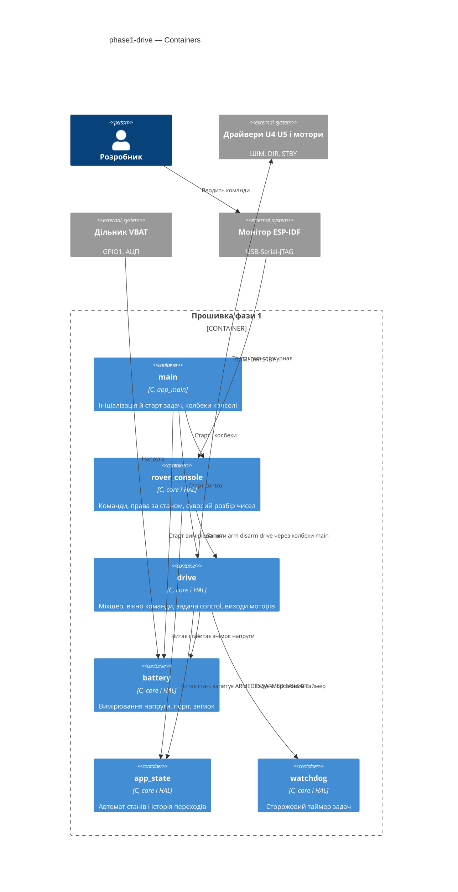
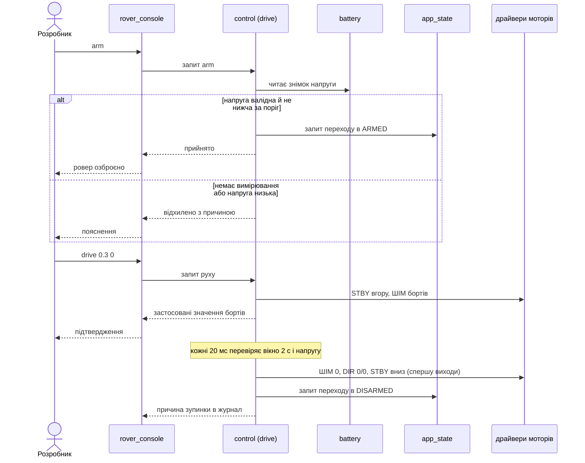
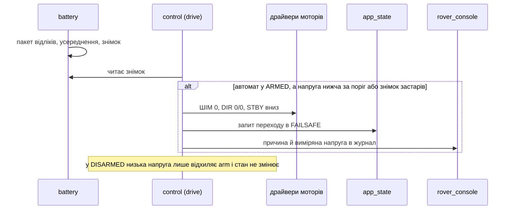
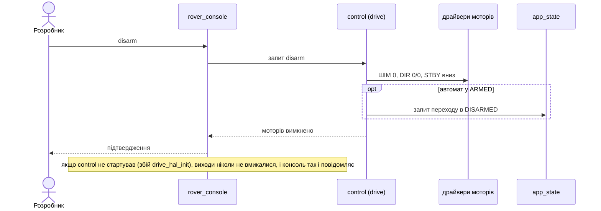
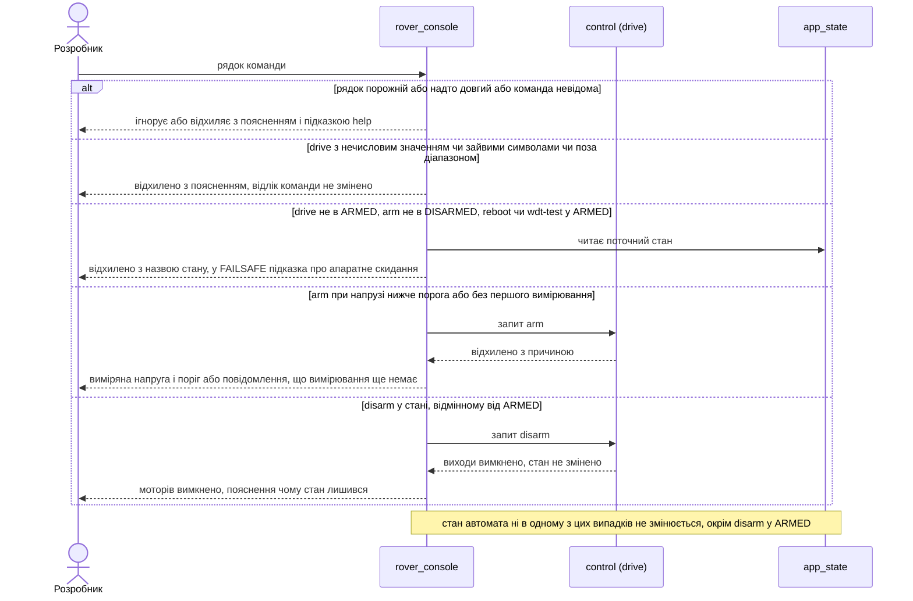
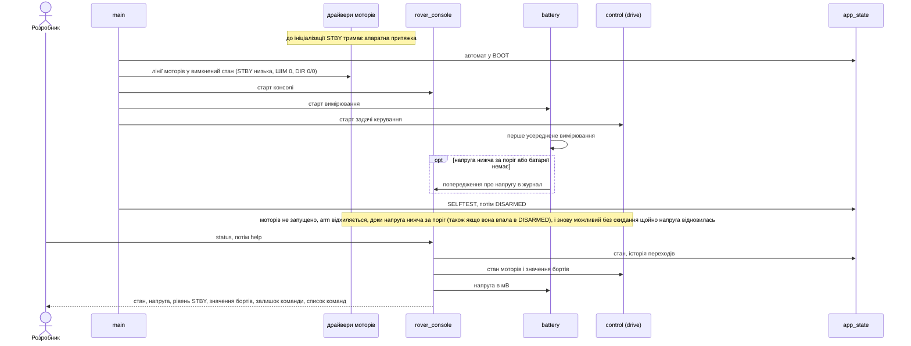
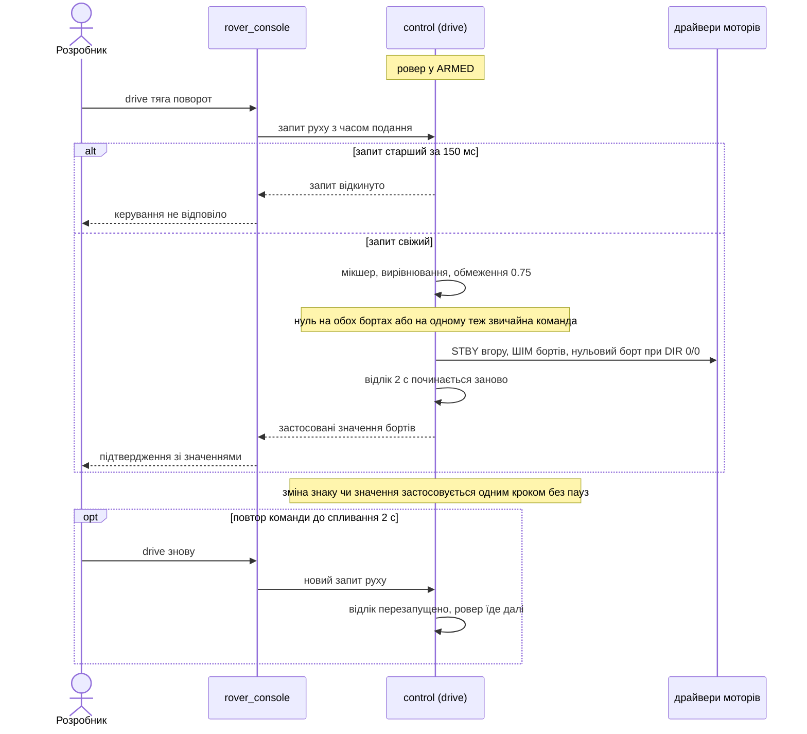
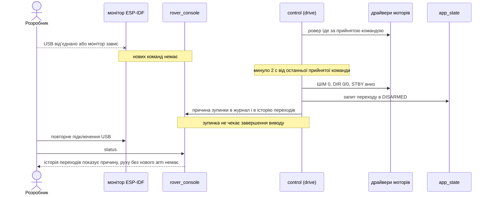

# Software Architecture Document — phase1-drive

## 1. Introduction and goals

**Intent.** Фаза 1 дає ровереру керований рух з консолі: озброїти, їхати тягою й поворотом, роззброїти. Мікшер перетворює тягу й поворот на команди двох бортів, потужність обмежена 0.75, команда руху діє 2 с і гасне сама, а слабка батарея (нижче 6.0 В) не дає рушити й зупиняє рух (spec §2, §4).

**Top-3 quality goals (повні сценарії — §10):**

1. Безпека виходів: STBY і ненульовий ШІМ існують лише в ARMED, зупинка швидка й не залежить від консолі чи хоста.
2. Керованість часом: команда руху і напруга батареї обмежують рух за заданими числами (2 с, 6.0 В, 1 с).
3. Перевірюваність: уся логіка рішень тестується на хості без плати; залізо перевіряє лише HAL.

**Stakeholders.**

| Role | Interest | Sign-off owner? |
|---|---|---|
| Розробник | Вмикає ровер, дивиться на колеса в повітрі, читає консоль, записує приймання в журнал bring-up | Yes |
| Агент | Збирає проєкт і доводить логіку хостовими тестами; не прошиває й не комітить без вказівки | No |

<!-- Decision overrides (¶4) — populated by the critic resolution loop, empty otherwise. -->

## 2. Constraints

**Technical.**
- C (gnu17), ESP-IDF v6.1, FreeRTOS, ціль `esp32s3`, плата YD-ESP32-S3 N16R8 (базова конфігурація — `sdkconfig.defaults`, захищений файл).
- Лише нові драйвери IDF (конституція, п. 5): `esp_adc` (oneshot + curve fitting), LEDC, `gpio`; legacy-заголовків `driver/adc.h`, `driver/timer.h`, `driver/pcnt.h` немає.
- LEDC: low-speed, один таймер на обидва канали моторів, 20 кГц, 10 біт (документ 02, §4.2, §8.4); окремий таймер резервується під зумер (фаза 2).
- Піни моторів і батареї лише з `board_pins.h` (конституція, п. 2): `PIN_PWM_L`, `PIN_PWM_R`, `PIN_DIR_L1/L2`, `PIN_DIR_R1/R2`, `PIN_STBY`, `PIN_VBAT_SENSE`; нових літералів немає.
- Фаза 1 не використовує шину I²C (конституція, п. 7, правило «перша операція — запис 0x00» діє з фази 2).
- Task WDT 5 с з перезавантаженням при спрацюванні лишається з фази 0 (ADR-0001 фази 0).

**Organisational.**
- Один розробник і один агент; прошивання лише розробником через VS Code (`CLAUDE.md`).
- Крок 1 у `docs/roadmap.md`; без жорсткого терміну. Розмір M.

**Conventions.**
- `docs/constitution.md`: core/HAL (п. 6), `vTaskDelayUntil` у періодичних задачах (п. 14), `idf.py build` без нових попереджень (п. 8), коментарі й коміти українською (п. 9), захищені файли (п. 10), `kicad-rover/` не редагується (п. 11).
- Іменування: ідентифікатори англійською; `static const char *TAG`, префікс фази в повідомленнях; колбеки між компонентами передає `main` (прецедент — `console_ops_t` фази 0).

**Regulatory / external.**
- N/A: немає мережі, персональних даних і регуляторних вимог (spec §6.1).

## 3. Context and scope

Розробник керує ровером з консолі через USB, а ровер у цій фазі стоїть із колесами в повітрі. Агент збирає проєкт і запускає хостові тести. Нове в порівнянні з фазою 0: прошивка керує двома драйверами моторів (U4, U5) і читає напругу акумулятора.

<!-- brownfield: прошивка має компоненти app_state, rover_console, watchdog, storage (core/HAL, фаза 0) і 9 заглушок; drive і battery — заглушки без коду. Карта — docs/architecture-map.md (reflects_commit e35e99f, відстає від фази 0; джерелом для SAD слугував поточний код components/ та phase0-skeleton/sad.md). -->

**External systems (in / out):**

| Actor or system | Type | Interaction |
|---|---|---|
| Розробник | Person | Вводить arm, drive, disarm, status; дивиться на колеса; міряє STBY і напругу |
| Агент | Person | Збирає проєкт і запускає хостові тести |
| Монітор ESP-IDF у VS Code | System (external) | Показує журнал, передає ввід через USB-Serial-JTAG |
| Драйвери моторів U4, U5 з моторами | System (hardware) | Приймають ШІМ, напрямок і STBY; STBY тримає низькою притяжка R16 |
| Акумулятор 2S з дільником VBAT | System (hardware) | Дає напругу на вхід АЦП (GPIO1) |

**C4 Context (L1):**



## 4. Solution strategy

**Target surface:** `cli` — єдиний зовнішній інтерфейс — консоль; інших поверхонь немає (так само, як у фазі 0).

**Top strategic choices (насіння ADR):**

1. **Безпека моторів в окремій задачі `control` (20 мс)** — вона єдиний власник ліній моторів і єдина запитує ARMED/DISARMED/FAILSAFE у фазі 1; консоль лише подає запит і чекає відповіді. Це дає швидку зупинку без залежності від консолі й базу для фаз 3, 5, 6 (ADR-0001).
2. **Зупинка вибігом, виходи вимикаються раніше за запис стану** — один спосіб зупинки для роззброєння, спливання й відсічки: ШІМ 0, DIR 0/0, STBY низька (ADR-0002).
3. **Напруга вимірюється окремою задачею й читається як знімок** — `control` бачить знімок «мВ, час, валідність»; застарілий або невалідний знімок означає зупинку (ADR-0003).
4. **Зависання `control` ловить Task WDT** — окремого запобіжника немає, ризик прийнятий на фазу 1 (ADR-0004).
5. **Чиста логіка окремо, HAL тонкий** — `drive_core` (мікшер, нормалізація, обмеження 0.75, вікно команди, рішення зупинки, виходи у вигляді готових рівнів), `battery_core` (перерахунок у мВ, поріг, свіжість); у HAL лише LEDC, GPIO, АЦП і задачі (конституція, п. 6).

Тактичні рішення нижче мають простежуватися до цих п'яти.

**Журнал припущень design (рівень easy; на вето Розробника):**

- `target_surfaces: [cli]`, як у фазі 0.
- Нові компоненти — наявні заглушки `drive` і `battery` (за roadmap); окремого компонента `control` немає: задача живе в `drive_hal`.
- `drive_core` не знає про FreeRTOS і ESP-IDF: приймає час `now_ms` аргументом, повертає рівні виходів (ШІМ у проміле 0…750, чотири рівні DIR, STBY) і запит стану; HAL перекладає проміле в 10-бітну шкалу (1023).
- Задача `control`: core 1, пріоритет 5, 20 мс через `vTaskDelayUntil`, підписана на Task WDT. Задача `battery`: core 0, пріоритет 2, 200 мс через `vTaskDelayUntil`, на кожен такт — пакет з 16 відліків АЦП, усереднення в core.
- Черга запитів `control` довжиною 4; консоль чекає відповіді до 200 мс і при тайм-ауті друкує «керування не відповіло» та вважає команду неприйнятою; кожен запит несе час подання, і `control` відкидає запити старші за 150 мс, тож запит, що прострочився, не виконається пізніше. `control` стартує до `storage_init`, тож `disarm` працює і в BOOT, якщо сховище не піднялося.
- Знімок напруги старший за 600 мс (три періоди) вважається застарілим.
- Калібрування напруги — константи в `battery_calib.h` з позначкою «виміряно: дата» (коефіцієнт 4.047, зсув 0, поріг 6000 мВ), без сховища налаштувань і команди перекалібрування (закриває spec OQ-4).
- Мінімальну напругу за час команди руху `control` друкує в журнал при зупинці — це спосіб записати просадку під навантаженням для spec OQ-3.
- `app_state` не змінюється: таблиця з 10 пар лишається; `console_ops_t` розширюється колбеками arm, disarm, drive і звіту про стан моторів.
- Ініціалізація ліній моторів (виходи, рівні «вимкнено») — перший виклик після `app_state_hal_init`, до старту консолі.

## 5. Building block view

Стиль — шари «чиста логіка → тонкий HAL → `app_main`», як у фазі 0. Залежності йдуть від `main` до компонентів; консоль не залежить від `drive` і `battery`: потрібні дії їй передає `main` колбеками. Лінії моторів пише лише `drive_hal`; запити ARMED, DISARMED та FAILSAFE у фазі 1 робить лише `control`, а SELFTEST і перший перехід у DISARMED на старті, як у фазі 0, запитує `main`.

**Internal decomposition:**

```
main/
└── main.c                      app_main: app_state_hal_init → drive_hal_init (виходи вимкнено) → watchdog_start → console_start → battery_start → drive_start (control) → storage_init → SELFTEST → DISARMED (без логіки)
components/
├── board/                      board_pins.h (без змін)
├── drive/
│   ├── drive_core.c            мікшер, нормалізація, обмеження 0.75, вікно команди 2 с, рішення control, виходи
│   ├── drive_hal.c             LEDC 20 кГц/10 біт, GPIO DIR і STBY, задача control, черга запитів, Task WDT
│   └── include/drive.h, drive_core.h, drive_hal.h
├── battery/
│   ├── battery_core.c          відліки → мВ, поріг, свіжість знімка
│   ├── battery_hal.c           adc_oneshot + curve fitting, задача battery, знімок
│   └── include/battery.h, battery_core.h, battery_hal.h, battery_calib.h
├── rover_console/              + команди arm, disarm, drive, розширений status, суворий розбір чисел
├── app_state/                  без змін
├── watchdog/, storage/         без змін
test/host/                      + test_drive.c, test_battery.c, розширений test_console.c
```

**C4 Container (L2):**



## 6. Runtime view

Діаграми seed-ять основні потоки; `sequences` докладно покриє кожен AC.

**Critical flow 1: озброїти, їхати, спливання часу команди**



**Critical flow 2: відсічка по напрузі в русі**



**Critical flow 3: роззброєння**



### Flow 4: відхилення команд (AC-05, AC-06, AC-07, AC-09, AC-13, AC-16)



### Flow 5: старт і діагностика (AC-15, AC-16, AC-22)



### Flow 6: команда руху — мікшер, обмеження, повтор (AC-03, AC-04, AC-10, AC-11, AC-21)



### Flow 7: втрата хоста під час руху (AC-12)



### Покриття (use-case і AC)

| US | Потоки |
|---|---|
| US-01 | потік 1, 3, 4 |
| US-02 | потік 1, 4, 6 |
| US-03 | потік 6 |
| US-04 | потік 1, 7 |
| US-05 | потік 2, 4, 5 |
| US-06 | потік 5 |
| US-07, US-08 | N/A: процес розробки (хостові тести, збірка, межі дозволеного для Агента), не рантайм прошивки |

| AC | Де показано |
|---|---|
| AC-01 | потік 1 |
| AC-02 | потік 3 |
| AC-03, AC-04, AC-10, AC-21 | потік 6 |
| AC-05, AC-06, AC-07 | потік 4 |
| AC-08, AC-20 | потоки 1, 2, 3 (виходи вимикаються раніше за запис стану, один спосіб зупинки) |
| AC-09 | потік 4 (disarm поза ARMED) і потік 3 |
| AC-11 | потоки 1, 6 |
| AC-12 | потік 7 |
| AC-13 | потоки 1, 4 |
| AC-14 | потік 2 |
| AC-15, AC-22 | потік 5 (також примітка у потоці 2) |
| AC-16 | потоки 4, 5 |
| AC-17, AC-18, AC-19 | N/A: перевіряються збіркою, хостовими тестами й процесом роботи Агента, не рантаймом |

**Позначки для design:** учасники діаграм — модулі з §5, а не загальні ролі, бо в прошивці немає сховища даних і мережі (persist-нотаток для data-model немає). Нових учасників поза §5 не додано, крім зовнішнього «монітор ESP-IDF» із §3.

## 7. Deployment view

<!-- N/A: один образ прошивки на одній платі, інфраструктури й середовищ розгортання немає; прошивання виконує Розробник через VS Code (spec §3, CLAUDE.md) -->

## 8. Crosscutting concepts

| Concept | Convention | Where defined |
|---|---|---|
| Логування | `ESP_LOGI/W/E`, `static const char *TAG`; зупинка пише в журнал після вимкнення виходів, не до | `docs/constitution.md` п. 9; тут |
| Обробка помилок | `esp_err_t` на викликах драйверів; `ESP_ERROR_CHECK` лише де збій фатальний; помилка ініціалізації `drive_hal` лишає виходи вимкненими й автомат у BOOT | ADR-0004 фази 0; тут |
| Час | `esp_timer_get_time()` у мс у HAL; core отримує `now_ms` аргументом, без прихованого годинника; різниці беззнаковим відніманням | тут |
| Періодичні задачі | `vTaskDelayUntil` для `control` (20 мс) і `battery` (200 мс) | `docs/constitution.md` п. 14 |
| Одноосібний запис виходів | лінії моторів пише лише `drive_hal`; запити ARMED/DISARMED/FAILSAFE у фазі 1 робить лише `control` (SELFTEST і перший DISARMED — `main`); кожен такт виходи примусово вимикаються, якщо стан не ARMED | ADR-0001, ADR-0002 |
| Рівні за замовчуванням | поза ARMED: ШІМ 0, DIR 0/0, STBY низька; до ініціалізації це гарантує притяжка R16 | spec AC-15, AC-20 |
| Калібрування | константи в `battery_calib.h` з позначкою «виміряно: дата»; попередні до закриття P3 | spec OQ-1, OQ-4 |
| Обмеження потужності | `DRIVE_PWM_MAX_PERMILLE 750` в одному місці `drive_core.h` | конституція п. 7 |
| Ідентифікатори, i18n, події, кеш | N/A: немає | — |

## 9. Architecture decisions

| # | Title | Status | Section |
|---|---|---|---|
| 0001 | Run motor safety logic in a dedicated control task | Accepted | §4 |
| 0002 | Stop by coasting with outputs off before state write | Accepted | §4 |
| 0003 | Measure battery in own task with stale-reading failsafe | Accepted | §4 |
| 0004 | Guard control task with Task WDT only | Accepted | §4 |

ADR files live under `docs/features/phase1-drive/adr/NNNN-<title>.md`.

## 10. Quality requirements

**QG-1. Безпека виходів**
- **When:** автомат у будь-якому стані, відмінному від ARMED, або ровер виходить з ARMED будь-яким шляхом (роззброєння, спливання, відсічка).
- **Then:** STBY піднята 0 % часу поза ARMED, ШІМ ненульовий 0 % часу поза ARMED; потужність і STBY вимкнено не пізніше одного періоду задачі керування (20 мс), виходи вимкнено раніше, ніж записано стан; модуль потужності борту ≤ 0.75.
- **How verify:** хостові тести `drive_core` (усі межі, усі стани, порядок «виходи, потім стан»); мультиметр на STBY і приймання на залізі з колесами в повітрі.

**QG-2. Керованість часом і напругою**
- **When:** команда руху не повторюється або напруга опускається нижче 6.0 В.
- **Then:** мотори вимкнено ≤ 2,1 с від останньої прийнятої команди; вимкнення моторів ≤ 1 с після падіння напруги під 6.0 В; озброєння відхиляється, доки немає першого вимірювання.
- **How verify:** хостові тести з підставним годинником; на залізі — часові мітки журналу й джерело живлення, що знижується.

**QG-3. Перевірюваність**
- **When:** Агент завершує зміну в межах фази 1.
- **Then:** 49 з 49 пар «команда × стан» і 49 з 49 пар станів автомата перевірено; хостовий прогін ≤ 5 с і 100 % пройдено; збірка без помилок і нових попереджень.
- **How verify:** вивід хостового раннера й `idf.py build`.

## 11. Risks and technical debt

| Risk / debt | Severity | Mitigation | Owner |
|---|---|---|---|
| Зависання `control` при ввімкнених моторах лишає ровер їхати до спрацювання Task WDT | Medium | ADR-0004: підписка на Task WDT; фаза 1 з колесами в повітрі; повернутися до запобіжника у фазі 3 | Розробник |
| Просадка напруги під навантаженням хибно спрацьовує відсічку 6.0 В і веде у FAILSAFE, вихід лише скиданням | Medium | `control` друкує мінімальну напругу за час команди; без гістерезису до даних приймання (spec OQ-3) | Розробник |
| Вивід у консоль при відсутньому хості блокує задачу `control` після зупинки; якщо блок триває понад 5 с, Task WDT перезавантажить плату, а історія переходів у RAM (потрібна AC-12 після повторного підключення) зникне | Medium | Виходи вимикаються до логу; USB-Serial-JTAG відкидає вивід без хоста; перевірити на прийманні AC-12 | Розробник |
| Розбіжність документа 02: §6.3 «гальмування» проти §2.3 (Hi-Z при низькій STBY) | Low | ADR-0002: зупинка вибігом; виправити документ | Розробник |
| Миттєва зміна знаку потужності без паузи дає піки струму | Low | Не специфікуємо плавний розгін до фаз 4–5 (spec §3); спостерігати на прийманні | Розробник |
| Open architectural decision: друга точка калібрування напруги (spec OQ-1) | Open question | Resolve before `/sdd:tasks`; доти використовуються попередні k = 4.047, зсув 0, а AC-13…AC-15 на залізі не приймаються | Розробник |
| Open architectural decision: повільне праве переднє колесо (spec OQ-2) | Open question | Resolve before приймання фази 1; повторити тест на більшій тязі | Розробник |
| Open architectural decision: поріг вільної внутрішньої памʼяті після старту (spec OQ-6) | Open question | Resolve before приймання фази 1; значення лише вимірюється й записується | Розробник |
| Open architectural decision: хибне спрацювання відсічки від просадки (spec OQ-3, перенесено з design) | Open question | Resolve before приймання фази 1; зняти мінімальну напругу з журналу під час руху | Розробник |

**Accepted debt (acceptable in v1, plan to fix later):**
- Калібрування напруги — константи в заголовку, без сховища й команди перекалібрування.
- Немає гістерезису й витримки відсічки, немає плавного розгону й гальмування.
- Знімок напруги вважається застарілим після 600 мс — число проєктне, підтверджується прийманням.

## 12. Glossary

| Term | Meaning |
|---|---|
| Борт | Лівий або правий бік ровера; два колеса одного боку отримують однакову команду |
| Команда руху | Команда `drive` із тягою і поворотом; діє 2 с і гасне, якщо її не повторити |
| Мікшер | Перетворення «тяга + поворот» на значення двох бортів (ліве = тяга + поворот, праве = тяга − поворот) |
| Відсічка по напрузі | Заборона запуску моторів і примусова зупинка при напрузі нижче 6.0 В |
| Вибіг | Зупинка без гальмування: ШІМ 0, DIR 0/0, STBY низька, мотори вільні |
| Знімок напруги | Останнє усереднене значення VBAT з часом вимірювання й ознакою валідності |
| Задача `control` | Задача з періодом 20 мс, єдиний власник ліній моторів у фазі 1 |
