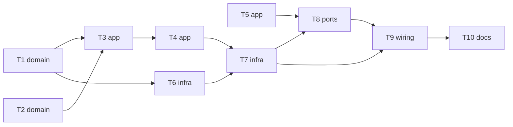

# Epic — phase1-drive

> **Spec:** [spec.md](../spec.md) · **Design:** [sad.md](../sad.md) · **ADRs:** [adr/](../adr/) · **Data model:** N/A (схеми даних немає) · **API:** N/A (контракт команд консолі — у spec §5 і sad §6)

## Goal

Дати ровереру керований рух з консолі: озброїти, їхати тягою й поворотом, роззброїти; команда руху діє 2 с, потужність ≤ 0.75, слабка батарея (нижче 6.0 В) не дає рушити й зупиняє рух (spec §2). Уся логіка рішень перевіряється на хості, залізо приймає Розробник з колесами в повітрі.

## Scope

- **In:** компоненти `drive` і `battery` (core і HAL), розширення `rover_console`, старт у `main`, чек-лист приймання.
- **Out:** пульт CRSF, регулювання швидкості й енкодери, світло й зумер, далекоміри, телеметрія, окреме колесо (spec §3).

## Task map

## Tasks

See [tracker.md](./tracker.md) for status. Machine contract: [tasks.json](../tasks.json).

| # | Task | Layer | Blocked by | DoD (short) |
|---|---|---|---|---|
| T1 | Створити battery_core: відліки в мВ, поріг 6000 мВ, свіжість знімка | domain | — | Хостові тести battery_core проходять (межі порога, свіжість, усереднення) |
| T2 | Створити drive_core: мікшер, вирівнювання, обмеження 0.75, рівні виходів | domain | — | Хостові тести мікшера, вирівнювання, насичення й рівнів виходів проходять |
| T3 | Додати drive_ctl: запити arm/disarm/drive, дозволи, причини відмов | app | T1, T2 | Хостові тести дозволів і причин проходять (arm 7 станів, drive 7 станів, disarm 7 станів) |
| T4 | Додати drive_ctl: вікно команди 2 с, відсічка по напрузі, порядок зупинки | app | T3 | Хостові тести вікна, відсічки й порядку зупинки проходять |
| T5 | Розширити console_core: arm, disarm, drive, суворий розбір чисел, матриця дозволів | app | — | Хостові тести AC-05, AC-06, AC-07 і форматів AC-16 проходять |
| T6 | Створити battery_hal: АЦП з калібруванням, задача battery, знімок напруги | infra | T1 | `idf.py build` без помилок і нових попереджень |
| T7 | Створити drive_hal: LEDC і GPIO моторів, задача control, черга запитів, Task WDT | infra | T4, T6 | `idf.py build` без помилок і нових попереджень |
| T8 | Підключити arm, disarm, drive і розширений status до console_hal | ports | T5, T7 | `idf.py build` без помилок і нових попереджень |
| T9 | Скласти main.c: порядок старту фази 1 і REQUIRES | wiring | T7, T8 | `idf.py build` без помилок і нових попереджень |
| T10 | Підготувати чек-лист приймання фази 1 на залізі і фінальний прогін перевірок | docs | T9 | Хостовий прогін: усі тести пройдено, ≤ 5 с |

## Risks / Hard rules

- STBY піднята лише в ARMED, ШІМ ≤ 0.75, VBAT < 6.0 В → мотори не запускаються (constitution п. 7).
- Ядро без заголовків ESP-IDF і FreeRTOS, номери GPIO лише в `board_pins.h`, `vTaskDelayUntil` у періодичних задачах (п. 2, 6, 14).
- Захищені файли (`CMakeLists.txt` кореня, `.vscode/`, `sdkconfig.defaults`) не змінюються без згоди Розробника (п. 10); `kicad-rover/` не редагується (п. 11).
- AC-13…AC-15 на залізі не приймаються, доки не закрито spec OQ-1 (друга точка калібрування напруги).
- Зависання `control` лишає мотори до спрацювання Task WDT (sad.md §11, ADR-0004).
