# Software Architecture Document — phase2-io

## 1. Introduction and goals

**Intent.** Фаза 2 піднімає шину периферії й дає ровереру світло та звук: перша операція на шині — запис нуля в розширювач портів, ручні команди керують кожним каналом світла і зумером, в ARMED задні ліхтарі показують напрямок руху, у FAILSAFE блимають задні ліхтарі, горить індикатор плати і періодично пищить зумер, кожен перехід у DISARMED, ARMED чи FAILSAFE супроводжує короткий сигнал. Відмова розширювача не зупиняє ровер (spec §2, §4).

**Top-3 quality goals (повні сценарії — §10):**

1. Безпека виходів і стартового стану: перший запис на шині — нуль, лінії скидання далекомірів ніколи не піднімаються, зумер не лишається під постійною напругою.
2. Незалежність руху від світла: збій шини, розширювача чи індикатора не затримує зупинку моторів і не блокує озброєння.
3. Перевірюваність: уся логіка рішень тестується на хості без плати; залізо перевіряє лише HAL.

**Stakeholders.**

| Role | Interest | Sign-off owner? |
|---|---|---|
| Розробник | Вмикає ровер, дивиться на світло й індикатор, слухає зумер, читає консоль, записує приймання в журнал bring-up | Yes |
| Агент | Збирає проєкт і доводить логіку хостовими тестами; не прошиває й не комітить без вказівки | No |

<!-- Decision overrides (¶4) — populated by the critic resolution loop, empty otherwise. -->

## 2. Constraints

**Technical.**
- C (gnu17), ESP-IDF v6.1, FreeRTOS, ціль `esp32s3`, плата YD-ESP32-S3 N16R8 (базова конфігурація — `sdkconfig.defaults`, захищений файл).
- Лише нові драйвери IDF (конституція, п. 5): `i2c_master` (не застарілий драйвер шини), LEDC, `gpio`; legacy-заголовків немає.
- Шина I²C: 100 кГц, не вище (конституція, п. 14; документ 02, §4.6); підтяжки дає модуль розширювача, внутрішні підтяжки не вмикаються, R17 і R19 не встановлені (документ 02, §4.6).
- Перша операція на шині після старту — запис `0x00` у розширювач (конституція, п. 7; документ 02, §4.3). Адреса — виміряна константа `PCF8574_ADDR` (`docs/measured.md`); скан її не визначає.
- Розряди розширювача (`board_pins.h`): світло — `IOEXP_BIT_LIGHT_EN`, `IOEXP_BIT_STOP_RED`, `IOEXP_BIT_STOP_GREEN`; розряди скидання далекомірів і вільний розряд завжди 0 до фази 6.
- LEDC: low-speed; таймер 0 і канали 0, 1 зайняті моторами (20 кГц, 10 біт); зумер — окремий таймер і окремий канал (документ 02, §4.2).
- Номери ліній — лише з `board_pins.h` (конституція, п. 2), включно з лінією зумера `PIN_BUZZER`; лінія вбудованого індикатора плати `PIN_STATUS_RGB` додана після виміру P8 (ADR-0005).
- `app_state` не змінюється: таблиця з 10 пар лишається (spec, таблиця переходів).
- Task WDT 5 с з перезавантаженням лишається з фази 0; нова задача `ui` підписується на нього.

**Organisational.**
- Один розробник і один агент; прошивання лише розробником через VS Code (`CLAUDE.md`).
- Крок 2 у `docs/roadmap.md`; без жорсткого терміну. Розмір S.

**Conventions.**
- `docs/constitution.md`: core/HAL (п. 6), `vTaskDelayUntil` у періодичних задачах (п. 14), `idf.py build` без нових попереджень (п. 8), коментарі й коміти українською (п. 9), захищені файли (п. 10), `kicad-rover/` не редагується (п. 11).
- Колбеки між компонентами передає `main` (прецедент — `console_ops_t` фаз 0 і 1).

**Regulatory / external.**
- N/A: немає мережі, персональних даних і регуляторних вимог (spec §6.1).

## 3. Context and scope

Розробник керує ровером з консолі через USB і дивиться на світло, індикатор плати та слухає зумер; колеса в повітрі. Агент збирає проєкт і запускає хостові тести. Нове в порівнянні з фазою 1: прошивка володіє шиною периферії, розширювачем портів зі світлом, зумером і (через порт) індикатором плати та реагує на стан автомата й рух бортів.

<!-- brownfield: прошивка має компоненти app_state, rover_console, watchdog, storage, drive, battery (core/HAL, фази 0–1); ioexp і ui — заглушки без коду; i2c_bus ще не існує. Карта — docs/architecture-map.md (reflects_commit e35e99f, відстає від фаз 0–1); джерелом для SAD слугував поточний код components/ і SAD фази 1. -->

**External systems (in / out):**

| Actor or system | Type | Interaction |
|---|---|---|
| Розробник | Person | Вводить light, beep, status, arm, drive; дивиться на світло й індикатор, слухає зумер; записує приймання |
| Агент | Person | Збирає проєкт і запускає хостові тести |
| Монітор ESP-IDF у VS Code | System (external) | Показує журнал, передає ввід через USB-Serial-JTAG |
| Розширювач портів U6 зі світлом | System (hardware) | Приймає байт: фари, червоний і зелений задні ліхтарі, лінії скидання далекомірів |
| Зумер BZ1 | System (hardware) | Пасивний, звучить на частоті ШІМ через транзистор Q6 |
| Індикатор плати | System (hardware) | Вбудований RGB-світлодіод модуля; тип не виміряно (OQ-3 spec) |
| Драйвери моторів U4, U5 | System (hardware) | Лише читаються значення бортів з `drive`; ui їх не торкається |

**C4 Context (L1):**

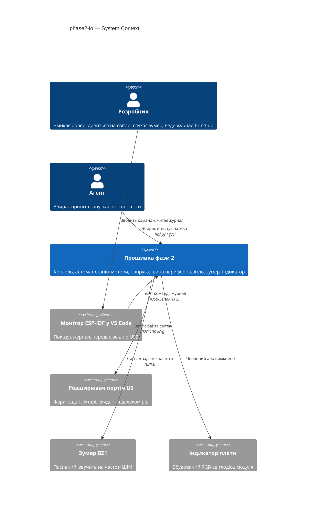

## 4. Solution strategy

**Target surface:** `cli` — єдиний зовнішній інтерфейс — консоль; інших поверхонь немає (як у фазах 0 і 1).

**Top strategic choices (насіння ADR):**

1. **Шина I²C — власний компонент `i2c_bus`** — шина 100 кГц, мʼютекс `m_i2c` і чиста логіка результату скану в одному місці; `ioexp` зараз і `tof` у фазі 6 лише користуються нею, без залежності `tof → ioexp` (ADR-0001).
2. **Один власник виходів — компонент `ui` під мʼютексом `m_ui`** — лише він пише в розширювач після старту, керує зумером і індикатором; ручні команди виконуються під мʼютексом `m_ui` у контексті викликача, а автоматику (задні ліхтарі, FAILSAFE, сигнали переходів) задача кожні 100 мс виводить з опитаних `app_state` і `drive`, повторюючи запис, доки він не вдасться (ADR-0002).
3. **Нуль першим і деградація замість FAULT** — `main` викликає `ioexp_start` одразу після ліній моторів, до консолі; доступність розширювача визначає лише підтверджений перший запис, а не скан; без нього світло недоступне, а рух, зумер і індикатор працюють (ADR-0003).
4. **Індикатор плати за портом із двома кольорами** — `ui_core` просить «вимкнено» чи «червоний», а драйвер світлодіода обирається окремим ADR після виміру OQ-3 (ADR-0004).
5. **Чиста логіка окремо, HAL тонкий** — `i2c_bus_core` (результат скану), `ioexp_core` (тіньовий регістр, маска розрядів, статус доступності), `ui_core` (кольори задніх ліхтарів, кольори індикатора, сигнали переходів і FAILSAFE, відлік звучання, пріоритет ручного сигналу, порядок перевірок команд); у HAL лише `i2c_master`, LEDC, мʼютекси й задача (конституція, п. 6).

Тактичні рішення нижче мають простежуватися до цих п'яти.

**Журнал припущень design (рівень easy; на вето Розробника):**

- `target_surfaces: [cli]`, як у фазах 0 і 1.
- Нові компоненти: `i2c_bus` (core і HAL); наявні заглушки `ioexp` і `ui` отримують core і HAL; `i2c_bus` додається до переліку документа 02 §6.4 (документ не змінюємо без вказівки).
- Задача `ui`: core 0, пріоритет 2, період 100 мс через `vTaskDelayUntil`, підписана на Task WDT (документ 02 §6.1). Стеки й розміри черг уточнить `tasks`.
- Ручні команди світла й зумера виконуються в задачі консолі під мʼютексом `m_ui`, без черги запитів і відповідей: затримка команди — час запису в шину, а не період задачі (виконує spec §6 «≤ 100 мс»). Ручний `beep`, поданий під час сигналу переходу, лягає в один відкладений слот `ui_core` (черги немає, наступна команда перезаписує слот) і починає звучати в такті, коли сигнал закінчився (spec AC-21). Невдалий запис ручної команди відкочує бажаний байт до останнього підтвердженого, тож повтор запису виконує лише автоматику й ніколи відхилену команду (spec AC-15). Порядок блокувань: `m_ui`, потім `m_i2c`; навпаки ніхто не бере.
- `ui_core` — чиста функція такту: входи (час `now_ms`, стан автомата, значення бортів, доступність розширювача, прапорець «повторити запис», один відкладений слот ручного сигналу) → виходи (бажаний байт каналів світла, колір індикатора, запит до зумера); без FreeRTOS і ESP-IDF.
- Напрям руху: знак `left_permille + right_permille` застосованих значень (з `drive_hal_status`); додатне чи нуль — жовтий (червоний і зелений разом), від'ємне — лише зелений (spec AC-17, уточнено 2026-10-18). У DISARMED задні ліхтарі за замовчуванням червоні, на вході в ARMED фари вмикаються самі, при виході з ARMED гаснуть (spec AC-27). Знімок читається раз за такт; коротша за такт зміна може не відбитися, це прийнято.
- Перехід стану ловиться порівнянням зі станом попереднього такту; сигнал лише при зміні на DISARMED, ARMED чи FAILSAFE; старт BOOT → SELFTEST → DISARMED, що вкладається в один такт, дає один сигнал (spec AC-21).
- FAILSAFE: відлік від такту, у якому `ui` побачила стан; блимання задніх ліхтарів 500 мс світить / 500 мс ні, починаючи зі «світить»; перший періодичний сигнал на 2000 мс від входу, далі кожні 2000 мс (spec §6); значення тривалостей — константи в `ui_core.h` з посиланням на spec §6.
- Частота сигналів переходу і FAILSAFE — константа в `ui_calib.h` із позначкою «виміряно: дата»; доки OQ-2 spec відкрите, константи немає, і код сигналів не пишеться (пункт 3 конституції).
- Зумер: LEDC таймер 1, канал 2, шкала 10 біт, шпаруватість 50 % під час звучання, нуль і низький рівень спокою після; частота змінюється перенастроюванням таймера 1, моторного таймера 0 це не стосується.
- Шина: `i2c_master_bus` на `PIN_I2C_SCL`/`PIN_I2C_SDA`, 100 кГц, внутрішні підтяжки вимкнено; таймаут транзакції запису 20 мс, зонда скану 10 мс; зв'язок із пристроєм — один `i2c_master_dev` для розширювача.
- Старт розширювача: до двох спроб запису нуля, сума в межах 1 с від входу в `app_main`; при двох невдачах скан пропускається (щоб не затримувати старт), у журнал іде причина; при успіху скан `0x08`–`0x77` лише журналиться.
- Збій під час роботи: `ui` звіряє бажаний байт із копією щотакту й повторює запис до успіху; `ioexp_hal` додатково перезаписує байт щосекунди (розширювач міг втратити живлення й піднятися з усіма виходами) і після 5 невдач підряд скидає стан шини (знахідка приймання, крок 11); журнал — одне повідомлення на збій і одне на відновлення (стан доступності шини — прапорець у `ioexp_core`).
- `console_ops_t` розширюється колбеками `light_cmd`, `beep_cmd` і `ui_status`; порядок перевірки команд світла й зумера (стан, синтаксис, канал × стан, доступність) виконує `console_core`, викликаючи таблицю дозволів `ui_core` (`ui_core_state_allows`, `ui_core_channel_allows`): розбір цілих чисел, каналів, дій і меж — у `console_core`, а що дозволено в якому стані — єдина таблиця в `ui_core` (spec, матриця).
- Індикатор плати: функція `indicator_set(colour)` у `ui_hal`; реалізація — адресований світлодіод через RMT, порядок GRB (виміряно P8; ADR-0005); рівень яскравості 40 — `ui_calib.h`.
- Лінія індикатора з'явиться в `board_pins.h` після виміру; діагностичний тест P8 для OQ-3 пишеться в `tools/bringup`, не в основній прошивці.
- Вільна внутрішня пам'ять: поріг ≥ 340000 байт (spec §6); `ui` додає стек, мʼютекс, чергу не потребує.

## 5. Building block view

Стиль — шари «чиста логіка → тонкий HAL → `app_main`», як у фазах 0 і 1. Залежності йдуть від `main` до компонентів; консоль не залежить від `ui` і `ioexp`: потрібні дії їй передає `main` колбеками. `ui` читає стан (`app_state`) і значення бортів (`drive`), але не пише в них і не блокує `drive`: зупинка моторів не залежить від світла.

**Internal decomposition:**

```
main/
└── main.c                      app_main: app_state_hal_init → drive_hal_init (виходи моторів вимкнено) → ioexp_start (i2c_bus, запис 0x00, скан) → watchdog_start → console_start → battery_start → drive_start → ui_start → storage_init → SELFTEST → DISARMED (без логіки)
components/
├── board/                      board_pins.h (без змін; лінія індикатора — після OQ-3)
├── i2c_bus/
│   ├── i2c_bus_core.c          результат скану: чи є очікувана адреса, рядок журналу
│   ├── i2c_bus_hal.c           i2c_master 100 кГц, мʼютекс m_i2c, зонд адрес
│   └── include/i2c_bus.h, i2c_bus_core.h, i2c_bus_hal.h
├── ioexp/
│   ├── ioexp_core.c            тіньовий регістр, маска розрядів світла, статус доступності, підтвердження запису
│   ├── ioexp_hal.c             запис байта через i2c_bus, старт: нуль першим, дві спроби, скан
│   └── include/ioexp.h, ioexp_core.h, ioexp_hal.h
├── ui/
│   ├── ui_core.c               такт: задні ліхтарі, FAILSAFE, сигнали переходів, відлік звучання, пріоритет, дозволи й порядок перевірок
│   ├── ui_hal.c                задача ui, мʼютекс m_ui, LEDC таймер 1 і канал 2 (зумер), порт індикатора, опитування app_state і drive
│   └── include/ui.h, ui_core.h, ui_hal.h, ui_calib.h
├── rover_console/              + команди light, beep; розширений status і help
├── app_state/, drive/, battery/, watchdog/, storage/   без змін
test/host/                      + test_i2c_bus.c, test_ioexp.c, test_ui.c, розширений test_console.c
tools/bringup/                  + P8: діагностика індикатора плати (OQ-3)
```

**C4 Container (L2):**

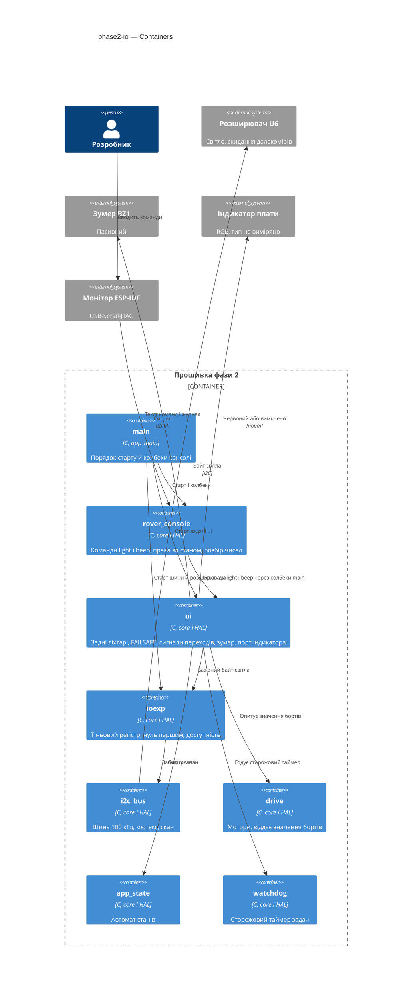

## 6. Runtime view

Діаграми seed-ять основні потоки; `sequences` докладно покриє кожен AC.

**Critical flow 1: старт — нуль першим, доступність, деградація**

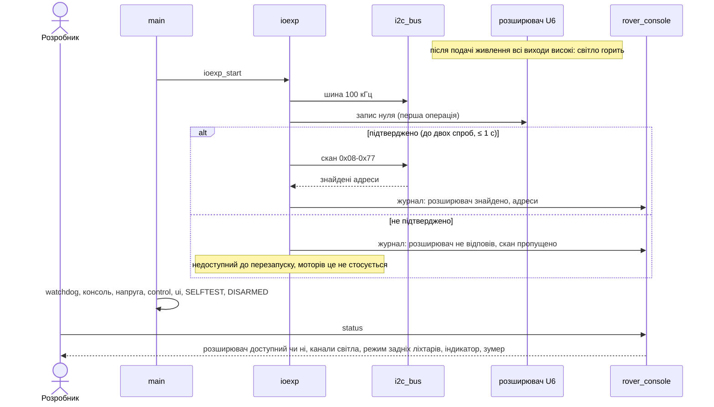

**Critical flow 2: ручна команда світла чи зумера**

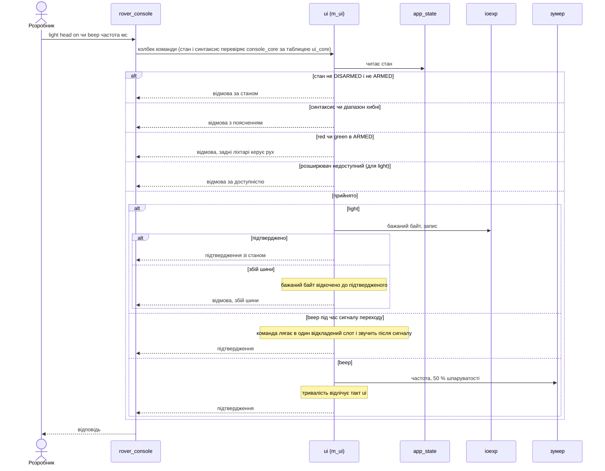

**Critical flow 3: такт ui — задні ліхтарі, сигнали переходів, FAILSAFE**

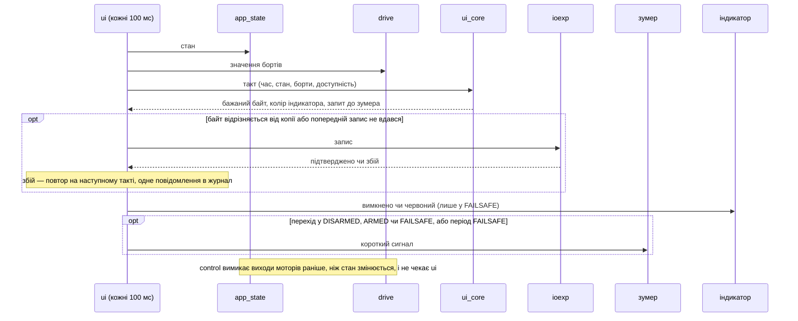

**Critical flow 4: відсічка в русі — зупинка першою, індикація потім**

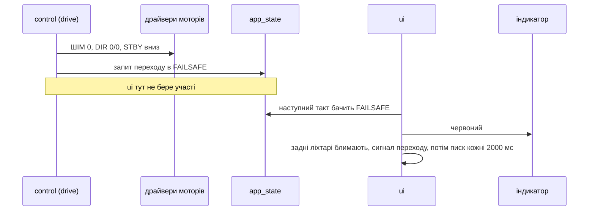

### Flow 5: відхилення команд світла й зумера (AC-05, AC-06, AC-07, AC-10, AC-14)

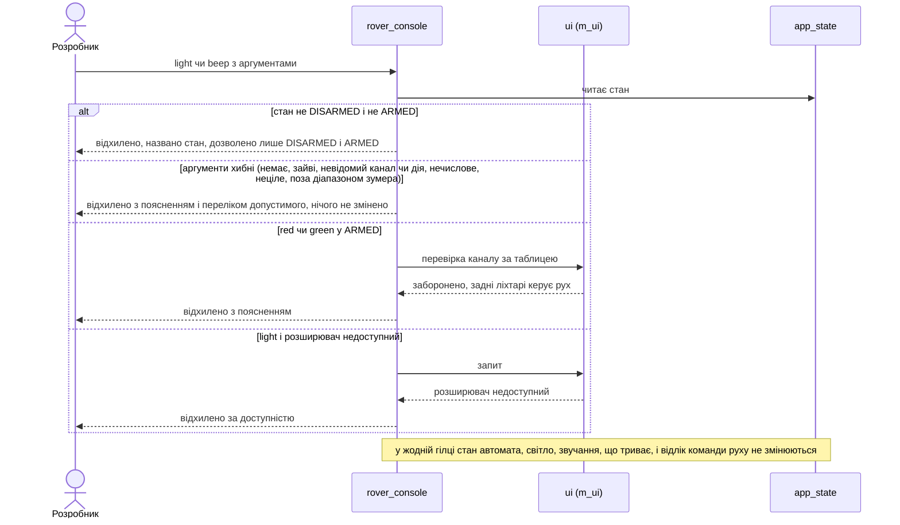

### Flow 6: задні ліхтарі за рухом в ARMED (AC-17, AC-18)

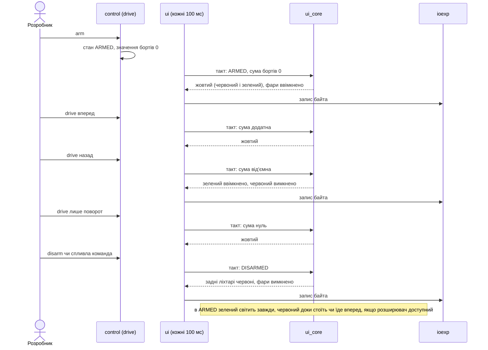

### Flow 7: сигнали переходів і відкладений ручний beep (AC-09, AC-21, AC-23)

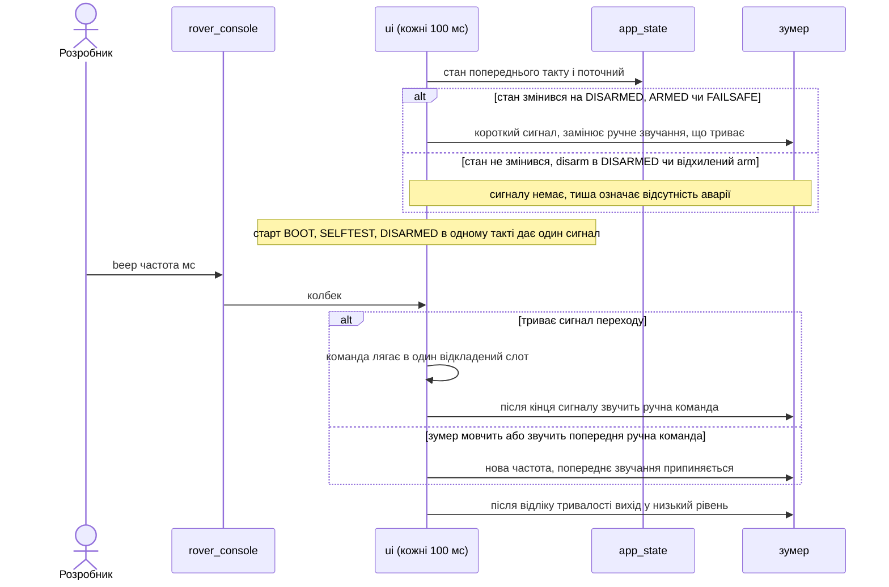

### Flow 8: FAILSAFE — блимання, індикатор, писк (AC-19, AC-20, AC-22)

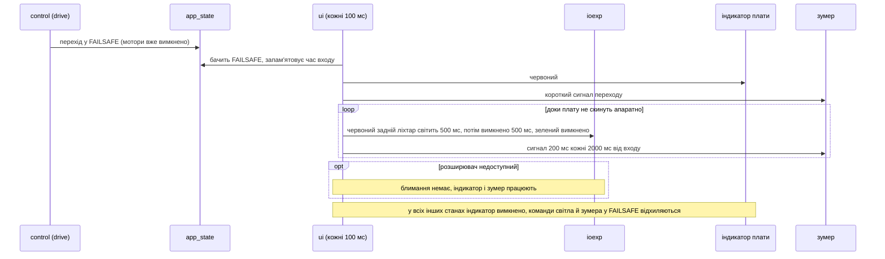

### Flow 9: збій шини під час роботи і повтор запису (AC-15)

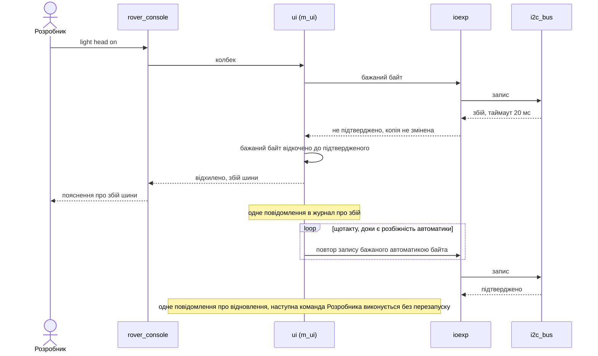

### Flow 10: зумер і світло поруч із рухом, маска розрядів (AC-11, AC-12, AC-16)

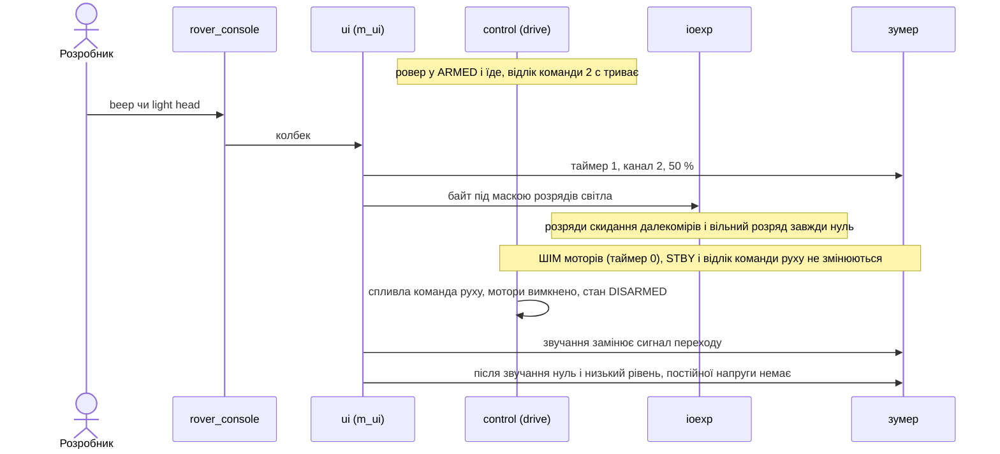

### Coverage: історії і критерії → потоки

| Історія | Потоки |
|---|---|
| US-01 | Flow 1 (AC-01, AC-02, AC-03) |
| US-02 | Flow 2 (AC-04), Flow 5 (AC-05, AC-06, AC-07) |
| US-03 | Flow 2 (AC-08), Flow 5 (AC-10), Flow 7 (AC-09), Flow 10 (AC-11, AC-12) |
| US-04 | Flow 1 (AC-13, status), Flow 5 (AC-14 відмова за доступністю) |
| US-05 | Flow 1 (AC-14), Flow 9 (AC-15) |
| US-06 | Flow 10 (AC-16) |
| US-07 | Flow 6 (AC-17, AC-18) |
| US-08 | Flow 8 (AC-19, AC-20) |
| US-09 | Flow 7 (AC-21, AC-23), Flow 8 (AC-22) |
| US-10, US-11 | не рантайм: AC-24, AC-25, AC-26 — процес роботи Агента (збірка, хостові тести, межі дозволів), перевіряються виводом збірки й раннера |

AC-02 і AC-11 — інваріанти порядку й рівня виходів; на діаграмах показані приміткою (Flow 1, Flow 10), перевіряються оглядом коду й залізом. AC-16 додатково перевіряється хостовим тестом копії розширювача.

**Позначки для design (лише прапорці, ADR не пишемо):** нових учасників поза §5 немає; діаграми використовують модулі з §5 (як у фазі 1), а не узагальнені «клієнт / service».

## 7. Deployment view

<!-- N/A: прошивка на одній платі, інфраструктури немає; запис у плату — лише розробник через VS Code. -->

**Monitoring:**
- Журнал монітора: рядки з мітками часу (початок виконання, перший запис нуля, знайдені адреси, збій і відновлення шини, переходи стану).
- Команда `status`: доступність розширювача, канали світла, режим задніх ліхтарів, колір індикатора, залишок звучання.

## 8. Crosscutting concepts

| Concept | Convention | Where defined |
|---|---|---|
| Logging | `static const char *TAG`, повідомлення українською, префікс компонента; одне повідомлення на зміну доступності шини | конституція п. 9, тут |
| Error handling | `esp_err_t` скрізь; збій шини чи індикатора → відмова команди або повтор на наступному такті, ніколи `abort()` і ніколи зміна стану автомата | документ 02 §5, тут |
| Time | `esp_timer_get_time()` у HAL; `ui_core` отримує `now_ms` аргументом | прецедент фаз 0–1 |
| Concurrency | `m_i2c` усередині `i2c_bus`; `m_ui` навколо стану `ui_core`; порядок `m_ui` → `m_i2c`; спільні дані лише під мʼютексом | документ 02 §6.2, тут |
| Permissions | права команд за станом — у `ui_core` і `console_core`, матриця з spec; порядок: стан, синтаксис, доступність | spec §5 |
| Outputs on failure | байт, що пишеться в розширювач, маскується розрядами світла; зумер після звучання — нуль і низький рівень | тут, ADR-0002 |
| ID strategy / i18n / events | N/A: один мовний канал (українська), подій між системами немає | — |

## 9. Architecture decisions

| # | Title | Status | Section |
|---|---|---|---|
| 0001 | Own the I2C bus in a separate component with testable scan logic | Accepted | §4, §5 |
| 0002 | Apply ui commands under a mutex and poll state every 100 ms | Accepted | §4, §6 |
| 0003 | Write zero first and degrade when the expander is unconfirmed | Accepted | §4, §6 |
| 0004 | Hide the board indicator behind a two-colour port until measured | Accepted | §4, §11 |
| 0005 | Drive the board indicator as an addressable LED over RMT in GRB order | Accepted | §4, §11 |

ADR files live under `docs/features/phase2-io/adr/NNNN-<title>.md`.

## 10. Quality requirements

Числа беруться дослівно зі spec §6.

**QG-1. Безпека виходів і стартового стану**
- **When:** плату ввімкнено або перезапущено, а потім надходять довільні команди світла, зумера та автоматичні зміни.
- **Then:** запис нуля в розширювач — перша транзакція, 0 звернень до шини до нього; перший запис ≤ 1000 мс від початку виконання застосунку (включно з повторною спробою); розряди скидання далекомірів і вільний розряд = 0 весь час; вихід зумера в низькому рівні поза звучанням; шина 100 кГц, не вище.
- **How verify:** огляд коду і рядок журналу з міткою першого запису; хостовий тест копії розширювача (маска розрядів) і логіки сигналів; осцилограф чи мультиметр на зумері; журнал монітора на 10 з 10 перезапусків.

**QG-2. Незалежність руху від світла**
- **When:** розширювач недоступний при старті, шина падає під час роботи, або ровер переходить у FAILSAFE.
- **Then:** виходи моторів вимикаються раніше, ніж відбувається будь-яке звернення до шини чи індикатора; збій шини чи індикатора не затримує перехід у FAILSAFE; `arm`, `drive`, `disarm` працюють як у фазі 1, а старт не затримується більше ніж на 1 с через відсутність відповіді; задні ліхтарі і індикатор змінюють колір ≤ 200 мс після зміни значень бортів або стану.
- **How verify:** огляд коду (порядок викликів, відсутність залежності `drive` від `ui`); приймання на залізі з відʼєднаним розширювачем у русі; мітки журналу; журнал при падінні шини.

**QG-3. Перевірюваність**
- **When:** Агент завершив зміну.
- **Then:** 63 з 63 пар «команда × стан», 21 з 21 пар «канал × стан» для команди світла і 49 з 49 пар станів автомата; хостовий прогін ≤ 5 с, 100 % пройдено; збірка 0 помилок, 0 нових попереджень; діапазон зумера 200–5000 Гц і 1–2000 мс, відхилення тривалості звуку ≤ 100 мс перевіряється підставним годинником.
- **How verify:** вивід хостового раннера; вивід збірки; слух і відео Розробника при прийманні на залізі.

## 11. Risks and technical debt

| Risk / debt | Severity | Mitigation | Owner |
|---|---|---|---|
| Транзакція до недоступної шини блокує задачу на таймаут запису (20 мс) щотакту, поки шина мертва | Medium | Таймаут 20 мс помітно менший за такт 100 мс; збій не зупиняє автомат і мотори; одне повідомлення в журнал на зміну доступності | Розробник |
| Перехід, коротший за такт 100 мс (туди-назад), може не відбитися на світлі й звуці | Low | Прийнято (опитування), задокументовано в ADR-0002; мотори від цього не залежать | Розробник |
| Вбудований індикатор плати: драйвер RMT займає канал RMT, який знадобиться пізніше | Low | Виміряно P8; ADR-0005; у фазах 3–6 врахувати вільні канали RMT | Розробник |
| Драйвер індикатора плати (вирішено 2026-10-18: адресований світлодіод, RMT, GRB; ADR-0005) | Low | Результат P8 у `docs/measured.md`; індикатор лише червоний і вимкнено | Розробник |
| Частота автоматичних сигналів зумера (вирішено 2026-10-18: 1000 Гц за результатом P9) | Low | Константа в `ui_calib.h` з позначкою «виміряно: дата» | Розробник |
| Розміри стеків і пріоритет задачі `ui`, розмір відкладеного слота не визначено | Low | Уточнює `/sdd:tasks`; перевіряється запасом вільної памʼяті (≥ 340000 байт, spec §6) | Розробник, до `/sdd:tasks` |
| `i2c_bus` не названо в переліку компонентів документа 02 §6.4 | Low | Рядок про компонент додається в документ за вказівкою Розробника; до того джерелом є цей SAD | Розробник |
| Апаратне вікно світіння від подачі живлення до першого запису нуля | Low | Прийнято (spec OQ-1 закрито), програмно усунути неможливо | Розробник |

**Accepted debt (acceptable in v1, plan to fix later):** (власник — Розробник, перегляд у фазі 6)
- Спільна шина без арбітражу пріоритетів: у фазі 6 до неї додасться опитування далекомірів, і розклад доступу до `m_i2c` треба перевірити.
- Блимання й писк у FAILSAFE реалізовано пасивним відліком у такті `ui`, без окремого апаратного таймера.

## 12. Glossary

| Term | Meaning |
|---|---|
| Розширювач портів | Мікросхема на шині периферії з вісьмома виходами: світло й скидання далекомірів; після живлення всі виходи високі |
| Канал світла | Один із трьох світлових виходів: фари, червоний і зелений задні ліхтарі |
| Задні ліхтарі | Червоний і зелений ліхтарі ззаду; в ARMED показують напрямок руху |
| Індикатор плати | Вбудований RGB-світлодіод модуля; червоний лише у FAILSAFE |
| Зумер | Пасивний звуковий випромінювач: звучить на частоті, яку задає прошивка |
| Діапазон зумера | 200–5000 Гц і 1–2000 мс, межі входять |
| Деградація | Режим без розширювача: світла немає, решта працює |
| Тіньовий регістр | Копія байта розширювача, яку прошивка тримає в памʼяті; значення береться з неї, а не зчитується з шини |
| Такт ui | Період 100 мс, у якому `ui` опитує стан і борти, відлічує звучання й блимання та повторює запис |
