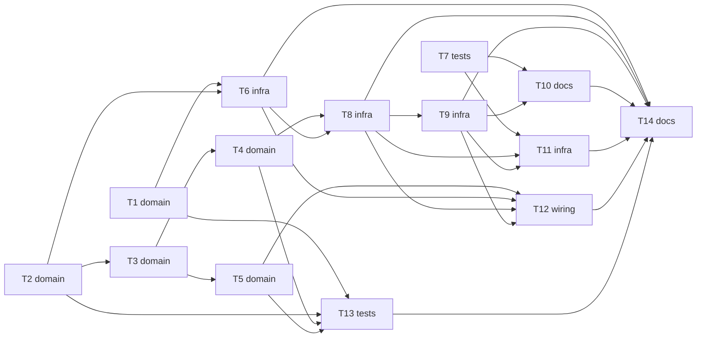

# Epic — phase2-io

> **Spec:** [spec.md](../spec.md) · **Design:** [sad.md](../sad.md) · **Контракт:** [cli.md](../contracts/cli.md) · **ADRs:** [adr/](../adr/)

## Goal

Фаза 2 піднімає шину периферії й дає ровереру світло та звук: нуль першим у розширювач, ручні `light` і `beep`, задні ліхтарі за рухом, індикація й писк у FAILSAFE, сигнали переходів; відмова розширювача лише вимикає світло (spec §2).

## Scope

- **In:** `i2c_bus`, `ioexp`, `ui` (core і HAL), розширення `rover_console`, колбеки й порядок старту в `main`, діагностичні P8 і P9 у `tools/bringup`.
- **Out:** далекоміри (фаза 6), пульт, енкодери, PID, мелодії, збереження стану світла, FAULT-самотест (spec §3).

## Task map

## Tasks

See [tracker.md](./tracker.md) for status. Machine contract: [tasks.json](../tasks.json).

| # | Task | Layer | Blocked by | DoD (short) |
|---|---|---|---|---|
| T1 | Створити i2c_bus_core: оцінка результату скану й рядок журналу | domain | — | Хостові тести `i2c_bus_core` проходять. |
| T2 | Створити ioexp_core: тіньовий регістр, маска розрядів світла, підтвердження запису, доступність | domain | — | Хостові тести `ioexp_core` проходять (маска, незалежність каналів, збій, недоступність). |
| T3 | Створити ui_core: задні ліхтарі за рухом, індикатор за станом, таблиця дозволів команд | domain | T2 | Хостові тести покривають 63 з 63 пар «команда × стан» і 21 з 21 пар «канал × стан». |
| T4 | Доповнити ui_core: ручний beep, відкладений слот, сигнали переходів, FAILSAFE-блимання й писк | domain | T3 | Хостові тести зумера, слота, сигналів і FAILSAFE проходять із підставним годинником. |
| T5 | Розширити console_core: розбір light і beep, порядок перевірок, help і status | domain | T3 | Хостові тести `console_core` проходять; решта команд фази 1 поводиться як раніше. |
| T6 | Створити i2c_bus_hal і ioexp_hal: шина 100 кГц, мʼютекс, нуль першим, скан | infra | T1, T2 | `idf.py build` без помилок і нових попереджень. |
| T7 | Додати діагностичні тести P8 (індикатор плати) і P9 (зумер) у tools/bringup | tests | — | `tools/bringup` збирається без помилок і нових попереджень. |
| T8 | Створити ui_hal: задача ui, мʼютекс m_ui, опитування стану й бортів, запис розширювача | infra | T4, T6 | `idf.py build` без помилок і нових попереджень; `ui` не блокує `control`. |
| T9 | Додати в ui_hal зумер: LEDC таймер 1 канал 2, низький рівень спокою, ручний і автоматичний звук | infra | T8 | `idf.py build` без помилок і нових попереджень. |
| T10 | Зафіксувати частоту автоматичних сигналів у ui_calib.h за результатом P9 | docs | T7, T9 | Константа взята з `docs/measured.md`, не вигадана. |
| T11 | Реалізувати драйвер індикатора плати за результатом P8 (окремий ADR) | infra | T7, T8, T9 | Драйвер відповідає ADR і виміру, `idf.py build` без нових попереджень. |
| T12 | Підключити колбеки світла й зумера в console_hal і порядок старту в main | wiring | T5, T6, T8, T9 | `idf.py build` без помилок і нових попереджень. |
| T13 | Зібрати хостовий раннер і перевірки конституції для phase2-io | tests | T1, T2, T4, T5 | Раннер повідомляє кількість тестів і що всі пройдені, ≤ 5 с. |
| T14 | Підготувати чекліст приймання фази 2 на залізі і запис у журнал bring-up | docs | T6, T8, T9, T10, T11, T12, T13 | `acceptance.md` існує і відповідає AC-01…AC-23. |

## Risks / Hard rules

- T10 і T11 заблоковані замірами P9 і P8 (OQ-2, OQ-3): без запису в `docs/measured.md` вони не починаються (конституція, пп. 3, 13).
- Нуль першим у розширювач, 100 кГц, мотори не залежать від світла (spec §6, sad.md §10).
- Приймання на залізі виконує лише Розробник; Агент не прошиває й не комітить без вказівки (AC-26).
