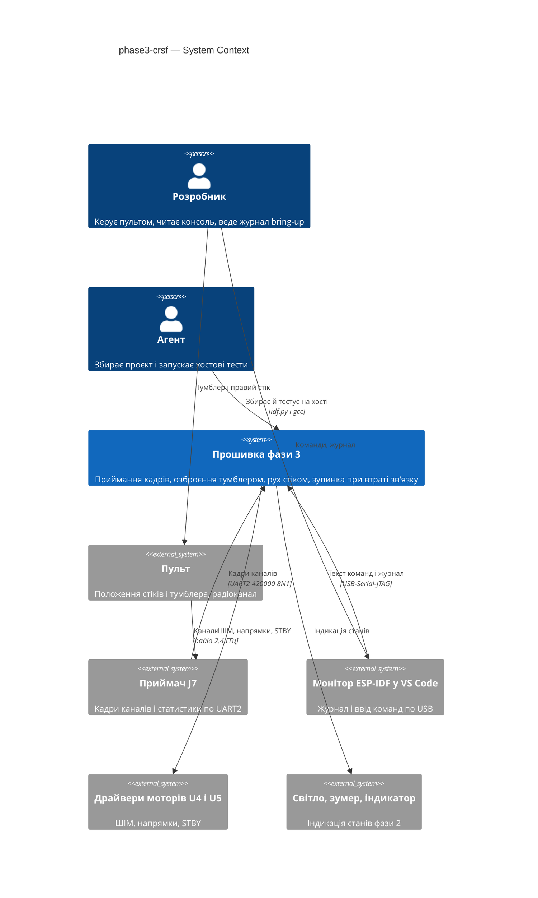
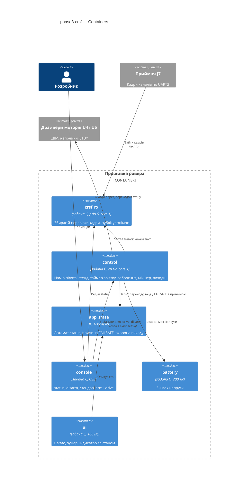
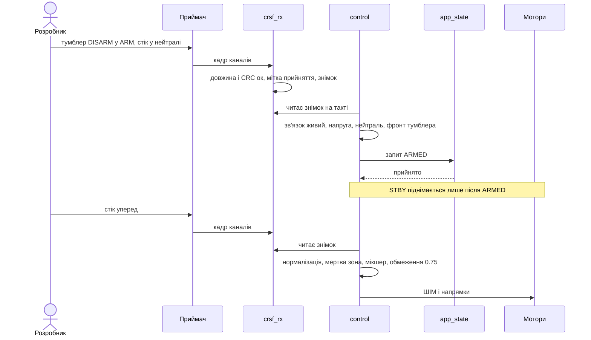
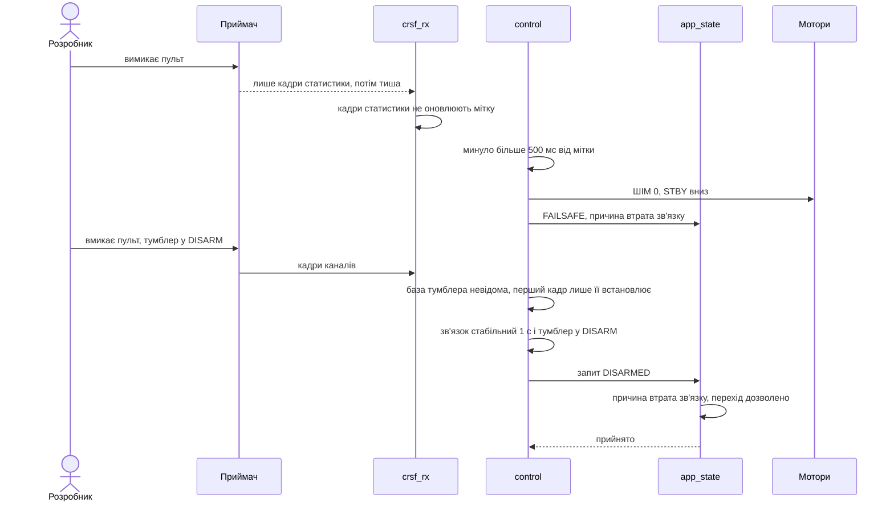
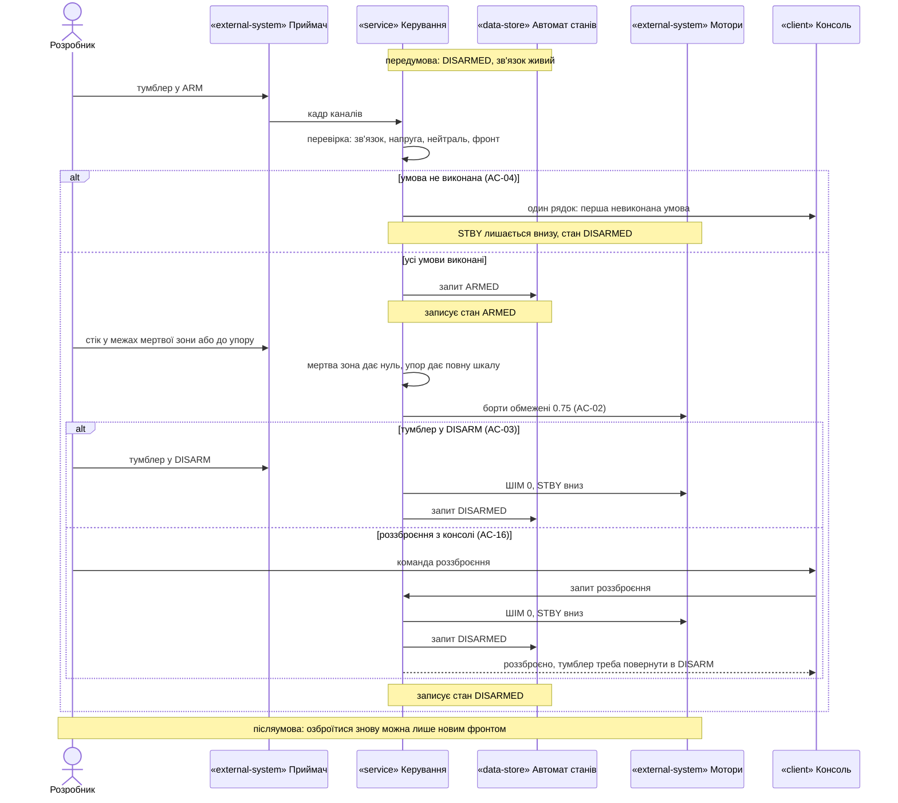
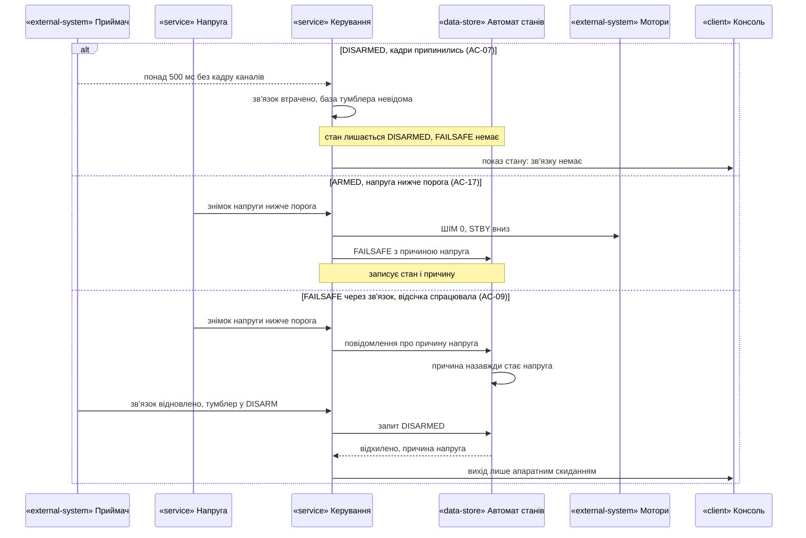
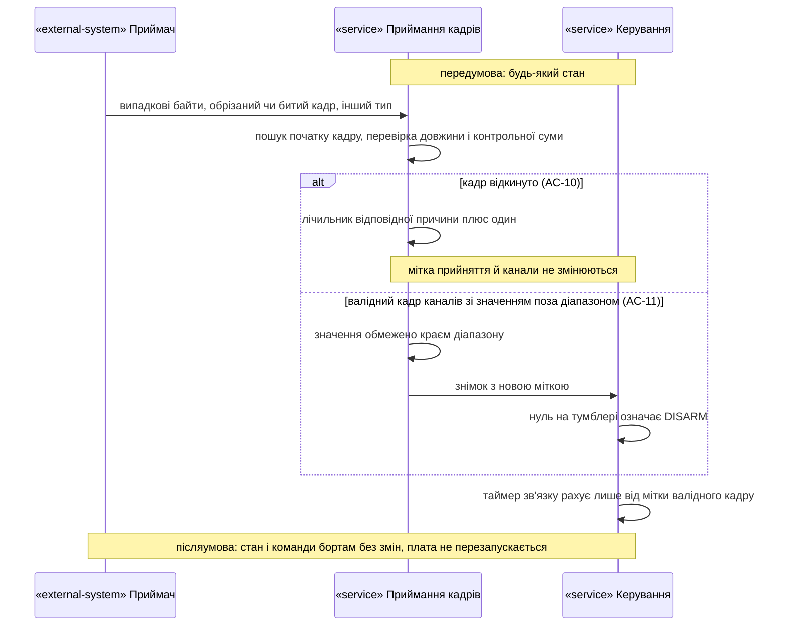
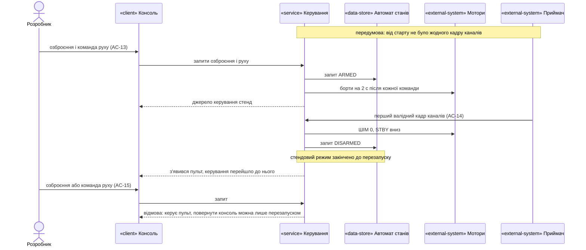
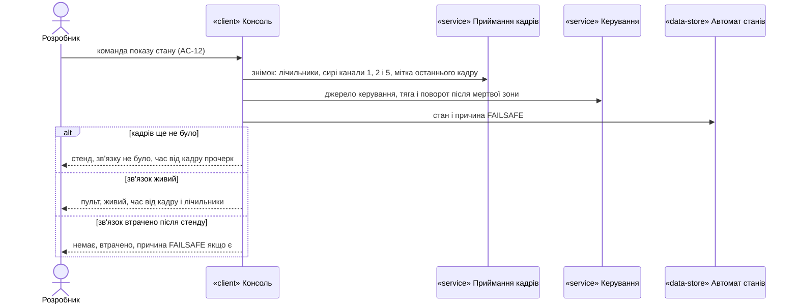

# Software Architecture Document — phase3-crsf

## 1. Introduction and goals

**Intent.** Фаза 3 дає Розробнику керування ровером з пульта. Прошивка читає кадри каналів приймача, тумблером озброює й роззброює ровер, правим стіком задає тягу й поворот через мікшер і обмеження потужності фази 1. Якщо в ARMED понад 0.5 с немає валідного кадру каналів, ровер зупиняється й переходить у FAILSAFE, а після стабільного відновлення зв'язку з тумблером у DISARM повертається в DISARMED. Консоль задає рух лише в стендовому режимі, до першого кадру від пульта (spec §1, §2, §4).

**Top-3 quality goals (повні сценарії — §10):**

1. Безпека при втраті зв'язку: зупинка не пізніше ніж за 520 мс після останнього валідного кадру каналів; ровер не озброюється й не їде без свідомої дії Розробника.
2. Стійкість до шуму: биті, обрізані, службові кадри й випадкові байти не змінюють стану, не підтримують зв'язок і не перезавантажують плату.
3. Перевірюваність: розбір кадрів, перетворення каналів, умови озброєння, таймер зв'язку, вихід із FAILSAFE і розведення джерел керування тестуються на хості без плати; залізо перевіряє лише HAL.

**Stakeholders.**

| Role | Interest | Sign-off owner? |
|---|---|---|
| Розробник | Керує з пульта й консолі, читає показ стану, записує приймання в журнал bring-up | Yes |
| Агент | Збирає проєкт і доводить логіку хостовими тестами; не прошиває й не комітить без вказівки | No |

<!-- Decision overrides (¶4) — populated by the critic resolution loop, empty otherwise. -->

- **Decision override: консольний рух у стендовому режимі попри інваріант «втрата кадрів > 500 мс → ШІМ 0, STBY вниз» — rationale:** рішення власника в spec §1 (2026-10-18): інваріант діє з першого валідного кадру каналів; до нього кадрів не було, тож втрати немає, а від руху без нагляду захищає двосекундне спливання команди руху фази 1. Інваріант у §2 читається з цим винятком.

## 2. Constraints

**Technical.**
- C (gnu17), ESP-IDF v6.1, FreeRTOS, ціль `esp32s3`, плата YD-ESP32-S3 N16R8 (`sdkconfig.defaults` — захищений файл, не змінюється).
- Лінія приймача: UART2, 420000 бод 8N1, RX — `PIN_ELRS_RX`, TX — `PIN_ELRS_TX` (`board_pins.h`; значення виміряні в P5). Драйвер `driver/uart.h` з чергою подій (документ 02 §7 «Фаза 3»); `UART_HW_FIFO_LEN` замість видаленого `UART_FIFO_LEN` (документ 02 §8).
- Формат кадру й перетворення — властивості протоколу (документ 02 §7 «Фаза 3»): `[0xC8][len][type][payload][crc8]`, CRC8 з поліномом 0xD5 по `type+payload`, кадр каналів — тип 0x16, 22 байти корисного навантаження, 16 каналів по 11 біт; робочий діапазон 172…1811, центр 992.
- Таймер зв'язку скидає лише валідний кадр типу 0x16: службові кадри 0x14 після вимкнення пульта йдуть ще ≈ 3.5 с (P5, `docs/measured.md`).
- Напрямок і крайні значення стіків виміряно (spec OQ-1, `docs/measured.md`, 2026-10-18): стік угору → CH2 більше, праворуч → CH1 більше, обидва знаки +1; CH2 172…1808, CH1 180…1792 — шкала 172…1811 з протоколу лишається.
- Інваріанти безпеки (конституція, п. 7): STBY піднімається лише в ARMED і лише свідомо; втрата кадрів > 500 мс → ШІМ 0, STBY вниз (з винятком для стендового режиму, §1 Decision override); ШІМ ≤ 0.75; VBAT < 6.0 В → мотори не запускаються.
- Таблиця переходів автомата змінюється: 11 пар із 49 (додано FAILSAFE → DISARMED, spec, примітка до таблиці переходів).
- Task WDT 5 с з перезавантаженням (фаза 0); нова задача підписується на нього.

**Organisational.**
- Один розробник і один агент; прошивання лише розробником через VS Code (`CLAUDE.md`).
- Крок 3 у `docs/roadmap.md`; без жорсткого терміну. Розмір S, маршрут quick.

**Conventions.**
- `docs/constitution.md`: core/HAL (п. 6), номери ліній лише в `board_pins.h` (п. 2), `vTaskDelayUntil` у періодичних задачах (п. 14), збірка без нових попереджень (п. 8), коментарі й коміти українською (п. 9), захищені файли (п. 10).
- Єдиний викликач переходів стану й єдиний писач виходів моторів — задача `control` (ADR-0001 фази 1); спершу виходи, потім стан (ADR-0002 фази 1).
- Колбеки між компонентами передає `main` (прецедент — `console_ops_t` фаз 0–2).
- Хостові тести: `test/host/run_tests.sh` збирає кожен `test_*.c` з усіма `components/*/*_core.c`; `check_core_headers.sh` ловить заголовки ESP-IDF у core.

**Regulatory / external.**
- N/A: немає мережі, персональних даних і регуляторних вимог (spec §6.1). Радіочастотну частину повністю забезпечують пульт і приймач.

## 3. Context and scope

Розробник керує ровером з пульта: пульт передає положення органів керування на приймач, приймач по лінії UART шле плате кадри каналів ≈ 100 разів на секунду. Консоль через USB лишається для показу стану, роззброєння й стендового режиму. Агент збирає проєкт і запускає хостові тести. Нове в порівнянні з фазою 2: прошивка має другого (радіо) джерела команд і мусить сама визначати, що воно зникло.

<!-- brownfield: задачі control (20 мс, prio 5, core 1), battery (200 мс), ui (100 мс), heartbeat (1 с), console; control — єдиний викликач app_state_request (drive_hal.c:248); консоль подає запити через чергу drive_hal_submit; причина зупинки last_stop у drive_hal; компонент crsf — заглушка без коду; UART у компонентах не використовується (лише tools/bringup P5). Карта docs/architecture-map.md (reflects_commit e35e99f) відстає від фаз 0–2 — джерелом слугував код і SAD фаз 1–2. -->

**External systems (in / out):**

| Actor or system | Type | Interaction |
|---|---|---|
| Розробник | Person | Керує пультом; вводить status, disarm, (у стенді) arm і drive; записує приймання |
| Агент | Person | Збирає проєкт і запускає хостові тести |
| Пульт | System (external) | Передає положення стіків і тумблера на приймач; прив'язаний до приймача |
| Приймач у роз'ємі J7 | System (hardware) | Шле кадри каналів (0x16) і статистики (0x14) по UART2; при втраті сигналу кадри каналів припиняються (P5) |
| Монітор ESP-IDF у VS Code | System (external) | Показує журнал, передає ввід через USB-Serial-JTAG |
| Драйвери моторів U4, U5 | System (hardware) | Отримують ШІМ, напрямки й STBY лише від задачі control |
| Розширювач портів, зумер, індикатор | System (hardware) | Через `ui` фази 2 показують стани, зокрема FAILSAFE і перехід у DISARMED |

**C4 Context (L1):**



## 4. Solution strategy

**Target surface:** `cli` — як у фазах 0–2; пульт — зовнішній пристрій вводу, а не поверхня, яку будує прошивка.

**Top strategic choices (насіння ADR):**

1. **Один вирішувач безпеки — задача `control`** — нова задача `crsf_rx` лише розбирає кадри й публікує знімок (сирі канали, мітка часу прийняття, лічильники) під коротким блокуванням; рішення про втрату зв'язку, озброєння, рух і вихід із FAILSAFE `control` ухвалює на своєму такті 20 мс із того самого знімка. Писач стану й виходів лишається один (ADR-0001).
2. **Причина FAILSAFE — у автоматі станів** — `app_state` приймає вхід у FAILSAFE разом із причиною («втрата зв'язку» / «напруга»), підвищує її до «напруга» при повторному повідомленні і сам відхиляє FAILSAFE → DISARMED для будь-якої причини, крім «втрата зв'язку». Умови з часом (≥ 1 с стабільного зв'язку, тумблер у DISARM) рахує `control` (ADR-0002).
3. **Канали → намір у `crsf_core`, розведення джерел — у кроці `control`** — `crsf_core` перетворює сирі канали на намір пілота (нормалізація, мертва зона, положення тумблера, чиста функція фронту); базу фронту, її скидання при втраті зв'язку і порівняння послідовних знімків на такті 20 мс веде `drive_ctl_step`; `drive_ctl_step` отримує намір і стан зв'язку як вхід, веде стендовий режим, вирішує, чиї запити приймати, і відповідає консолі причиною відмови (ADR-0003).
4. **Чиста логіка окремо, HAL тонкий** — `crsf_core` (збирання кадрів із потоку, CRC8, розпакування, лічильники, нормалізація, мертва зона, фронт тумблера, форматування рядків показу стану), `drive_core` (стендовий режим, таймер зв'язку, умови озброєння й виходу), `app_state_core` (причина FAILSAFE і охорона переходу); у HAL лише драйвер UART, задача, блокування й мітки часу (конституція, п. 6).

Тактичні рішення нижче мають простежуватися до цих чотирьох.

**Журнал припущень design (рівень easy; прийнято Розробником 2026-10-18):**

- `target_surfaces: [cli]`, як у фазах 0–2.
- Компонент `crsf` отримує `crsf_core.c` і `crsf_hal.c`; нових компонентів немає. Документ 02 §6.4 описує `crsf/` як «парсер, CRC8, failsafe-таймер» — таймер переїжджає в `control` (ADR-0001); документ 02 не змінюємо без вказівки.
- Задача `crsf_rx`: пріоритет 6, ядро 1 (документ 02 §6.1), стек 3072 байти; подієва — чекає на черзі подій UART з таймаутом 100 мс, щоб регулярно скидати Task WDT навіть без пульта; на подіях переповнення FIFO чи буфера скидає вхідний буфер, рахує подію й продовжує.
- Драйвер UART: буфер прийому 512 байтів, без буфера передачі (телеметрія — фаза 7), черга подій на 16 елементів; лінію TX налаштовано, але нічого не передається.
- Мітка прийняття кадру — `esp_timer_get_time()` у мс, яку ставить `crsf_rx` у момент, коли кадр пройшов перевірку довжини й контрольної суми (spec §6). `control` бере `now_ms` з того самого годинника; різниця беззнакова, переповнення через ≈ 49 діб не впливає.
- Знімок: структура з 16 сирими каналами, міткою прийняття, лічильником кадрів (номер, щоб `control` бачив, чи прийшов новий кадр) і лічильниками «валідні кадри каналів / неправильна контрольна сума / неправильна довжина / інші типи / переповнення». Захищена спін-блокуванням `portMUX` (як `s_status` у `drive_hal`); копіювання знімка — менше 100 байтів.
- Збирач кадрів шукає байт синхронізації 0xC8, перевіряє довжину (2…62 байти за протоколом; для типу 0x16 — рівно 24), накопичує байти між порціями читання, після відкинутого кадру шукає наступний 0xC8 з байта, наступного за відкинутим початком.
- Нормалізація: x = (raw − 992) / 819, обмеження до [−1, 1]; мертва зона по кожній осі окремо d = 0.05: |x| ≤ d → 0, інакше знак(x) · (|x| − d) / (1 − d). Знаки осей — константи `CRSF_THROTTLE_SIGN = +1`, `CRSF_STEER_SIGN = +1` у `crsf_calib.h` з позначкою «виміряно: 2026-10-18» (spec OQ-1, `docs/measured.md`).
- Тумблер: канал 5 (індекс 4) > 992 → ARM. Фронт = зміна з DISARM на ARM між двома послідовними знімками з новим кадром, які `control` бачить на своїх тактах 20 мс, за живого зв'язку (проміжні кадри між тактами не потрібні: положення тумблера фіксоване); база «невідома» на старті й після кожної втрати зв'язку, перший кадр лише встановлює базу.
- Канали в коді — константи індексів у `crsf_core.h` (CH1 = 0 поворот, CH2 = 1 тяга, CH5 = 4 тумблер) з посиланням на P5; це не номери ліній, тож пункт 2 конституції їх не стосується.
- `drive_ctl_in_t` отримує поле `rc` (новий знімок у вигляді «чи був кадр від старту, мітка останнього кадру, номер кадру, намір пілота»); `drive_ctl_t` — стан стендового режиму, джерело озброєння (консоль / пульт), момент початку стабільного зв'язку, базу фронту тумблера.
- Нові причини відмови: «керує пульт» (консольні `arm` і `drive` після стендового режиму), «немає зв'язку», «стік не в нейтралі», «тумблер не перемикався з DISARM» — з порядком перевірки зв'язок → напруга → нейтраль → фронт (spec AC-04). Нові причини зупинки: «втрата зв'язку», «з'явився пульт», «тумблер у DISARM».
- Журнал відмови озброєння з пульта — один рядок на відхилений фронт (spec AC-04), друкує HAL `control` за ознакою в `drive_ctl_out_t`.
- Відсічка по напрузі у FAILSAFE з причиною «втрата зв'язку»: `drive_ctl_step` перевіряє ту саму умову відсічки, що й в ARMED (той самий знімок `battery`, той самий поріг і правило застарілого виміру), і повідомляє `app_state` про причину «напруга» (ADR-0002).
- Показ стану: новий колбек `rc_status` у `console_ops_t`; рядки форматує `crsf_core` (чиста функція), дані — зі знімка `crsf` і статусу `drive` (джерело керування, причина FAILSAFE з `app_state`).
- `ui` не змінюється: вихід із FAILSAFE у DISARMED він побачить опитуванням стану і подасть сигнал переходу в DISARMED; припинення блимання й писку перевіряє хостовий тест `ui_core` на переході, якого досі не було (§11).
- `main`: `crsf_start()` після `drive_start()` і до консолі; невдача ініціалізації UART — рядок у журнал, ровер працює в стендовому режимі (кадрів не буде).

## 5. Building block view

Стиль — як у фазах 0–2: компоненти ESP-IDF, у кожного чиста логіка `<name>_core.c` без заголовків ESP-IDF і тонкий `<name>_hal.c` з драйверами, задачами й блокуваннями. Дані від приймача течуть в один бік: `crsf_rx` → знімок → `control`; зворотного каналу немає. Усі рішення про безпеку — в одному чистому кроці `drive_ctl_step`, якому `crsf_core` дає готовий намір пілота.

**Internal decomposition:**

```
components/
├── crsf/
│   ├── include/crsf_core.h    # збирач кадрів, CRC8, розпакування, лічильники, намір пілота, рядки status
│   ├── include/crsf_calib.h   # знаки осей +1/+1, «виміряно: 2026-10-18»
│   ├── include/crsf_hal.h     # crsf_start(), crsf_snapshot_get()
│   ├── crsf_core.c
│   └── crsf_hal.c             # UART2, задача crsf_rx, знімок під portMUX
├── drive/                     # drive_ctl_step: стенд, таймер зв'язку, озброєння тумблером, вихід із FAILSAFE
├── app_state/                 # + причина FAILSAFE, охорона FAILSAFE → DISARMED, 11 пар
├── rover_console/             # + колбек rc_status; матриця за станом без змін
├── ui/                        # без змін
└── board/include/board_pins.h # PIN_ELRS_RX, PIN_ELRS_TX (без змін)
main/main.c                    # crsf_start(), колбек rc_status
test/host/test_crsf.c          # + розширення test_drive.c, test_app_state.c
```

**C4 Container (L2):**



`control` у цій діаграмі — та сама задача фази 1 (`drive_hal`); нова лише `crsf_rx`.

## 6. Runtime view

**Critical flow 1: озброєння тумблером і рух стіком**



**Critical flow 2: втрата зв'язку і вихід із FAILSAFE**



### Flow 3: відмови озброєння, мертва зона і роззброєння



### Flow 4: втрата зв'язку в DISARMED і відсічка по напрузі



### Flow 5: шум у лінії приймача



### Flow 6: стендовий режим і поява пульта



### Flow 7: показ стану



### Coverage: US і AC → потік

| Історія | Потоки | Критерії приймання → де показано |
|---|---|---|
| US-01 | 1, 3, 4 | AC-01 → потік 1; AC-02 → потік 3; AC-17 → потік 4, гілка «ARMED, напруга» |
| US-02 | 1, 3 | AC-03 → потоки 1 і 3; AC-04 → потік 3, гілка відмови; AC-16 → потік 3, гілка консолі |
| US-03 | 2, 4 | AC-05, AC-06 → потік 2; AC-07 → потік 4, гілка DISARMED |
| US-04 | 2, 4 | AC-08 → потік 2; AC-09 → потік 4, гілка відсічки у FAILSAFE |
| US-05 | 5 | AC-10, AC-11 → потік 5 |
| US-06 | 7 | AC-12 → потік 7 |
| US-07 | 6 | AC-13, AC-14, AC-15 → потік 6 |
| US-08 | N/A | AC-18, AC-19 — збірка й хостові тести Агента, не робота прошивки |
| US-09 | N/A | AC-20 — правило процесу для Агента, не робота прошивки |

Позначки для інших стадій: нових учасників поза §5 немає («Напруга» — задача `battery`, «Приймання кадрів» — `crsf_rx`, «Керування» — `control`, «Автомат станів» — `app_state`); нових рішень рівня ADR потоки не виявили. Схема даних не змінюється: «записує стан» — це стан автомата в пам'яті, без сховища.


## 7. Deployment view

<!-- N/A: reuses existing deployment unit, no infra change — та сама прошивка на тій самій платі; прошиває Розробник через VS Code. -->

**Monitoring:** показ стану (`status`) — джерело керування, стан зв'язку, час від останнього кадру, лічильники кадрів і переповнень, сирі канали 1, 2, 5, намір пілота, причина FAILSAFE; журнал — рядки переходів, відмов озброєння (один на фронт), втрати й відновлення зв'язку з мітками часу.

## 8. Crosscutting concepts

| Concept | Convention | Where defined |
|---|---|---|
| Час | `esp_timer_get_time()` у мс в HAL; core отримує `now_ms` як вхід; беззнакова різниця | тут, як у фазах 1–2 |
| Власність виходів і стану | лише `control`; спершу виходи, потім стан | ADR-0001 і ADR-0002 фази 1; ADR-0001 цієї фази |
| Обмін між задачами | знімок під `portMUX` (дані від `crsf_rx`), черга з відповіддю (запити консолі в `control`) | ADR-0001; `drive_hal` фази 1 |
| Помилки периферії | перевірка `esp_err_t` скрізь; збій драйвера UART — журнал і стендовий режим, ніколи `abort()` | документ 02 §5; тут |
| Валідація вводу | довжина, CRC8, тип, обмеження діапазону каналів; відкинуте рахується, нічого не змінює | spec AC-10, AC-11; `crsf_core` |
| Журнал | українською, з мітками часу; без рядка на кожен кадр | конституція, п. 9; spec AC-04 |
| Калібровані константи | лише з `docs/measured.md`, у `*_calib.h` з датою виміру | конституція, п. 3, 13 |
| Тестування | core на хості з підставним годинником; HAL — приймання на залізі | конституція, п. 6 |
| Internationalisation | N/A — одна мова | — |

## 9. Architecture decisions

| # | Title | Status | Section |
|---|---|---|---|
| 0001 | Decide link loss in the control task from a receiver snapshot | Accepted | §4 |
| 0002 | Keep the FAILSAFE cause in the state machine and guard recovery there | Accepted | §4 |
| 0003 | Turn channels into pilot intent in crsf core and arbitrate the source in the control step | Accepted | §4 |

ADR files live under `docs/features/phase3-crsf/adr/NNNN-<title>.md`.

## 10. Quality requirements

**QG-1. Безпека при втраті зв'язку**
- **When:** ровер озброєний з пульта їде, і кадри каналів припиняються (пульт вимкнено, приймач мовчить або шле лише службові кадри).
- **Then:** ≤ 520 мс від останнього валідного кадру каналів до нуля на обох бортах і низької STBY (500 мс інваріанту + один такт задачі керування 20 мс, документ 02 §6.1); 10 з 10 вимкнень пульта на ходу; 0 переходів у FAILSAFE за 10 хв їзди з живим зв'язком у межах кімнати.
- **How verify:** хостовий тест кроку `control` з підставним годинником (граничні точки тесту довкола межі «строго більше 500 мс» за spec §6; кадри 0x14 без 0x16); на залізі — мітки часу в журналі монітора (мітка останнього кадру й мітка переходу) під час 10 вимкнень пульта і 10 хв їзди.

**QG-2. Стійкість до шуму**
- **When:** у лінію приймача надходять випадкові байти, обрізані чи биті кадри, кадри інших типів, або приймач перепідключають.
- **Then:** 0 хибно прийнятих кадрів каналів, 0 змін стану й 0 перезапусків на тестовому потоці з 100 000 випадкових байтів, перемішаних із валідними кадрами (фіксоване зерно генератора); частка кадрів із неправильною контрольною сумою < 1 %.
- **How verify:** хостовий тест збирача `crsf_core`; на залізі — перепідключення приймача 5 разів у DISARMED без зміни стану, лічильники в показі стану.

**QG-3. Перевірюваність і відгук керування**
- **When:** Агент завершує задачу фази 3; Розробник рухає стік.
- **Then:** хостовий прогін ≤ 5 с, 100 % тестів пройдено; 49 з 49 пар станів автомата; 126 з 126 пар «команда × стан × режим керування»; збірка — 0 помилок, 0 нових попереджень; затримка «стік → борти» ≤ 50 мс від прийому кадру до нової команди бортам; вільна внутрішня пам'ять після старту ≥ 345000 байт.
- **How verify:** вивід хостового раннера і збірки; діагностичні мітки часу (прийняття кадру і запис команди бортам); `status` і запис у `docs/measured.md`.

## 11. Risks and technical debt

| Risk / debt | Severity | Mitigation | Owner |
|---|---|---|---|
| Приймач, налаштований на «фіксовані положення» замість «без імпульсів», маскує втрату зв'язку (spec OQ-2) | High | Перевірка налаштування приймача з пульта і запис у `docs/measured.md` до приймання фази 3 на залізі (due, spec OQ-2) | Розробник |
| Вихід із FAILSAFE у DISARMED раніше ніколи не виконувався: `ui` може не погасити блимання чи періодичний писк | Medium | Хостовий тест `ui_core` на переході FAILSAFE → DISARMED; приймання на залізі (AC-08) | Агент |
| Тремтіння такту `control` понад 20 мс з'їдає запас 520 мс | Low | `control` — пріоритет 5 на ядрі 1, `crsf_rx` пріоритет 6 коротко розбирає байти; виміряти максимальний інтервал між тактами в журналі під час приймання | Агент |
| Переповнення буфера UART під час довгих блокувань ядра 1 | Low | Подія переповнення скидає буфер і рахується в показі стану; таймер зв'язку на це реагує так само, як на тишу | Агент |
| Калібрування напруги попереднє (spec OQ-3, фаза 1 OQ-1): поріг 6.0 В в умовах озброєння й виходу орієнтовний | Medium | Приймання AC-17 на залізі — після закриття OQ-1 фази 1; due: до приймання фази 3 на залізі (spec OQ-3) | Розробник |
| `docs/architecture-map.md` відстає від фаз 0–2 | Low | Запустити `/sdd:survey` після фази 3 | Розробник |

**Accepted debt (acceptable in v1, plan to fix later):**
- Передавальна лінія до приймача налаштована, але не використовується — телеметрія у фазі 7.
- Документ 02 §6.2 і §6.4 описують чергу `q_rc` і таймер у компоненті `crsf`; фактична схема — знімок і таймер у `control` (ADR-0001); документ 02 оновлюється лише за вказівкою Розробника.

## 12. Glossary

Канонічні терміни — `CONTEXT.md` (Пульт, Звʼязок з пультом, Втрата звʼязку, Тумблер озброєння, Нейтраль стіків, Стендовий режим, Причина аварійної зупинки). Тут лише технічні терміни цього документа.

| Term | Meaning |
|---|---|
| Знімок приймача | Остання копія сирих каналів, мітки прийняття, номера кадру й лічильників, яку `crsf_rx` публікує, а `control` і консоль читають |
| Мітка прийняття | Момент (мс від старту), коли `crsf_rx` прийняв кадр каналів після перевірки довжини й контрольної суми; від неї рахується втрата зв'язку |
| Намір пілота | Результат перетворення каналів: тяга й поворот після мертвої зони, положення тумблера, фронт DISARM → ARM |
| База фронту | Попереднє положення тумблера; «невідома» на старті й після втрати зв'язку, тож перший кадр фронтом не є |
| Охорона виходу | Перевірка в автоматі станів: FAILSAFE → DISARMED дозволено лише з причиною «втрата зв'язку» |
