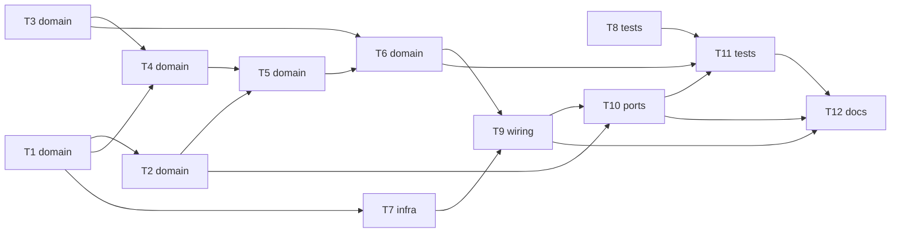

# Epic — phase3-crsf

> **Spec:** [spec.md](../spec.md) · **Design:** [sad.md](../sad.md) · **Data model:** — (легальний пропуск, схеми немає) · **API:** [contracts/cli.md](../contracts/cli.md) · **ADRs:** [adr/](../adr/)

## Goal

Розробник їздить ровером з пульта: озброює тумблером, керує правим стіком, а втрата зв'язку зупиняє ровер не пізніше ніж за 520 мс і після стабільного відновлення повертає його в DISARMED. Шум у лінії приймача не змінює стану, а вся логіка доведена хостовими тестами (spec §2).

## Scope

- **In:** компоненти `crsf` (core і HAL), `app_state` (причина FAILSAFE), `drive` (крок керування і HAL), `rover_console` (help, disarm, status), `ui_core` (лише тест виходу з FAILSAFE), `main`, хостові тести, чекліст приймання.
- **Out:** телеметрія на пульт (фаза 7), керування світлом із пульта, криві й режими швидкості, налаштування приймача й пульта (spec §3).

## Task map

## Tasks

See [tracker.md](./tracker.md) for status. Machine contract: [tasks.json](../tasks.json).

| # | Task | Layer | Blocked by | DoD (short) |
|---|---|---|---|---|
| T1 | Створити crsf_core: збирач кадрів із потоку байтів, CRC8, розпакування 16 каналів, лічильники | domain | — | `test/host/run_tests.sh` зелений, серед тестів — усі випадки з чекліста |
| T2 | Доповнити crsf_core: намір пілота (нормалізація, мертва зона, тумблер, функція фронту) і рядки status | domain | T1 | Хостові тести наміру й рядків status зелені |
| T3 | Додати в app_state причину FAILSAFE, підвищення до «напруга» і охорону переходу FAILSAFE → DISARMED | domain | — | Тести автомата зелені: 49 з 49 пар, охорона і підвищення причини |
| T4 | Розширити drive_ctl_step: стендовий режим, таймер зв'язку, втрата зв'язку в ARMED і DISARMED, відмова консолі «керує пульт» | domain | T1, T3 | Хостові тести таймера й стенду зелені |
| T5 | Розширити drive_ctl_step: озброєння фронтом тумблера з умовами, рух стіком, роззброєння тумблером і з консолі | domain | T2, T4 | Хостові тести озброєння, руху й роззброєння зелені |
| T6 | Розширити drive_ctl_step: вихід з FAILSAFE після ≥ 1 с стабільного зв'язку з тумблером у DISARM і відсічка у FAILSAFE | domain | T3, T5 | Хостові тести виходу з FAILSAFE зелені |
| T7 | Створити crsf_hal: UART2 420000 8N1, задача crsf_rx, знімок під portMUX, Task WDT | infra | T1 | `idf.py build` без помилок і нових попереджень; `check_pins.sh` чистий |
| T8 | Перевірити ui_core на виході FAILSAFE → DISARMED: блимання, писк і індикатор гаснуть, сигнал переходу звучить | tests | — | Тест виходу з FAILSAFE у `test_ui.c` зелений |
| T9 | Підключити знімок приймача в drive_hal, причину FAILSAFE, журнал подій зв'язку і crsf_start у main | wiring | T6, T7 | `idf.py build` без помилок і нових попереджень |
| T10 | Оновити консоль: help для arm і drive, відповіді disarm, рядки status про пульт через колбек rc_status | ports | T2, T9 | Тести консолі зелені |
| T11 | Прогнати хостовий раннер і перевірки конституції для phase3-crsf, закрити покриття 49 пар і 126 пар | tests | T6, T8, T10 | Усі хостові тести зелені за ≤ 5 с |
| T12 | Підготувати чекліст приймання фази 3 на залізі і місця для записів у журнал bring-up | docs | T9, T10, T11 | `acceptance.md` містить по кроку на кожен апаратний AC і запис KPI |

## Risks / Hard rules

- Конституція п. 7: STBY лише в ARMED і свідомо; втрата кадрів > 500 мс → ШІМ 0, STBY вниз (виняток стенду — spec §1 Decision override); ШІМ ≤ 0.75; VBAT < 6.0 В → мотори не стартують.
- Конституція п. 2, 6, 14: номери ліній лише в `board_pins.h`; core без ESP-IDF; `vTaskDelayUntil` у періодичних задачах.
- sad.md §11: OQ-2 (режим failsafe приймача) і OQ-3 (калібрування напруги) мають бути закриті до приймання на залізі; вихід FAILSAFE → DISARMED у `ui` раніше не виконувався (T8).
