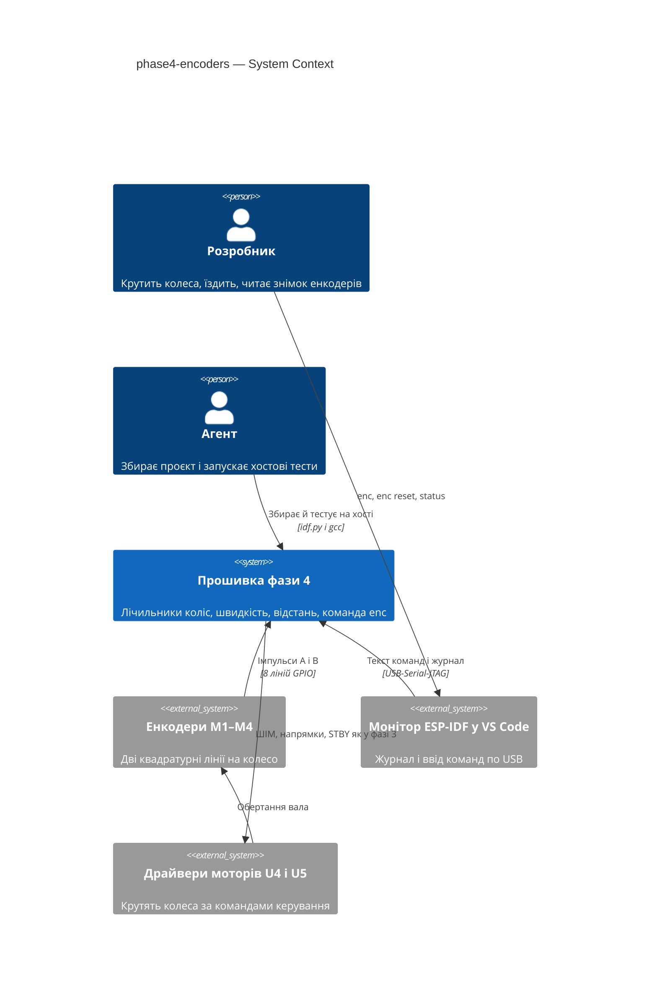
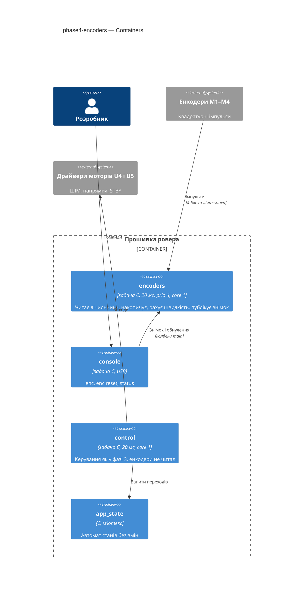
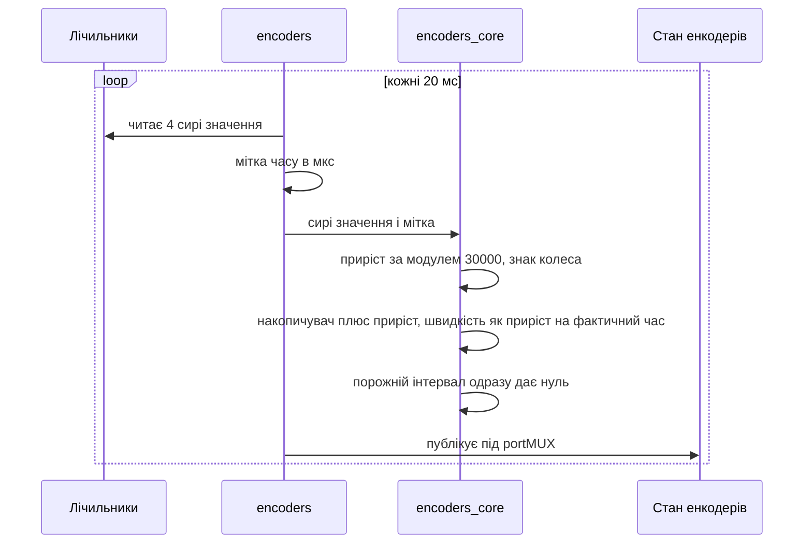
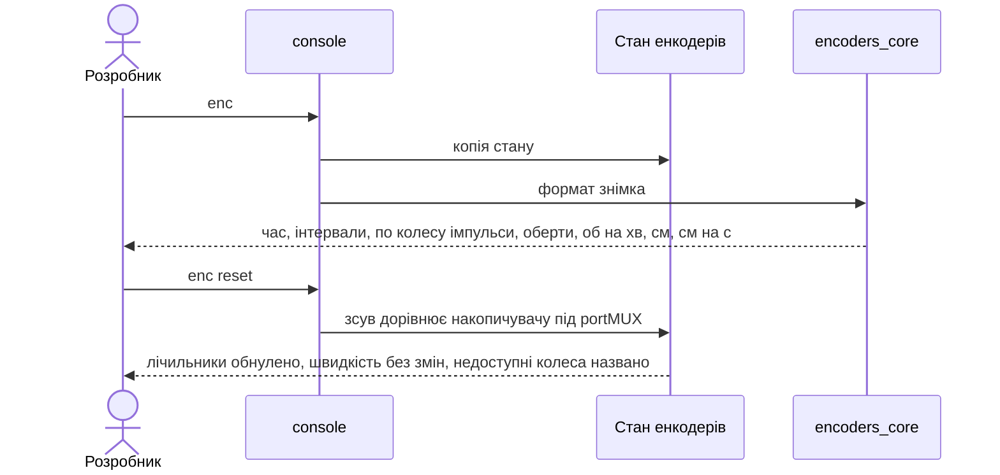
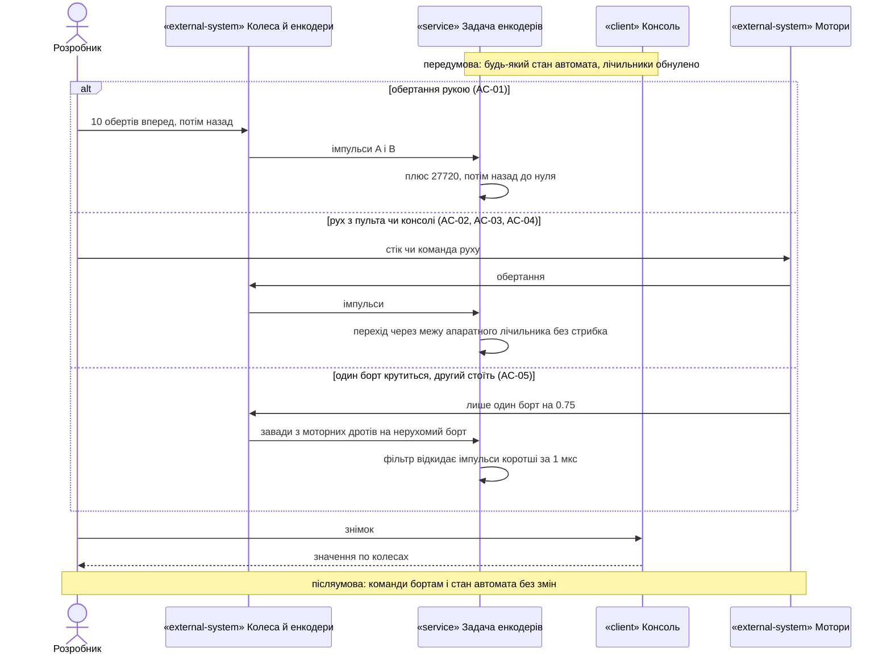
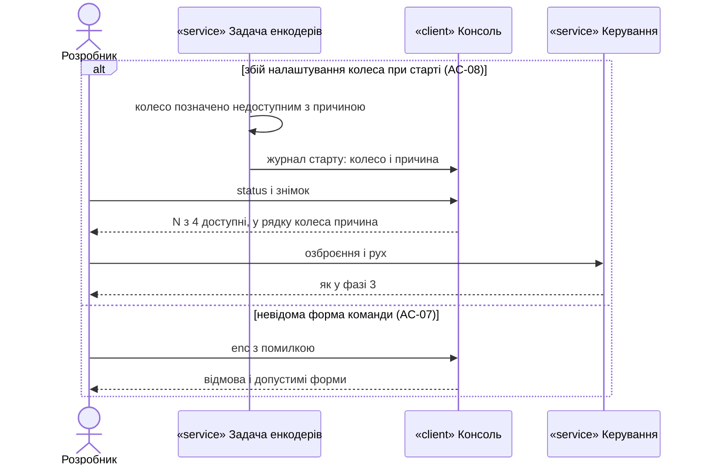

# Software Architecture Document — phase4-encoders

## 1. Introduction and goals

**Intent.** Фаза 4 дає прошивці вимірювання обертів коліс. Чотири квадратурні енкодери рахуються з повною роздільністю (2772 імпульси на оберт колеса), лічильник кожного колеса накопичується без переповнення й зі знаком «вперед = плюс», а кожні 20 мс прошивка обчислює швидкість колеса як приріст, поділений на фактичний час між вибірками. Консольна команда `enc` показує знімок чотирьох коліс в імпульсах, обертах, об/хв, сантиметрах і см/с (діаметр 44 мм), `enc reset` обнуляє лічильники. Енкодери лише вимірюють: на команди бортам, озброєння й автомат станів вони в цій фазі не впливають (spec §1, §2, §4).

**Top-3 quality goals (повні сценарії — §10):**

1. Правдивий лічильник: 10 обертів рукою → 27720 ± 2 %; 0 стрибків і 0 змін знака, поки кожне колесо набирає ≥ 100 000 імпульсів на 0.75; ≤ 4 імпульси на нерухомому колесі.
2. Правдива швидкість для фази 5: номінальний інтервал 20 мс, приріст ділиться на фактичний час; швидкість стає нулем не пізніше ніж через 40 мс після останнього імпульсу.
3. Перевірюваність: накопичення через межу, знак, швидкість, перерахунок одиниць і розбір команди тестуються на хості; залізо перевіряє лише HAL.

**Stakeholders.**

| Role | Interest | Sign-off owner? |
|---|---|---|
| Розробник | Крутить колеса рукою, їздить з пульта, читає знімок енкодерів, записує приймання в журнал bring-up | Yes |
| Агент | Збирає проєкт і доводить логіку хостовими тестами; не прошиває й не комітить без вказівки | No |

<!-- Decision overrides (¶4) — populated by the critic resolution loop, empty otherwise. -->

## 2. Constraints

**Technical.**
- C (gnu17), ESP-IDF v6.1, FreeRTOS, ціль `esp32s3`, плата YD-ESP32-S3 N16R8 (`sdkconfig.defaults` — захищений файл).
- Лише новий драйвер лічильника імпульсів `driver/pulse_cnt.h`; legacy `driver/pcnt.h` у v6 видалено (конституція, п. 5).
- Рівно 4 блоки лічильника імпульсів, і всі чотири займають енкодери (документ 02 §4.1).
- Лінії енкодерів — `PIN_ENC_FL_A` … `PIN_ENC_RR_B` у `board_pins.h` (конституція, п. 2); апаратний фільтр завад ≈ 1000 нс обов'язковий, бо лінії A/B ідуть у шлейфі з моторними дротами (документ 02 §4.8).
- Виміряні величини (`docs/measured.md`): `ENC_PULSES_PER_REV` = 2772 (×4), `ENC_NEEDS_PULLUP` = 0 (рішення D3 закрито), `ENC_DIR_SIGN` = +1, −1, +1, −1 у порядку FL, FR, RL, RR, відповідність M1 → FL, M2 → RL, M3 → FR, M4 → RR, `WHEEL_DIAMETER_MM` = 44.
- Апаратний лічильник 16-бітний (±32767); скидання в нуль на заданій межі працює лише з увімкненими порівнювачами меж — драйвер вмикає їх, коли на межі стоїть watch-point (`pulse_cnt.c`; P6 працював саме так).
- Інваріанти безпеки (конституція, п. 7) не змінюються: енкодери не керують STBY, ШІМ, озброєнням і переходами автомата.
- Task WDT 5 с з перезавантаженням (фаза 0); нова задача підписується на нього.

**Organisational.**
- Один розробник і один агент; прошивання лише розробником через VS Code (`CLAUDE.md`).
- Крок 4 у `docs/roadmap.md`; розмір S, маршрут quick.

**Conventions.**
- `docs/constitution.md`: core/HAL (п. 6), номери ліній лише в `board_pins.h` (п. 2), виміряні константи лише з `docs/measured.md` (пп. 3, 13), `vTaskDelayUntil` у періодичних задачах (п. 14), збірка без нових попереджень (п. 8), коментарі й коміти українською (п. 9).
- Єдиний писач стану й виходів моторів — задача `control` (ADR-0001 фази 1); енкодери їх не торкаються.
- Колбеки між компонентами передає `main` (`console_ops_t` фаз 0–3); дані між задачами — знімок під `portMUX` (прецедент — `crsf_snapshot_get`, ADR-0001 фази 3).
- Хостові тести: `test/host/run_tests.sh` збирає кожен `test_*.c` з усіма `components/*/*_core.c`; `check_core_headers.sh`, `check_pins.sh`, `check_delays.sh` — статичні перевірки.

**Regulatory / external.**
- N/A: немає мережі, персональних даних і регуляторних вимог (spec §6.1).

## 3. Context and scope

Розробник крутить колеса рукою або їздить з пульта чи консолі; прошивка рахує імпульси чотирьох енкодерів і на запит показує знімок у консолі. Агент збирає проєкт і запускає хостові тести. Нове в порівнянні з фазою 3: прошивка вперше читає зворотний зв'язок від коліс, але ще ним не керує.

<!-- brownfield: задачі control (20 мс, prio 5, core 1), crsf_rx (prio 6, core 1), battery (200 мс, prio 2, core 0), ui (prio 2, core 0), heartbeat, console (prio 1, core 0); компонент encoders — заглушка лише з CMakeLists.txt; PCNT у компонентах не використовується (лише tools/bringup P6: ±30000, accum_count, фільтр 1000 нс, ×4 через два канали). Карта docs/architecture-map.md (reflects_commit e35e99f) відстає від фаз 0–3 — джерелом слугували код і SAD фаз 1–3. -->

**External systems (in / out):**

| Actor or system | Type | Interaction |
|---|---|---|
| Розробник | Person | Крутить колеса, керує пультом чи консоллю; вводить `enc`, `enc reset`, `status`; записує приймання |
| Агент | Person | Збирає проєкт і запускає хостові тести |
| Енкодери M1–M4 | System (hardware) | Дві квадратурні лінії на колесо, у шлейфі з моторними дротами |
| Монітор ESP-IDF у VS Code | System (external) | Показує журнал, передає ввід через USB-Serial-JTAG |
| Драйвери моторів U4, U5 | System (hardware) | Крутять колеса за командами `control` (без змін відносно фази 3) |

**C4 Context (L1):**



Прошивка отримує імпульси від чотирьох енкодерів і віддає знімок у консоль через монітор; мотори крутять ті самі вали, що їх рахують енкодери, але команди моторам від енкодерів не залежать.

## 4. Solution strategy

**Target surface:** `cli` — як у фазах 0–3; новий вхід (енкодери) — залізо, а не поверхня.

**Top strategic choices (насіння ADR):**

1. **Власна задача `encoders` знімає лічильники** — періодична задача 20 мс (`vTaskDelayUntil`) читає чотири апаратні лічильники, ставить мітку часу, викликає чистий крок `encoders_core` і публікує знімок під `portMUX`. Енкодери працюють незалежно від `control`; фаза 5 читатиме знімок (ADR-0001).
2. **Накопичення — різниця за модулем у core** — апаратний лічильник з межами ±30000 сам скидається в нуль; `encoders_core` обчислює приріст за модулем 30000 у межах (−15000, 15000], множить на знак колеса і додає до 64-бітного накопичувача. Без переривань і без watch-point (ADR-0002).
3. **Чиста логіка окремо, HAL тонкий** — `encoders_core`: приріст за модулем, знак, накопичувач, обнулення через зсув, швидкість як приріст / фактичний час, нуль після зупинки, перерахунок в оберти, об/хв, см і см/с, доступність коліс, форматування знімка; розбір команди `enc` — у `console_core`. У HAL лише драйвер лічильника, задача, блокування й мітка часу (конституція, п. 6).

Тактичні рішення нижче мають простежуватися до цих трьох.

**Журнал припущень design (рівень easy):**

- `target_surfaces: [cli]`, як у фазах 0–3.
- Компонент `encoders` отримує `encoders_core.c`, `encoders_hal.c`, `include/encoders_core.h`, `include/encoders_hal.h`, `include/encoders_calib.h`; нових компонентів немає.
- Задача `encoders`: пріоритет 4, ядро 1 (поруч із `control` і `crsf_rx`, нижче за них; документ 02 §6.1 радить ядро 0 для всього, крім керування й радіо — відхід свідомий, бо у фазі 5 це джерело швидкості для `control`, §11), стек 3072 байти, період 20 мс через `vTaskDelayUntil`, підписана на Task WDT. Документ 02 §6.1 такої задачі не має (§11).
- Блок лічильника на колесо: межі ±30000, без `accum_count`, з watch-point на +30000 і −30000 без callback (вони лише вмикають апаратні порівнювачі меж, як у P6, тож лічильник скидається в нуль на межі; переривань немає); два канали з діями фронтів і рівнів як у P6 (×4, той самий напрямок, що дав виміряні знаки); фільтр завад 1000 нс; підтяжки не вмикаються — конфігурація ліній як у P6, на якій виміряно `ENC_NEEDS_PULLUP` = 0.
- Мітка вибірки — `esp_timer_get_time()` у мкс одразу після читання чотирьох лічильників; швидкість колеса = приріст останнього інтервалу / (мітка − попередня мітка), без утримання й усереднення; порожній інтервал одразу дає 0, тож нуль настає не пізніше ніж через 2 інтервали (40 мс) після останнього імпульсу (spec §6).
- Межа однієї вибірки: |приріст| ≤ 15000 імпульсів між двома вибірками; більший рух між вибірками неможливо відрізнити від руху назад (ADR-0002, §11). Якщо між двома вибірками минуло понад 0.75 с (15000 імпульсів за верхньої межі spec §6 — 20 000 імпульсів/с), задача пише рядок у журнал (діагностика пропуску; значення не відкидаються).
- `encoders_calib.h`: `ENC_PULSES_PER_REV 2772`, `ENC_DIR_SIGN {+1, −1, +1, −1}` (FL, FR, RL, RR), `WHEEL_DIAMETER_MM 44` — кожна з позначкою «виміряно: дата» і посиланням на `docs/measured.md`. Довжина кола = π × 44 мм обчислюється в core.
- Стан енкодерів (опублікована структура; «знімок енкодерів» — лише вивід у консоль за глосарієм): на колесо — доступність і причина (рядок назви помилки), накопичувач (`int64_t`), зсув обнулення (`int64_t`), швидкість в імпульсах за секунду; спільне — лічильник інтервалів, мітка останньої вибірки (мс від старту), ознака «задача працює». Знімок < 200 байтів, копіюється під `portMUX`.
- Обнулення: `encoders_reset()` під `portMUX` встановлює зсув = накопичувач для доступних коліс (накопичувач і швидкість не змінюються, тож стрибка швидкості немає, spec AC-09); показ = накопичувач − зсув. Відповідь `enc reset` перелічує недоступні колеса, якщо вони є (spec AC-08).
- Недоступність по колесу (spec AC-08): помилка створення блоку, каналу, фільтра чи старту позначає лише своє колесо; задача працює, поки доступне хоча б одне колесо. Якщо задачу не вдалося створити, усі колеса недоступні з причиною «задача encoders не запущена». Ровер стартує далі.
- Консоль: нова команда `CONSOLE_CMD_ENC` у `console_core`; форми «`enc`» і «`enc reset`», будь-що інше — відмова з переліком допустимих форм (spec AC-07); дозволена в усіх 7 станах (spec, матриця). Нові колбеки `console_ops_t`: `enc_snapshot(buf, n)` і `enc_reset(buf, n)` — текст відповіді форматує `encoders_core`; рядок у `status` — «енкодери: N з 4 доступні[, недоступні: …]» через `enc_status(buf, n)`.
- Формат знімка (spec, «Вміст знімка енкодерів»): рядок заголовка з часом від старту й лічильником інтервалів, далі по рядку на колесо: імпульси, оберти `%.2f`, об/хв `%.1f`, см `%.1f`, см/с `%.1f`.
- `main`: `encoders_start()` після `watchdog_start()` і до `battery_start()` — незалежно від того, чи стартує `control`; збій — рядок у журнал, ровер працює далі.
- Хостові тести: `test/host/test_encoders.c` (core) і розширення `test/host/test_console.c` (розбір `enc`, матриця дозволів 10 команд × 7 станів).

## 5. Building block view

Стиль — як у фазах 0–3: компоненти ESP-IDF, у кожного чиста логіка `<name>_core.c` без заголовків ESP-IDF і тонкий `<name>_hal.c`. Дані від енкодерів течуть в один бік: лічильники → задача `encoders` → знімок → консоль (і у фазі 5 — `control`). Зворотного впливу на керування немає.

**Internal decomposition:**

```
components/
├── encoders/
│   ├── include/encoders_core.h   # крок вибірки, приріст за модулем, знак, накопичувач, швидкість, одиниці, формат
│   ├── include/encoders_calib.h  # 2772, знаки коліс, 44 мм — «виміряно: дата»
│   ├── include/encoders_hal.h    # encoders_start(), encoders_snapshot_get(), encoders_reset()
│   ├── encoders_core.c
│   └── encoders_hal.c            # 4 блоки лічильника, фільтр, задача encoders, знімок під portMUX
├── rover_console/                # + команда enc, колбеки enc_snapshot, enc_reset, enc_status
└── board/include/board_pins.h    # PIN_ENC_* (без змін)
main/main.c                       # encoders_start(), колбеки консолі
test/host/test_encoders.c         # + розширення test_console.c
```

**C4 Container (L2):**



Нова лише задача `encoders`; `control` і `app_state` показані, щоб видно було: зв'язку з енкодерами в цій фазі немає.

## 6. Runtime view

**Critical flow 1: вибірка і накопичення**



**Critical flow 2: знімок і обнулення з консолі**



### Flow 3: ручне обертання, рух і завади



### Flow 4: недоступне колесо і помилкова команда



### Coverage: US і AC → потік

| Історія | Потоки | Критерії приймання → де показано |
|---|---|---|
| US-01 | 1, 3 | AC-01 → потік 3, гілка «рукою» |
| US-02 | 1, 2, 3 | AC-02, AC-03 → потік 3, гілка «рух»; AC-09 → потік 2 |
| US-03 | 1, 3 | AC-04 → потоки 1 і 3; AC-05 → потік 3, гілка «один борт» |
| US-04 | 2 | AC-06 → потік 2 (см і см/с у знімку) |
| US-05 | 4 | AC-07, AC-08 → потік 4 |
| US-06 | N/A | AC-10, AC-11 — збірка й хостові тести Агента, не робота прошивки |
| US-07 | N/A | AC-12 — правило процесу для Агента, не робота прошивки |

Схема даних не змінюється: знімок живе в пам'яті, без сховища.

## 7. Deployment view

<!-- N/A: reuses existing deployment unit, no infra change — та сама прошивка на тій самій платі; прошиває Розробник через VS Code. -->

**Monitoring:** знімок енкодерів (`enc`) — час від старту, лічильник інтервалів, по колесу імпульси, оберти, об/хв, см, см/с або недоступність з причиною; `status` — скільки енкодерів доступно; журнал старту — недоступні колеса з причиною.

## 8. Crosscutting concepts

| Concept | Convention | Where defined |
|---|---|---|
| Час | `esp_timer_get_time()` у HAL; core отримує мітку як вхід; беззнакова різниця | як у фазах 1–3 |
| Обмін між задачами | знімок під `portMUX` (дані від `encoders`); консоль лише читає й обнуляє через зсув | ADR-0001 фази 3; ADR-0001 цієї фази |
| Власність виходів і стану | лише `control`; енкодери не пишуть ні виходів, ні стану | ADR-0001 і ADR-0002 фази 1 |
| Помилки периферії | перевірка `esp_err_t` скрізь; збій — недоступне колесо з причиною, ніколи `abort()` | документ 02 §5 з винятком spec §1; тут |
| Калібровані константи | лише з `docs/measured.md`, у `encoders_calib.h` з датою виміру | конституція, пп. 3, 13 |
| Журнал | українською; без рядків на кожну вибірку | конституція, п. 9 |
| Тестування | core на хості з підставними сирими значеннями й мітками; HAL — приймання на залізі | конституція, п. 6 |
| Internationalisation | N/A — одна мова | — |

## 9. Architecture decisions

| # | Title | Status | Section |
|---|---|---|---|
| 0001 | Sample encoders in a dedicated 20 ms task and publish a snapshot | Accepted | §4 |
| 0002 | Accumulate counts by modular difference in encoders core | Accepted | §4 |

ADR files live under `docs/features/phase4-encoders/adr/NNNN-<title>.md`.

## 10. Quality requirements

**QG-1. Правдивий лічильник**
- **When:** Розробник крутить колесо рукою на 10 обертів; тримає стік повністю вперед і назад; крутить лише один борт на обмеженні потужності.
- **Then:** 10 обертів → 27720 ± 2 % на кожному колесі; 0 стрибків і 0 змін знака, поки кожне колесо набирає ≥ 100 000 імпульсів в один бік на 0.75 (≥ 10 с, ≤ 60 с); сумарна зміна лічильника ≤ 4 імпульси за 10 с, поки другий борт крутиться на 0.75; приріст лічильника між знімками = середнє швидкостей двох знімків × різниця часу від старту ± 5 %; без переповнення щонайменше 10^15 імпульсів у кожен бік.
- **How verify:** приймання AC-01, AC-04, AC-05 на залізі; хостовий тест накопичення через межу ±30000 у обидва боки й біля граничних значень накопичувача.

**QG-2. Правдива швидкість для фази 5**
- **When:** колесо крутиться чи зупиняється; такт задачі тремтить.
- **Then:** інтервал 20 мс; відхилення окремого інтервалу ≤ 1 мс; за 10 с — 500 ± 1 інтервалів; швидкість колеса = 0 не пізніше ніж через 2 інтервали (40 мс) після останнього імпульсу; різниця між знімками під час руху ≤ 10 % для колеса з ≥ 20 імпульсами за інтервал; середнє чотирьох коліс на відрізку 1 м по прямій — у межах ±5 % від рулетки.
- **How verify:** хостовий тест кроку `encoders_core` з підставними мітками (нерівні інтервали, зупинка); на залізі — два знімки з проміжком ≥ 10 с (лічильник інтервалів проти часу від старту), приймання AC-02 і AC-06.

**QG-3. Перевірюваність і незмінність керування**
- **When:** Агент завершує задачу фази 4; Розробник керує ровером.
- **Then:** хостовий прогін ≤ 5 с, 100 % тестів пройдено; збірка — 0 помилок, 0 нових попереджень; 0 викликів звичайної затримки в періодичних задачах; затримка «стік → борти» не гірша за фазу 3 (≤ 50 мс); вільна внутрішня пам'ять після старту ≥ 345000 байт.
- **How verify:** вивід хостового раннера, збірки й `check_delays.sh`; діагностичні мітки затримки фази 3 у журналі; `status` і запис у `docs/measured.md`.

## 11. Risks and technical debt

| Risk / debt | Severity | Mitigation | Owner |
|---|---|---|---|
| Припущення ADR-0002 «апаратний лічильник на межі ±30000 скидається в нуль, тож значення узгоджені за модулем 30000» хибне для v6.1 | Medium | Хостовий тест не покаже — лише залізо: AC-04 (≥ 100 000 імпульсів, узгодженість лічильника і швидкості ± 5 %); у разі провалу — повернутися до варіанта watch-point з ADR-0002 | Агент |
| Задача `encoders` пропускає вибірки довше, ніж колесо проходить 15000 імпульсів, і приріст читається з хибним знаком | Low | За верхньої межі spec §6 (20 000 імпульсів/с) 15000 імпульсів — ≈ 0.75 с без жодної вибірки, тобто вже зависання задачі; пропуск понад 0.75 с задача пише в журнал, Task WDT 5 с перезавантажить плату при повному зависанні. Найбільшу швидкість на 0.75 записати в `docs/measured.md` при прийманні (spec §7) | Агент |
| Задача `encoders` і `control` мають незалежні такти 20 мс: у фазі 5 швидкість для регулятора може бути до 20 мс старою | Low | Фаза 5 переглядає це в своєму SAD (ADR-0001, Consequences); у фазі 4 швидкість ніхто не споживає в контурі | Розробник |
| Повільне FR (P7): AC-02 і AC-04 можуть «не пройти» через залізо | Medium | spec AC-02, AC-04: несправність заліза записується в журнал bring-up, а не вважається провалом прошивки | Розробник |
| Документ 02 §6.1 не має задачі `encoders` і радить ядро 0 для всього, крім керування й радіо (задача `encoders` — на ядрі 1), §8.2 радить watch-point і накопичення в перериванні, §7 «Фаза 4» — інтервал апаратним таймером | Low | Відходи зафіксовано в ADR-0001 і ADR-0002; документ 02 оновлюється лише за вказівкою Розробника | Розробник |
| `docs/architecture-map.md` відстає від фаз 0–3 | Low | Запустити `/sdd:survey` після фази 4 | Розробник |

**Accepted debt (acceptable in v1, plan to fix later):**
- Знак енкодера не перевіряється проти команди бортам (виявлення заклинювання чи переплутаних дротів) — фаза 5 (spec §3).
- Лічильники не зберігаються між перезапусками (spec §3).

## 12. Glossary

Канонічні терміни — `CONTEXT.md` (Енкодер колеса, Лічильник колеса, Швидкість колеса, Пройдена відстань колеса, Зрив лічильника, Знімок енкодерів, Журнал вимірювань). Тут лише технічні терміни цього документа.

| Term | Meaning |
|---|---|
| Сире значення | Поточне показання апаратного лічильника колеса в межах ±30000; на межі скидається в нуль |
| Приріст за модулем | Різниця двох сирих значень, зведена за модулем 30000 до (−15000, 15000]: найкоротший шлях між ними |
| Накопичувач | 64-бітна сума приростів колеса зі знаком колеса від старту; показ лічильника = накопичувач − зсув |
| Зсув обнулення | Значення накопичувача в момент `enc reset`; дає нульовий показ без зміни накопичувача й швидкості |
| Стан енкодерів | Структура, яку публікує задача `encoders` під `portMUX` (накопичувачі, зсуви, швидкості, доступність); консоль форматує з неї знімок енкодерів |
| Мітка вибірки | Момент (мкс від старту), коли задача `encoders` прочитала чотири лічильники; від різниці міток рахується швидкість |
