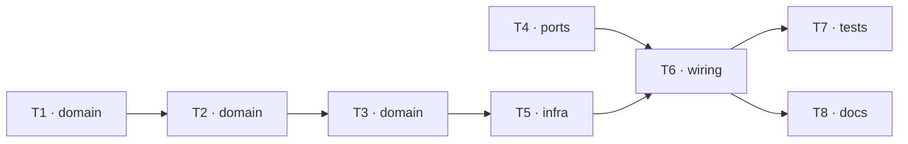

# Epic — phase4-encoders

> **Spec:** [spec.md](../spec.md) · **Design:** [sad.md](../sad.md) · **Data model:** — (легальний пропуск: зміни схеми немає) · **API:** [contracts/cli.md](../contracts/cli.md) · **ADRs:** [adr/](../adr/)

## Goal

Прошивка рахує чотири енкодери без зривів і зі знаком «вперед = плюс», кожні 20 мс обчислює швидкість кожного колеса і на команду `enc` показує лічильник, оберти, швидкість і відстань (spec §2). Фаза 5 отримує готову швидкість коліс.

## Scope

- **In:** `components/encoders/` (core і HAL), команда `enc` у `components/rover_console/`, підключення в `main/`, хостовий запобіжник констант, процедура приймання.
- **Out:** регулювання швидкості, одометрія й курс, виявлення заклинювання, телеметрія на пульт, збереження лічильників між перезапусками (spec §3).

## Task map

Паралельні гілки: T1 → T2 → T3 (логіка енкодерів) і T4 (команда консолі) стартують разом; T7 і T8 — після T6.

## Tasks

See [tracker.md](./tracker.md) for status. Machine contract: [tasks.json](../tasks.json).

| # | Task | Layer | Blocked by | DoD (short) |
|---|---|---|---|---|
| T1 | Створити encoders_core: приріст за модулем 30000, знак колеса, 64-бітний накопичувач, обнулення через зсув | domain | — | `test/host/run_tests.sh` зелений, серед тестів — усі випадки з чекліста |
| T2 | Додати в encoders_core швидкість колеса: приріст на фактичний час, нуль на порожньому інтервалі, лічильник інтервалів | domain | T1 | `test/host/run_tests.sh` зелений з тестами швидкості й лічильника інтервалів |
| T3 | Додати в encoders_core одиниці (оберти, об/хв, см, см/с), доступність коліс і тексти знімка, enc reset та рядка status | domain | T2 | `test/host/run_tests.sh` зелений з тестами одиниць, форматів і недоступності |
| T4 | Додати в console_core команду enc: дві форми, хибні аргументи, дозвіл у всіх станах, рядок help | ports | — | `test/host/run_tests.sh` зелений з тестами розбору й матриці 140 пар |
| T5 | Створити encoders_hal: 4 блоки лічильника з watch-point без callback, фільтр 1000 нс, задача 20 мс, стан під portMUX | infra | T3 | `idf.py build` без помилок і нових попереджень |
| T6 | Підключити encoders_start і колбеки enc_snapshot, enc_reset, enc_status у main | wiring | T4, T5 | `idf.py build` без помилок і нових попереджень |
| T7 | Додати check_calib.sh (константи енкодерів проти measured.md) і прогнати всі хостові запобіжники | tests | T6 | усі хостові скрипти й `run_tests.sh` зелені, `selftest_tools.sh` ловить навмисне розходження |
| T8 | Написати acceptance.md: процедура приймання фази 4 на залізі для Розробника | docs | T6 | `acceptance.md` має крок на кожну апаратну AC з очікуваним числом і місцем для запису |

## Risks / Hard rules

- Конституція: core без заголовків ESP-IDF (п. 6), піни лише в `board_pins.h` (п. 2), константи лише з `docs/measured.md` (пп. 3, 13), `vTaskDelayUntil` (п. 14), збірка без нових попереджень (п. 8).
- Скидання апаратного лічильника на межі ±30000 перевіряє лише приймання AC-04 на залізі (sad.md §11, ADR-0002).
- Повільне FR — несправність заліза, а не провал прошивки (spec AC-02, AC-04).
