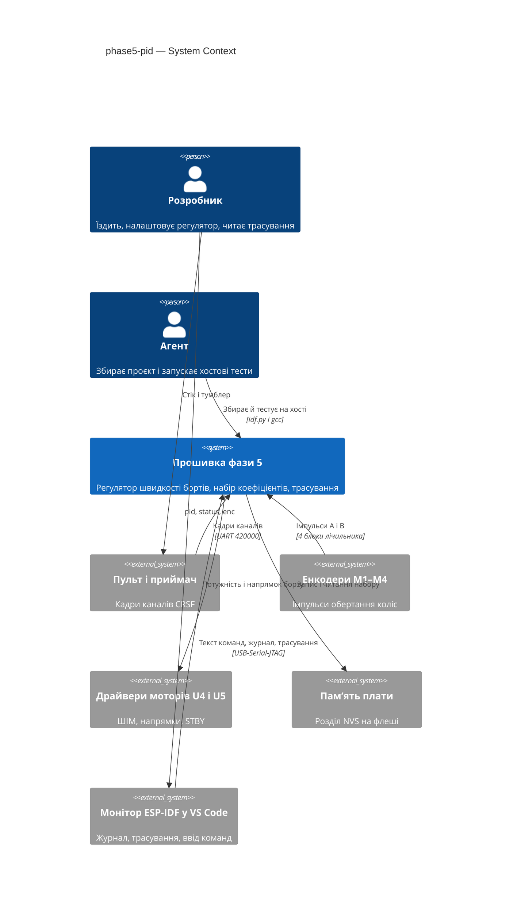
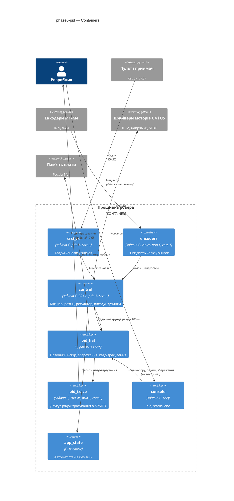
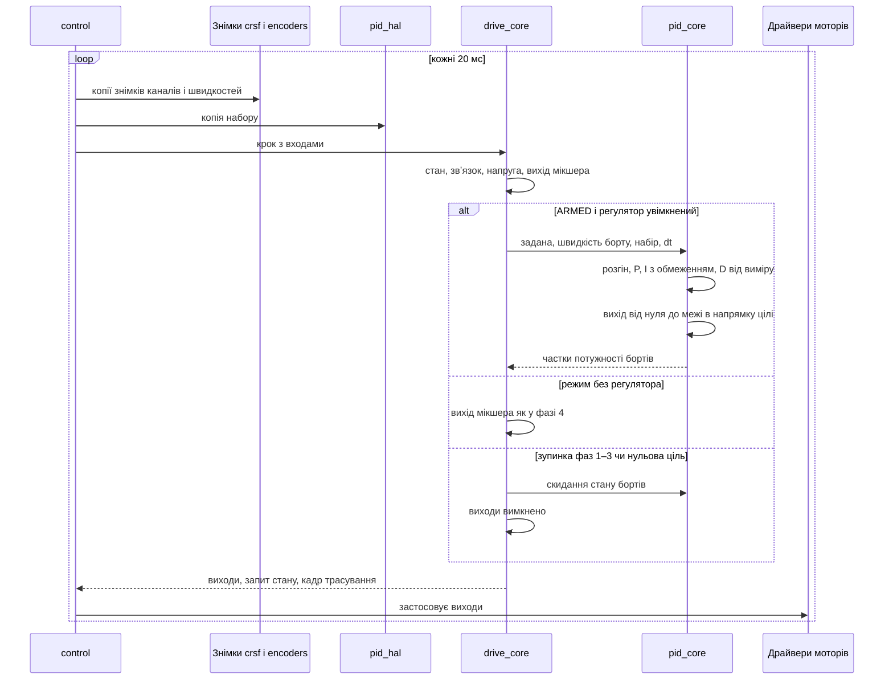
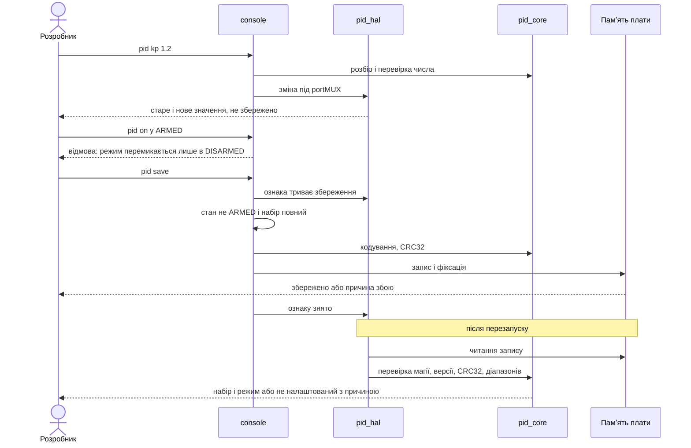
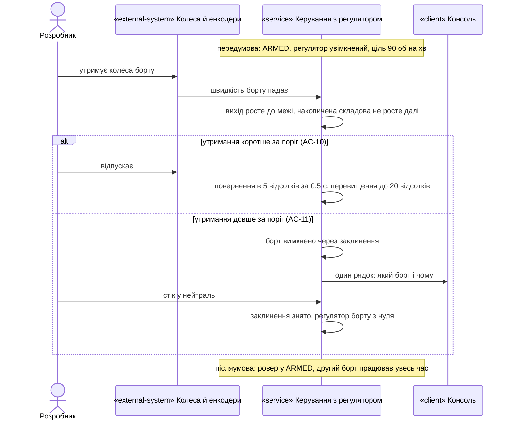
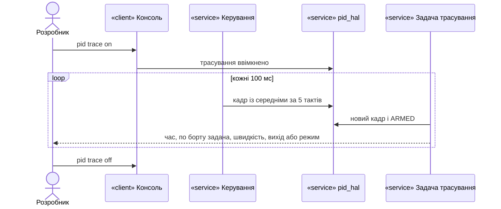

# Software Architecture Document — phase5-pid

## 1. Introduction and goals

**Intent.** Фаза 5 замикає контур швидкості. На кожен борт працює регулятор швидкості зі зворотним звʼязком від енкодерів фази 4. Стік чи стендова команда руху через мікшер фази 1 дає задану швидкість борту (повний стік — стеля 150 обертів колеса за хвилину), плавний розгін обмежує лише її зростання, а регулятор у кожному такті керування (20 мс) змінює потужність борту в межах від нуля до межі потужності в напрямку цілі. Набір коефіцієнтів (Kp, Ki, Kd, темп розгону) один на обидва борти, змінюється з консолі на ходу і зберігається разом із режимом окремою командою. Заклинений борт вимикається, борт без енкодерів їде в режимі без регулятора, а без повного набору ровер поводиться як у фазі 4. Останній крок фази — підняття межі потужності до виміряної безпечної величини (spec §1, §2, §4).

**Top-3 quality goals (повні сценарії — §10):**

1. Утримання швидкості: стала похибка ±5 % від заданої на 50–150 обертах колеса за хвилину, повернення в ±5 % за ≤ 0.5 с після навантаження, перевищення ≤ 20 %, рівність бортів ≤ 5 %, відхід ≤ 10 см на 2 м.
2. Безпека: вихід ≤ межі потужності в 100 % тактів; нульова ціль чи зупинка фаз 1–3 → нуль потужності в першому ж такті керування (≤ 20 мс); захист від заклинення ≤ поріг + 1 такт.
3. Незмінний такт і перевірюваність: затримка «кадр пульта → борти» ≤ 20 мс максимум, зокрема з увімкненим трасуванням; уся логіка регулятора тестується на хості.

**Stakeholders.**

| Role | Interest | Sign-off owner? |
|---|---|---|
| Розробник | Налаштовує набір за трасуванням, їздить з пульта, перевіряє утримання швидкості, заклинення й збереження, записує приймання в журнал bring-up і заміри в журнал вимірювань | Yes |
| Агент | Збирає проєкт і доводить логіку регулятора хостовими тестами; не прошиває, не комітить без вказівки, не підставляє невиміряних чисел | No |

<!-- Decision overrides (¶4) — populated by the critic resolution loop, empty otherwise. -->

## 2. Constraints

**Technical.**
- C (gnu17), ESP-IDF v6.1, FreeRTOS, ціль `esp32s3`, плата YD-ESP32-S3 N16R8 (`sdkconfig.defaults` — захищений файл); octal PSRAM і код у флеші: запис у флеш на час операції зупиняє кеш обох ядер.
- Сховище налаштувань — розділ NVS, ініціалізований компонентом `storage` (фаза 0; поведінка при збої ініціалізації — ADR-0004 фази 0).
- Незалежне керування колесом неможливе: один канал ШІМ і пара ліній напрямку на борт (документ 02 §2.2); таблиця істинності драйвера — документ 02 §2.3.
- Межа потужності 0.75 (`DRIVE_PWM_MAX_PERMILLE` 750 у `drive_core.h`; коментар біля константи переходить із посилання на п. 7 конституції, звідки рядок прибрано, на spec AC-09) до запису OQ-2; поріг заклинення — лише з OQ-1. Обидва числа з'являються в коді тільки після запису в `docs/measured.md` (конституція, пп. 3, 13).
- Стеля заданої швидкості 150 обертів колеса за хвилину — рішення Розробника (spec §1), не замір.
- Енкодери: швидкість колеса з задачі `encoders` (20 мс, prio 4, core 1) у знімку під `portMUX` (ADR-0001 фази 4), 2772 імпульси на оберт, знаки коліс +1, −1, +1, −1.
- Інваріанти безпеки (конституція, п. 7): STBY лише в ARMED; втрата кадрів > 500 мс → ШІМ 0, STBY вниз; VBAT < 6.0 В → мотори не запускаються. Регулятор жодного з них не обходить.
- Task WDT 5 с з перезавантаженням (фаза 0); нова задача підписується на нього.

**Organisational.**
- Один розробник і один агент; прошивання лише розробником через VS Code (`CLAUDE.md`).
- Крок 5 у `docs/roadmap.md`; розмір S, маршрут quick.

**Conventions.**
- `docs/constitution.md`: core/HAL (п. 6), номери ліній лише в `board_pins.h` (п. 2), виміряні константи лише з `docs/measured.md` (пп. 3, 13), `vTaskDelayUntil` у періодичних задачах (п. 14), збірка без нових попереджень (п. 8), коментарі й коміти українською (п. 9).
- Єдиний писач стану й виходів моторів — задача `control` (ADR-0001 і ADR-0002 фази 1); причина FAILSAFE живе в автоматі станів (ADR-0002 фази 3).
- Колбеки між компонентами передає `main` (`console_ops_t`); дані між задачами — знімок під `portMUX`.
- Хостові тести: `test/host/run_tests.sh` збирає кожен `test_*.c` з усіма `components/*/*_core.c`; `check_core_headers.sh`, `check_pins.sh`, `check_delays.sh` — статичні перевірки.

**Regulatory / external.**
- N/A: немає мережі, персональних даних і регуляторних вимог (spec §6.1).

## 3. Context and scope

Розробник їздить з пульта чи стендовою командою, налаштовує регулятор з консолі й читає трасування; прошивка перетворює стік на задану швидкість борту і тримає її за енкодерами. Агент збирає проєкт і запускає хостові тести. Нове в порівнянні з фазою 4: енкодери вперше впливають на команди бортам, а набір коефіцієнтів живе в памʼяті плати між перезапусками.

<!-- brownfield: задачі control (20 мс, prio 5, core 1; drive_ctl_step — чистий крок у drive_core), crsf_rx (prio 6, core 1), encoders (20 мс, prio 4, core 1; знімок enc_state_t під portMUX через encoders_state_get), battery (200 мс, prio 2, core 0), ui (prio 2, core 0), heartbeat, console (prio 1, core 0); компонент pid — заглушка лише з CMakeLists.txt; storage ініціалізує NVS, але жоден компонент у ньому ще нічого не зберігає. Стендова команда руху зараз фіксує виходи раз на прийняту команду (drive_ctl_t.outputs) на вікно 2 с. Карта docs/architecture-map.md (reflects_commit e35e99f) відстає від фаз 0–4 — джерелом слугували код і SAD фаз 1–4. -->

**External systems (in / out):**

| Actor or system | Type | Interaction |
|---|---|---|
| Розробник | Person | Керує пультом чи консоллю; вводить `pid …`, `status`, `enc`; притискає й утримує колеса; записує приймання і заміри |
| Агент | Person | Збирає проєкт і запускає хостові тести |
| Пульт і приймач | System (hardware) | Кадри каналів CRSF: стік і тумблер озброєння (без змін від фази 3) |
| Енкодери M1–M4 | System (hardware) | Імпульси обертання коліс — тепер зворотний звʼязок регулятора |
| Драйвери моторів U4, U5 | System (hardware) | ШІМ, напрямки, STBY — тепер від регулятора |
| Памʼять плати (розділ NVS) | System (hardware) | Зберігає набір коефіцієнтів і режим між перезапусками |
| Монітор ESP-IDF у VS Code | System (external) | Журнал, трасування й ввід команд через USB-Serial-JTAG |

**C4 Context (L1):**



Прошивка отримує стік від пульта чи консолі і швидкості коліс від енкодерів, а віддає потужність бортам; набір коефіцієнтів читається з памʼяті плати при старті й записується туди лише на команду збереження.

## 4. Solution strategy

**Target surface:** `cli` — як у фазах 0–4; нові входи (енкодери як зворотний звʼязок, памʼять плати) — залізо, а не поверхня.

**Top strategic choices (насіння ADR):**

1. **Регулятор — частина кроку `control`, швидкість — зі знімка енкодерів.** `control` у кожному такті копіює опублікований знімок `encoders`, а чистий крок `drive_ctl_step` викликає `pid_core` для кожного борту перед тим, як порахувати виходи. Зупинки фаз 1–3 скидають регулятор у тому самому кроці; задачі й такти не змінюються (ADR-0001).
2. **Набір у памʼяті плати — один запис із версією і контрольною сумою.** Kp, Ki, Kd, темп розгону і режим лежать одним двійковим записом (blob) з магічним числом, версією формату і CRC32 під одним ключем; перевірка й кодування — у `pid_core`, тож AC-07 перевіряється на хості (ADR-0002).
3. **Трасування друкує окрема задача низького пріоритету.** `control` лише накопичує середні за 100 мс і публікує кадр трасування; задача `pid_trace` (core 0, prio 1) форматує й друкує, тож повільний USB не торкається такту керування (ADR-0003).

Тактичні рішення нижче мають простежуватися до цих трьох.

**Журнал припущень design (рівень easy):**

- `target_surfaces: [cli]`, як у фазах 0–4.
- Компонент `pid` отримує `pid_core.c`, `pid_hal.c`, `include/pid_core.h`, `include/pid_hal.h`, `include/pid_calib.h`; `drive`, `rover_console`, `main` розширюються; нових компонентів немає. `drive` залежить від `pid` і `encoders` (лише їхніх `_core.h`).
- `pid_core` (без заголовків ESP-IDF): тип набору `pid_set_t` (kp, ki, kd, ramp, режим, ознаки «задано» для кожного з чотирьох чисел, ознака «збережено»); стан борту `pid_side_t` (задана після розгону, накопичена складова, попередня швидкість борту для D, ознака «попередній відлік є», таймер заклинення, ознака «вимкнено через заклинення»); функції: швидкість борту з двох коліс (середнє доступних, за одним, або «немає»), розгін, крок регулятора, детектор заклинення, скидання, кодування й перевірка запису, CRC32, форматування рядка трасування і показу стану.
- Крок регулятора (spec «Поведінка регулятора», §6 «Такт регулятора»): P, I і D оновлюються лише тоді, коли у знімку енкодерів зʼявився новий інтервал (змінився лічильник інтервалів); між новими знімками вихід регулятора тримається, а нульова ціль і зупинки діють у кожному такті `control`. Похибка e = задана − швидкість борту (об/хв, зі знаком цілі); dt — різниця міток двох останніх інтервалів енкодерів у секундах, обмежена 10…40 мс; накопичена складова I += Ki·e·dt, а коли вихід уже на межі (чи на нулі) і e тисне далі в насичення, I не змінюється в цей бік; D = −Kd·(швидкість − попередня)/dt, у першому такті після скидання D = 0; вихід = Kp·e + I + D, обмежений [0, межа] у напрямку цілі. Нульова ціль → вихід 0 і скидання стану борту.
- Розгін: модуль заданої після розгону зростає не більше ніж на ramp·dt за такт; зменшення модуля і зміна знака проходять через нуль одразу (spec AC-13).
- Задана швидкість: вихід мікшера `drive_mix` × `PID_TARGET_MAX_RPM` (150, у `pid_core.h` з коментарем «рішення Розробника, 2026-10-19»), стік у нейтралі (мертва зона фази 3) → 0.
- Швидкість колеса зі знімка: `speed_pps` × 60 / 2772 (через `enc_core_rpm`). Знімок старший за 100 мс (задача `encoders` зависла чи не стартувала) → обидва борти в режимі без регулятора до оновлення, один рядок у журнал (рішення Розробника на design, 2026-10-20; spec AC-12b). Задача `encoders` може працювати без Task WDT (`encoders_hal.c`), тож цей відкат — єдиний захист від зависання енкодерів.
- Режим борту: «за двома колесами» / «за одним колесом» / «без регулятора» / «вимкнено через заклинення». Режим регулятора (увімкнений/вимкнений/не налаштований) фіксується в момент переходу в ARMED і до роззброєння не змінюється (spec AC-15 дозволяє перемикання лише в DISARMED; фіксація закриває гонку між перевіркою стану в консолі і переходом).
- Заклинення: |вихід| ≥ 98 % межі і |швидкість борту| < 10 % |заданої| безперервно ≥ `PID_STALL_MS`; таймер скидається, щойно умова зникла хоч в одному такті; знімається, коли задана після розгону стала нулем. До закриття OQ-1 код детектора і символи `PID_STALL_*` не пишуться взагалі (spec §1, override; AC-19); задача детектора стартує лише після запису порогу, і тоді `PID_STALL_MS` у `pid_calib.h` має позначку «виміряно: дата».
- Стендова команда руху: `drive_ctl_t` зберігає вихід мікшера (ліве, праве) на вікно 2 с замість фіксованих виходів, і `control` перераховує виходи кожен такт (з регулятором чи без); у режимі без регулятора виходи дорівнюють фазі 4 (`drive_outputs_from` від виходу мікшера). Вихід регулятора (частка потужності зі знаком цілі, |v| ≤ межі) подається в той самий `drive_outputs_from`, тож нової функції виходів немає.
- Межа потужності: на задачі підняття `DRIVE_PWM_MAX_PERMILLE` переїжджає в `drive_calib.h` зі значенням OQ-2 і позначкою «виміряно: дата»; консоль її не змінює (spec AC-09).
- Обмін набором: `pid_hal` тримає поточний `pid_set_t` під `portMUX`; консоль змінює його через колбеки; `control` копіює набір кожен такт (зміна діє з наступного такту, spec AC-03). Бо накопичується Ki·e·dt, зміна Ki не дає стрибка (spec «Поведінка регулятора»).
- Консоль: `CONSOLE_CMD_PID` у `console_core`; форми `pid`, `pid kp|ki|kd|ramp <число>`, `pid on`, `pid off`, `pid save`, `pid trace on`, `pid trace off`; `pid limit …` і будь-яка спроба змінити межу — окрема відмова (spec AC-09); решта — відмова з переліком форм (spec AC-04). Матриця дозволів (spec §5) — у `console_core` за станом автомата. Нові колбеки `console_ops_t`: `pid_show`, `pid_set_param`, `pid_set_mode`, `pid_save`, `pid_trace`.
- Збереження: `pid save` у задачі `console` — перевірка повноти набору, кодування в core, `nvs_set_blob` + `nvs_commit` у просторі `pid`, ключ `set`; збій — повідомлення з назвою помилки, набір у сеансі лишається «не збережено» (spec AC-08). Заборона в ARMED і OBSTACLE_HOLD — за матрицею (запис у флеш зупиняє кеш, тож пригальмував би такт керування). Щоб закрити гонку між перевіркою стану й записом, консоль під `portMUX` спершу ставить ознаку «триває збереження», потім перевіряє стан; поки ознака стоїть, `control` відхиляє озброєння (з пульта й консолі) з причиною «триває збереження набору»; ознака знімається після `nvs_commit` (spec AC-15).
- Старт: `pid_hal_init()` у `main` після `storage_init()` і до старту `control`: читає запис, `pid_core` перевіряє магію, версію, розмір, CRC32, скінченність і діапазони; невдача — «регулятор не налаштований» і рядок журналу з причиною (spec AC-07).
- Трасування: `control` накопичує за 5 тактів суми заданої, швидкості й виходу по борту, кожні 100 мс публікує кадр (час від старту плати в мс, середні, вихід мікшера для борту без регулятора, режими бортів, ознака ARMED, номер кадру) під `portMUX`; задача `pid_trace` (prio 1, core 0, стек 3072, 100 мс через `vTaskDelayUntil`, Task WDT) друкує новий кадр, якщо трасування ввімкнене і ровер в ARMED (ADR-0003).
- Журнал: одна подія — один рядок (заклинення борту, відкат на режим без регулятора, завантаження набору при старті); без рядків на кожен такт поза трасуванням.
- Хостові тести: `test/host/test_pid.c` (core), розширення `test/host/test_drive.c` (крок з регулятором лише на новому знімку, скидання при кожній зупинці, стендова команда, відкат при застарілому знімку, відмова озброєння під час збереження) і `test/host/test_console.c` (форми `pid`, матриця 16 команд × 7 станів).

## 5. Building block view

Стиль — як у фазах 0–4: компоненти ESP-IDF, у кожного чиста логіка `<name>_core.c` без заголовків ESP-IDF і тонкий `<name>_hal.c`. Контур замикається всередині кроку `control`: знімок енкодерів і копія набору входять у `drive_ctl_step`, той викликає `pid_core` і повертає виходи. Набір змінює консоль, зберігає `pid_hal`, друкує трасування окрема задача.

**Internal decomposition:**

```
components/
├── pid/
│   ├── include/pid_core.h   # набір, стан борту, крок, розгін, заклинення, запис і CRC32, формат
│   ├── include/pid_calib.h  # PID_STALL_ENABLED / PID_STALL_MS — лише після OQ-1, «виміряно: дата»
│   ├── include/pid_hal.h    # pid_hal_init(), набір під portMUX, збереження, кадр трасування, pid_trace_start()
│   ├── pid_core.c
│   └── pid_hal.c            # NVS, portMUX, задача pid_trace
├── drive/                   # drive_ctl_step: вихід мікшера → задана → pid_core → виходи; скидання при зупинках
├── encoders/                # без змін (знімок читає control)
├── rover_console/           # + команда pid, матриця дозволів
main/main.c                  # pid_hal_init(), pid_trace_start(), колбеки консолі
test/host/test_pid.c         # + розширення test_drive.c, test_console.c
```

**C4 Container (L2):**



Нові лише `pid_hal` і задача `pid_trace`; `control` отримує новий вхід (знімок енкодерів, набір) і новий вихід (кадр трасування), а `encoders`, `crsf_rx` і `app_state` не змінюються.

## 6. Runtime view

**Critical flow 1: такт керування з регулятором**



**Critical flow 2: набір з консолі, збереження і старт**



### Flow 3: заклинення і утримання колеса



### Flow 4: трасування



### Coverage: US і AC → потік

| Історія | Потоки | Критерії приймання → де показано |
|---|---|---|
| US-01 | 1, 4 | AC-01 → потік 1, гілка «ARMED і регулятор», вимір — потік 4 |
| US-02 | 1, 4 | AC-02 → потік 1; відхід — рулетка |
| US-03 | 2, 4 | AC-03, AC-04 → потік 2; AC-05 → потік 4; AC-15 → потік 2 (відмова pid on у ARMED, перевірка стану й ознака збереження); AC-16 → потік 1, гілка «без регулятора» |
| US-04 | 2 | AC-06, AC-07, AC-08 → потік 2 |
| US-05 | 1, 3 | AC-09 → потік 1 (обмеження виходу); AC-10, AC-11 → потік 3; AC-12, AC-12b → потік 1, гілка «без регулятора» |
| US-06 | 1 | AC-13 → потік 1 (розгін, нульова ціль); AC-14 → потік 1, гілка «зупинка» |
| US-07 | 1 | AC-17 → потік 1 з новою межею |
| US-08 | N/A | AC-18, AC-19 — збірка й хостові тести Агента, не робота прошивки |
| US-09 | N/A | AC-20 — правило процесу для Агента, не робота прошивки |

**Схема даних.** Новий запис у памʼяті плати: простір `pid`, ключ `set`, один blob (ADR-0002): магічне число, версія формату 1, kp, ki, kd, ramp (float32), режим (u8), CRC32 по всіх попередніх полях. Інших змін зберігання немає.

## 7. Deployment view

<!-- N/A: reuses existing deployment unit, no infra change — та сама прошивка на тій самій платі; прошиває Розробник через VS Code. Перший старт після фази 4 не має запису набору і дає «регулятор не налаштований» (spec AC-07). -->

**Monitoring:** трасування регулятора (`pid trace on`) — 10 рядків за секунду в ARMED; `pid` — режим, набір із позначкою «збережено», по борту задана, швидкість, вихід і режим борту; журнал старту — завантажений набір або причина відкидання; журнал — рядок на кожне заклинення і відкат на режим без регулятора.

## 8. Crosscutting concepts

| Concept | Convention | Where defined |
|---|---|---|
| Час | `esp_timer_get_time()` у HAL; core отримує мітки й dt як вхід | як у фазах 1–4 |
| Обмін між задачами | знімки під `portMUX` (канали, швидкості, набір, кадр трасування); `control` лише копіює | ADR-0001 фази 3, ADR-0001 фази 4, ADR-0001 і ADR-0003 цієї фази |
| Власність виходів і стану | лише `control`; регулятор — чиста функція в його кроці | ADR-0001 і ADR-0002 фази 1; ADR-0001 цієї фази |
| Помилки периферії | `esp_err_t` скрізь; збій NVS — повідомлення з назвою помилки, ніколи `abort()` | документ 02 §5 з винятками spec §1 |
| Калібровані константи | лише з `docs/measured.md`, у `*_calib.h` з датою виміру; стеля 150 — рішення Розробника з датою | конституція, пп. 3, 13 |
| Постійні налаштування | один версійований запис із CRC32 на компонент | ADR-0002 цієї фази |
| Журнал | українською; подія — один рядок; трасування лише з окремої задачі | конституція, п. 9; ADR-0003 |
| Тестування | core на хості з підставними мітками і знімками; HAL — приймання на залізі | конституція, п. 6 |
| Internationalisation | N/A — одна мова | — |

## 9. Architecture decisions

| # | Title | Status | Section |
|---|---|---|---|
| 0001 | Run the speed regulator inside the control step from the encoder snapshot | Accepted | §4 |
| 0002 | Store the coefficient set as one versioned CRC-checked NVS record | Accepted | §4 |
| 0003 | Print the regulator trace from a low-priority task | Accepted | §4 |

ADR files live under `docs/features/phase5-pid/adr/NNNN-<title>.md`.

## 10. Quality requirements

**QG-1. Утримання швидкості**
- **When:** Розробник тримає стік нерухомо (≈ 90 обертів колеса за хвилину), притискає колесо пальцем і відпускає; їде 2 м по прямій на ≈ 75 і ≈ 120 обертах; утримує колесо коротше за поріг заклинення.
- **Then:** стала похибка швидкості борту ±5 % від заданої на 50–150 обертах колеса за хвилину, поки вихід не на межі потужності; повернення в ±5 % заданої ≤ 0.5 с після притиснення і після відпускання; перевищення ≤ 20 % заданої; швидкості бортів при однаковій заданій відрізняються ≤ 5 %; відхід ≤ 10 см на 2 м по прямій на ≈ 75 і ≈ 120 обертах колеса за хвилину.
- **How verify:** трасування й рулетка, приймання AC-01, AC-02, AC-10; хостовий тест кроку регулятора з підставною моделлю борту.

**QG-2. Безпека регулятора**
- **When:** будь-який набір, повний стік, заблоковане колесо, будь-яка зупинка фаз 1–3, нульова ціль.
- **Then:** 20 мс, той самий такт керування, що й інтервал швидкості фази 4; регулятор використовує останній знімок енкодерів, не старший за один такт (20 мс), і оновлює P, I, D лише на новому знімку; вихід ≤ межі в 100 % тактів; межа 0.75 до запису OQ-2; нульова ціль чи зупинка фаз 1–3 → нуль потужності в першому ж такті керування (≤ 20 мс); втрата звʼязку — як у фазі 3 (0.5 с); темп зростання заданої швидкості ≤ темпу з набору з точністю до одного такту; захист від заклинення ≤ поріг заклинення + 1 такт (поріг — OQ-1, OQ-2).
- **How verify:** хостові тести `test_pid.c` і `test_drive.c`; трасування AC-09, AC-13, AC-14; приймання AC-11.

**QG-3. Незмінний такт, налаштування і перевірюваність**
- **When:** Розробник їде з увімкненим трасуванням, змінює коефіцієнт у ARMED, зберігає набір і перезапускає плату; Агент завершує задачу фази 5.
- **Then:** затримка «кадр пульта → борти» ≤ 20 мс максимум, зокрема з увімкненим трасуванням; 10 рядків трасування за секунду, 100 ± 2 за 10 с у ARMED; зміна коефіцієнта діє з наступного такту керування; 100 % збережених наборів відновлюються після перезапуску, пошкоджений запис → «не налаштований»; 0 викликів звичайної затримки в періодичних задачах; хостовий прогін ≤ 5 с, 100 % тестів пройдено; збірка — 0 помилок, 0 нових попереджень; вільна внутрішня памʼять після старту ≥ 345000 байт.
- **How verify:** діагностичні мітки фази 3 у журналі монітора; лічба рядків трасування (AC-05); приймання AC-06; хостовий тест AC-07; вивід раннера, збірки й `check_delays.sh`; `status` і запис у `docs/measured.md`.

## 11. Risks and technical debt

| Risk / debt | Severity | Mitigation | Owner |
|---|---|---|---|
| Такти `encoders` і `control` незалежні: швидкість у регуляторі до 20 мс стара, затримка контуру до двох тактів обмежує Kp і Kd | Medium | Крок лише на новому знімку, D від виміру, dt із міток енкодерів; якщо AC-01 не тримає 0.5 с — перейти на варіант із ADR-0001 (вибірка в такті `control`) | Агент |
| Захист від заклинення не діє до запису порогу (OQ-1) | Medium | `PID_STALL_ENABLED` = 0 до OQ-1; задачі з детектором не стартують без запису; утримання колеса до того обмежене межею потужності | Розробник |
| OQ-1: поріг часу заклинення на 0.75 | Open question | Замір чинною прошивкою фази 4 (spec §8) | Розробник, до `/sdd:tasks` |
| OQ-2: безпечна межа потужності вище 0.75 і поріг заклинення на ній | Open question | Діагностична прошивка після приймання регулятора на 0.75 (spec §8) | Розробник, до задачі підняття межі |
| Запис у флеш зупиняє кеш обох ядер на час `nvs_commit` | Low | Збереження заборонене в ARMED і OBSTACLE_HOLD (матриця spec §5); у DISARMED виходи вимкнені | Агент |
| Повільний USB під трасуванням | Low | Друк лише в задачі `pid_trace` (ADR-0003); пропущений кадр не блокує `control`; допуск 100 ± 2 | Агент |
| Правий борт (повільне FR) упирається в межу 0.75 на високій заданій — нерівність на повному стіку до OQ-2 | Medium | spec §3 non-goal; AC-17 після підняття межі | Розробник |
| Один замовклий енкодер на ходу не виявляється | Low | spec §3 non-goal; вихід обмежений межею потужності | Розробник |
| Відкат на режим без регулятора, коли знімок енкодерів застарів понад 100 мс (100 мс — рішення Розробника, не замір) | Low | spec AC-12b, рядок у журналі, хостовий тест | Розробник |
| `docs/architecture-map.md` відстає від фаз 0–4 | Low | Запустити `/sdd:survey` після фази 5 | Розробник |

**Accepted debt (acceptable in v1, plan to fix later):**
- Один набір на обидва борти (spec §3).
- Немає активного гальмування регулятором (spec «Поведінка регулятора»).
- Формат запису набору версії 1 без правил міграції — нова версія відкидає старий запис як «не налаштований» (ADR-0002).

## 12. Glossary

Канонічні терміни — `CONTEXT.md` (Регулятор швидкості, Швидкість борту, Задана швидкість борту, Стеля заданої швидкості, Межа потужності, Набір коефіцієнтів, Плавний розгін, Режим без регулятора, Заклинення борту, Трасування регулятора). Тут лише технічні терміни цього документа.

| Term | Meaning |
|---|---|
| Стан борту регулятора | Задана після розгону, накопичена складова, попередня швидкість борту для D, таймер і ознака заклинення; скидається при нульовій цілі й кожній зупинці |
| Накопичена складова | Сума Ki·похибка·dt; обмежена так, що не росте в бік насичення, коли вихід на межі чи на нулі |
| Режим борту | За двома колесами, за одним колесом, без регулятора або вимкнено через заклинення |
| Запис набору | Blob у просторі NVS `pid`, ключ `set`: магія, версія, чотири числа, режим, CRC32 |
| Кадр трасування | Час від старту плати, середні за 5 тактів задана, швидкість і вихід по борту (для борту без регулятора — вихід мікшера), режими бортів, ознака ARMED і номер кадру; публікує `control`, друкує `pid_trace` |
