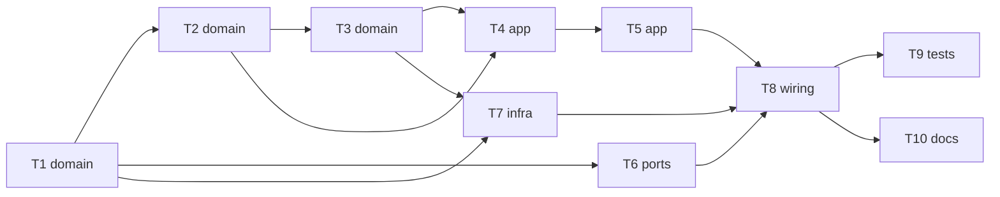

# Epic — phase5-pid

> **Spec:** [spec.md](../spec.md) · **Design:** [sad.md](../sad.md) · **ADRs:** [adr/](../adr/) · Data model і API — N/A (маршрут quick: сховища БД і мережевого API немає; запис набору — `sad.md` §6)

## Goal

Кожен борт тримає задану стіком швидкість під навантаженням, а однаковий стік дає однакову швидкість обох бортів. Розробник налаштовує регулятор з консолі на ходу, бачить трасування і зберігає набір між перезапусками; без повного набору ровер поводиться як у фазі 4 (spec §2).

## Scope

- **In:** `components/pid/` (core і HAL), `components/drive/` (крок керування), `components/rover_console/` (команда `pid`), `main/main.c`, хостові тести й перевірки, процедура приймання.
- **Out:** захист від заклинення борту і підняття межі потужності вище 0.75 (винесено з фази 5, spec §3); окремі набори на борти; автоматичний підбір коефіцієнтів; телеметрія на пульт (spec §3).

## Task map

## Tasks

See [tracker.md](./tracker.md) for status. Machine contract: [tasks.json](../tasks.json).

| # | Task | Layer | Blocked by | DoD (short) |
|---|---|---|---|---|
| T1 | Створити pid_core: набір коефіцієнтів, перевірка чисел, запис із версією і CRC32 | domain | — | Хостові тести набору й запису зелені; core без заголовків ESP-IDF; збірка без попереджень |
| T2 | Додати в pid_core крок регулятора: задана з мікшера, розгін, P/I/D, вихід у напрямку цілі, швидкість борту | domain | T1 | Хостові тести кроку, розгону, насичення, знака виходу зелені |
| T3 | Додати в pid_core кадр трасування і тексти: рядок трасування, показ стану регулятора | domain | T2 | Тести формату трасування й показу стану зелені |
| T4 | Вбудувати регулятор у drive_ctl_step: задана щотакту, крок лише на новому знімку, фіксація режиму при озброєнні | app | T2, T3 | Тести кроку керування з регулятором зелені, тести фаз 1–4 не зламані |
| T5 | Додати в drive_ctl_step відкати і зупинки: недоступні енкодери, застарілий знімок, скидання при зупинках, відмова озброєння під час збереження | app | T4 | Тести відкатів, скидання при зупинках і відмови озброєння зелені |
| T6 | Додати в console_core команду pid: форми, відмови, матриця дозволів за станом | ports | T1 | Тести форм pid і матриці 16×7 зелені |
| T7 | Створити pid_hal: набір під portMUX, завантаження й збереження в NVS, задача pid_trace | infra | T1, T3 | Збірка без попереджень; check_delays чистий; HAL — приймання T10 |
| T8 | Підключити регулятор: drive_hal подає знімок і набір, main стартує pid_hal і pid_trace, колбеки консолі | wiring | T5, T6, T7 | Прошивка збирається без попереджень; хостові тести зелені |
| T9 | Посилити хостові перевірки: межа потужності 750, core без ESP-IDF, повний прогін з test_pid.c | tests | T8 | Усі статичні перевірки й хостовий прогін зелені |
| T10 | Написати acceptance.md: процедура приймання фази 5 на залізі для Розробника | docs | T8 | Процедура покриває апаратні AC і KPI |

## Risks / Hard rules

- Вихід регулятора ≤ межі потужності 0.75 в 100 % тактів; межа не змінюється з консолі (spec §6, AC-09).
- Нульова ціль чи зупинка фаз 1–3 → нуль потужності в першому ж такті (spec §6 «Зупинка»).
- Core без заголовків ESP-IDF, `vTaskDelayUntil` у періодичних задачах, збірка без нових попереджень (конституція, пп. 6, 8, 14).
- Без захисту від заклинення заблокований борт тримає 0.75 — приймання утримання колеса не довше 2 с (sad §11).
- Агент не прошиває, не комітить без вказівки; апаратні задачі закриває лише запис Розробника в журнал bring-up (spec AC-20).
