# Software Architecture Document — phase6-tof

## 1. Introduction and goals

**Intent.** Фаза 6 дає роверу очі: чотири далекоміри стають двома секторами (передній і задній), а сектор, зайнятий ближче за поріг 170 мм, обнуляє тягу в його бік. Озброєний ровер у такому стані перебуває в OBSTACLE_HOLD, виїжджає назад чи розвертається на місці тим самим стіком і сам повертається в ARMED, коли сектор вільний. Відмова далекоміра (вийнятий шлейф, завислий обмін) не зупиняє й не вішає прошивку: сектор не вважається зайнятим через нього, а повернути датчик у роботу можна командою консолі в DISARMED. Опитування далекомірів ведеться окремою задачею, рішення про обмеження руху й переходи стану ухвалює крок `control`, а розширювач портів стає єдиним власником байта, що тримає і світло, і лінії скидання датчиків.

**Top-3 quality goals (повні сценарії — §10):**

1. Зупинка перед перешкодою: нуль обом бортам ≤ 250 мс після першого відліку, меншого за поріг; ровер не торкається стіни (10 заїздів з 10).
2. Безпека в новому стані: відсічка по напрузі (6.0 В), втрата звʼязку (0.5 с), роззброєння й STBY діють в OBSTACLE_HOLD так само, як в ARMED; таблиця переходів — рівно 12 пар із 49.
3. Живучість до відмови датчика: вийнятий або завислий далекомір не зупиняє і не вішає прошивку (затримка «кадр пульта → борти» ≤ 20 мс, відмова виявляється за 250 мс), а датчик повертається командою в DISARMED.

**Stakeholders.**

| Role | Interest | Sign-off owner? |
|---|---|---|
| Розробник | Їздить пультом і з консолі, перевіряє зупинку й відмову датчика на залізі, пише приймання в журнал bring-up і заміри в журнал вимірювань | Yes |
| Агент | Збирає проєкт, доводить логіку хостовими тестами; не прошиває, не підставляє поріг і не комітить без вказівки | No |

**Decision override (2026-10-21, design/critic): задачу `sensors` не підписано на Task WDT попри документ 02 §5 («підписані всі періодичні задачі») — rationale:** власник обрав не підписувати: перезавантаження на ходу гірше за мовчазну втрату захисту з попередженням. Завислу задачу ловить вік знімка (250 мс → сектори «не охороняються», рядок журналу), транзакції обмежені 10 мс.

## 2. Constraints

**Technical.**
- C (gnu17), ESP-IDF v6.1, FreeRTOS, ціль `esp32s3`, плата YD-ESP32-S3 N16R8 (`sdkconfig.defaults` — захищений файл).
- Шина периферії: `i2c_master`, 100 кГц, підвищувати заборонено (конституція, п. 14); на шині розширювач портів 0x20 і до чотирьох далекомірів; один мʼютекс `i2c_bus_lock` на всі пристрої (ADR-0001 фази 2).
- Чотири VL53L0X мають однакову заводську адресу 0x29; адреси 0x30…0x33 живуть до скидання датчика, тож процедуру треба повторювати при кожному старті (документ 02 §4.7). Лінії скидання (XSHUT) сидять на розширювачі: біти 0, 1, 2 і 4 (`IOEXP_BIT_XSHUT_*`); біт 3 — фари, 5 і 6 — задні ліхтарі.
- Далекоміри (журнал вимірювань, P4): U7 — вперед ліворуч під 45°, U8 — прямо вперед, U9 — вперед праворуч під 45°, U10 — прямо назад; бокового покриття немає; «поза діапазоном» віддається значенням 8190 мм; точність ≈ +12…−7 мм на 100 мм; ближче 40 мм поведінка не виміряна.
- Драйвер VL53L0X — мінімальний власний (рішення D4 закрито в P4); діагностична версія — `tools/bringup/main/p4_tof.c`.
- Поріг перешкоди 170 мм — виміряне рішення Розробника, запис у `docs/measured.md` (2026-10-21); у коді — єдина константа калібрування.
- Межа потужності 0.75, стеля заданої швидкості 150 об/хв (фаза 5); регулятор не подає зворотної потужності, тож ровер зупиняється вибігом ≤ 30 мм.
- Інваріанти безпеки (конституція, п. 7): STBY піднімається лише в ARMED і свідомо; втрата кадрів > 0.5 с → ШІМ 0, STBY вниз; перша операція на шині — запис 0x00 в розширювач; VBAT < 6.0 В → мотори не запускаються.
- Поточний код прив'язує рух до стану ARMED у `drive_core.c`, `console_core.c`, `ui_core.c` (spec §1 «Розбіжності»); OBSTACLE_HOLD досі недосяжний, таблиця має 11 пар.

**Organisational.**
- Один розробник і один агент; прошивання лише розробником через VS Code (`CLAUDE.md`).
- Крок 6 у `docs/roadmap.md`; розмір S, маршрут quick.

**Conventions.**
- `docs/constitution.md`: core/HAL (п. 6), номери ліній лише в `board_pins.h` (п. 2), виміряні константи лише з `docs/measured.md` (пп. 3, 13), `vTaskDelayUntil` у періодичних задачах (п. 14), збірка без нових попереджень (п. 8), коментарі й коміти українською (п. 9).
- Єдиний писач стану й виходів моторів — задача `control`; стан змінюється лише через `app_state_request` (ADR-0002 фази 1, ADR-0002 фази 3).
- Дані між задачами — знімок під `portMUX` (ADR-0001 фази 4); колбеки в консоль передає `main` (`console_ops_t`).
- Хостові тести: `test/host/run_tests.sh` збирає кожен `test_*.c` з усіма `components/*/*_core.c`; статичні перевірки `check_core_headers.sh`, `check_pins.sh`, `check_delays.sh`, `check_calib.sh`.

**Regulatory / external.**
- N/A: немає мережі, персональних даних і регуляторних вимог (spec §6.1).

## 3. Context and scope

Розробник їздить пультом чи стендовою командою з консолі; ровер, що їде вперед, більше не здатний в'їхати в стіну на повному стіку. Прошивка отримує відстані від чотирьох далекомірів по шині периферії, сама тримає їхні лінії скидання через розширювач портів, ухвалює рішення про заборону руху в бік перешкоди й показує стан у консолі. Агент збирає проєкт і запускає хостові тести. Нове порівняно з фазою 5: прошивка вперше читає зовнішнє середовище, і вперше досяжний стан OBSTACLE_HOLD.

<!-- brownfield: задача control (20 мс, prio 5, core 1; drive_ctl_step — чистий крок у drive_core, єдиний писач виходів і запитів стану), crsf_rx, encoders (20 мс, prio 4, core 1; знімок під portMUX), battery (200 мс, core 0), ui (100 мс, prio 2, core 0), pid_trace, console (core 0); i2c_bus — шина 100 кГц і мʼютекс; ioexp — єдиний писач PCF8574, але його маска (`IOEXP_LIGHT_MASK`) обнуляє розряди скидання далекомірів при кожному записі й перезапису раз на секунду; app_state — таблиця з 11 пар; компонент tof — заглушка з одним CMakeLists.txt; діагностичний драйвер VL53L0X лише в tools/bringup/main/p4_tof.c -->

**External systems (in / out):**

| Actor or system | Type | Interaction |
|---|---|---|
| Розробник | Person | Їздить пультом, читає й подає команди консолі (`tof`, `tof reinit`), записує приймання на залізі |
| Агент | Person | Збирає проєкт, запускає хостові тести; не прошиває |
| Пульт | System (external) | Стік і тумблер озброєння через приймач (фаза 3) |
| Чотири далекоміри VL53L0X | System (hardware) | Віддають відстань по шині периферії; скидаються лініями XSHUT |
| Розширювач портів PCF8574 | System (hardware) | Один байт: світло (біти 3, 5, 6) і лінії скидання далекомірів (біти 0, 1, 2, 4) |
| Мотори й драйвери | System (hardware) | Отримують команди бортів від `control` |

**C4 Context (L1):**

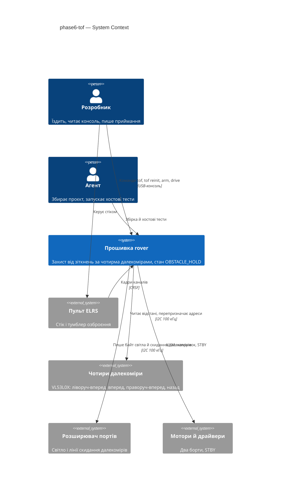

## 4. Solution strategy

**Target surface:** `cli` — як у фазах 0–5; далекоміри й розширювач — залізо, а не поверхня.

**Top strategic choices (насіння ADR):**

1. **Обмеження руху — частина кроку `control`, відстані — зі знімка далекомірів.** `control` копіює опублікований знімок `tof`, а чистий крок `drive_ctl_step` одразу після мікшера розкладає пару бортів на тягу й поворот, обрізає тягу в бік зайнятого сектору й просить перехід ARMED ↔ OBSTACLE_HOLD. Обмеження, зупинки фаз 1–3 і регулятор стоять в одному чистому кроці, який тестується на хості (ADR-0001).
2. **Розширювач портів — єдиний власник усього байта, включно з лініями скидання.** Тіньовий регістр `ioexp` розширюється на розряди 0, 1, 2 і 4; запис світла й щосекундний перезапис зберігають їхній стан, а `tof` змінює їх лише через `ioexp`. Інакше кожен запис світла скидав би датчики і збивав їхні адреси (ADR-0002).
3. **Опитування далекомірів — окрема задача `sensors` на core 0 з власним виявленням відмови.** Задача читає датчики раз на 50 мс, веде фільтр, сектори й відмови в `tof_core` і публікує знімок. Затримка шини не торкається такту керування; завислу задачу `control` бачить за віком знімка (ADR-0003).
4. **OBSTACLE_HOLD — стан руху, а не окремий режим: усі перевірки «лише ARMED» стають одним предикатом.** `app_state_core` дає предикат «ровер їде» (ARMED або OBSTACLE_HOLD) і нову пару OBSTACLE_HOLD → DISARMED; `drive`, консоль, `pid` і `ui` переходять на предикат. Відсічка, втрата звʼязку й роззброєння діють в обох станах без дублювання; у `drive_hal.c` на предикат переходять журнал роззброєння, `last_stop` і лічильник затримки «кадр → борти» (ADR-0004).

Тактичні рішення нижче мають простежуватися до цих чотирьох.

**Журнал припущень design (рівень easy):**

- `target_surfaces: [cli]`, як у фазах 0–5.
- Компонент `tof` отримує `tof_core.c`, `tof_hal.c`, `include/tof_core.h`, `include/tof_hal.h`, `include/tof_calib.h`; `ioexp`, `app_state`, `drive`, `ui`, `rover_console`, `main` розширюються; нових компонентів більше немає. `drive` залежить від `tof` лише через `tof_core.h`; `tof_hal` залежить від `ioexp_hal.h`, `i2c_bus_hal.h`, `app_state_hal.h`.
- `tof_calib.h` містить єдину константу `TOF_OBSTACLE_MM` 170 («виміряно: 2026-10-21», рядок у `docs/measured.md`); `check_calib.sh` отримує цей файл у список. Решта параметрів (`TOF_PERIOD_MS` 50, `TOF_MEDIAN_N` 3, `TOF_RELEASE_COUNT` 3, `TOF_FAIL_MS` 250, `TOF_STALE_MS` 250, `TOF_OUT_OF_RANGE_MM` 8190) — у `tof_core.h` як параметри логіки, а не виміри.
- `tof_core` (без заголовків ESP-IDF): датчики за ідентифікаторами `TOF_LEFT_FRONT` (U7), `TOF_FRONT` (U8), `TOF_RIGHT_FRONT` (U9), `TOF_REAR` (U10); стан датчика «ще немає / працює / поза діапазоном / відмова»; кільце з трьох останніх відліків і медіана; мітка останнього валідного відліку; сектори передній (мінімум із трьох, лише справних і готових) і задній (U10); лічильник звільнення (три поспіль оновлення, не менші за поріг); функції `tof_core_sample`, `tof_core_tick`, `tof_core_view`, `tof_limit_sides`, форматування показу й рядка входу в утримання.
- Обмеження руху: `tof_limit_sides(ліве, праве, передній зайнятий, задній зайнятий)` обчислює тягу = (ліве + праве)/2 і поворот = (ліве − праве)/2, обрізає тягу знизу нулем (передній) або зверху (задній) і повертає нову пару. Модуль нової пари не перевищує модуль початкової, тож межа 0.75 і насичення не порушуються. Викликається у `drive_ctl_step` після `drive_mix` (пульт) і після відновлення пари з вікна стендової команди, до стелі заданої швидкості, розгону й регулятора.
- Знімок: `tof_view_t` (валідність, номер, мітка в мс, чотири датчики зі станом і відстанню, два сектори зі «зайнятий», «охороняється» і відстанню, ознака «захист діє») під `portMUX` у `tof_hal`; `control` копіює його щотакту, як знімок енкодерів.
- Вік знімка: старший за 250 мс (або `valid == false`, задача не стартувала чи зависла) → обидва сектори «не охороняються» і не зайняті, одна подія журналу «знімок застарів», друга при відновленні; ровер їде далі, як при відмові всіх датчиків (spec AC-06, AC-07).
- Перехід стану: `drive_ctl_step` ставить запит OBSTACLE_HOLD, коли state == ARMED і зайнятий будь-який сектор, і запит ARMED, коли state == OBSTACLE_HOLD і обидва вільні; відсічка по напрузі, втрата звʼязку, нове зʼявлення пульта й роззброєння мають перевагу в тому ж такті. Запит ARMED з OBSTACLE_HOLD не йде через `pid_hal_arm_begin` (це не озброєння): HAL відрізняє його за станом «до».
- Інваріант ADR-0002 фази 1 «коли є запит стану, виходи вже вимкнені» стосується запитів DISARMED і FAILSAFE; запити OBSTACLE_HOLD і назад не вимикають виходів (рух у вільний бік триває).
- `pid` і трасування: `armed_prev`, скидання регулятора поза рухом, кадр трасування і блокування `pid on/off/save` переходять на предикат «ровер їде»; перехід ARMED ↔ OBSTACLE_HOLD не скидає й не перезахоплює режим регулятора.
- `ui_core`: режим задніх ліхтарів «авто» діє в ARMED, OBSTACLE_HOLD і FAILSAFE; правило «вхід у рух» спирається на стан, який `ui` справді бачить (опитування раз на 100 мс): перехід зі стану не-руху (DISARMED тощо) в ARMED або OBSTACLE_HOLD вмикає фари й дає сигнал переходу (озброєння біля вже зайнятого сектору виглядає для `ui` як DISARMED → OBSTACLE_HOLD), а перехід між ARMED і OBSTACLE_HOLD їх не чіпає; ручні світло й зумер в OBSTACLE_HOLD, як і раніше, відхиляються.
- `ioexp`: у `ioexp_t` додається маска стану розрядів скидання; `ioexp_prepare` підставляє її в байт; нова операція `ioexp_hal_xshut(bit, high)` змінює розряд і пише байт; `ioexp_hal_apply` та новий виклик беруть внутрішній мʼютекс `ioexp`, бо тепер пишуть дві задачі (`ui` на core 0 і `sensors` на core 0). Перший запис 0x00 при старті лишається першою операцією на шині.
- Послідовність старту `tof_hal` (у задачі `sensors`, не в `app_main`): для кожного датчика за порядком U7, U8, U9, U10 підняти його XSHUT через `ioexp_hal_xshut`, пауза 5 мс через `esp_rom_delay_us` (≥ 2 мс за документом 02 §4.7; 5 мс — як у перевіреній послідовності P4, `docs/measured.md`), перевірка ідентифікатора моделі, ініціалізація, перепризначення адреси на 0x30…0x33, безперервний режим; результат кожного друкується в журнал. Розширювач недоступний → усі чотири в відмові з одним попередженням.
- Повторна ініціалізація (`tof reinit`): консоль через колбек ставить запит у `sensors` і чекає до 3 с; на цей час опитування решти датчиків призупиняється (ініціалізація датчика містить очікування до 500 мс, P4), а після завершення лічильники відмови решти скидаються, щоб пауза не дала хибних відмов (послаблення spec AC-08, рішення власника на design); задача опускає XSHUT усіх відмовивших, потім піднімає їх по одному за тією ж послідовністю; між датчиками перевіряє `app_state_get() == DISARMED` і зупиняється, якщо стан змінився; світло не торкається, бо байт пише `ioexp` із збереженням біт світла.
- Транзакції датчика: таймаут 10 мс у циклі опитування (50 мс на ініціалізацію); кожна транзакція під `i2c_bus_lock`; опитування неблокувальне — готового відліку немає, значить, нового відліку цей цикл немає. Після п'яти циклів підряд, у яких не відповів жоден датчик, задача викликає `i2c_bus_reset` (як `ioexp`).
- Задача `sensors`: core 0, prio 3, період 50 мс через `vTaskDelayUntil` (документ 02 §6.1), стек 4096; у Task WDT не підписана — Decision override у §1 (завислу задачу обробляє вік знімка).
- Консоль: `CONSOLE_CMD_TOF` у `console_core` (форми `tof` і `tof reinit`; будь-яка інша — відмова з переліком форм і поясненням, що поріг не змінюється); матриця дозволів зі spec §5; команда руху `drive` приймається в ARMED і OBSTACLE_HOLD; колбеки `tof_show`, `tof_reinit` передає `main`.
- Журнал: один рядок на подію (вхід в OBSTACLE_HOLD з сектором, мм і порогом; звільнення; відмова й повернення датчика; знімок застарів/відновився; результат старту кожного датчика; «захист вимкнено» на старті й при озброєнні, коли немає жодного справного); без рядків на кожен такт.
- Хостові тести: новий `test/host/test_tof.c` (медіана, відстань сектору, зайнятість строго за порогом, звільнення за трьома оновленнями, відмова за 250 мс, `tof_limit_sides`, форматування, розбір форм команди разом із `test_console.c`); розширення `test_app_state.c` (12 пар, предикат, вхід в OBSTACLE_HOLD лише з ARMED), `test_drive.c` (обмеження, перехід станів, паритет інваріантів ARMED в OBSTACLE_HOLD, застарілий знімок), `test_ui.c` (задні ліхтарі, фари й сигнал при переходах), `test_ioexp.c` (біти скидання зберігаються при запису світла й перезаписі), `test_console.c` (матриця); `check_delays.sh` дозволяє `tof_hal.c` лише для пауз `vTaskDelay(1)` усередині очікування готовності регістра в ініціалізації (як `battery_hal.c`: пауза всередині одного вимірювання, а не період задачі); 5 мс після підняття XSHUT — `esp_rom_delay_us`.

## 5. Building block view

Стиль — як у фазах 0–5: компоненти ESP-IDF, у кожного чиста логіка `<name>_core.c` без заголовків ESP-IDF і тонкий `<name>_hal.c`. Нова відповідальність розподілена так: `sensors` лише вимірює й ставить діагноз датчикам, `control` лише вирішує (обмеження, перехід стану), `ioexp` володіє байтом розширювача, `app_state` визначає, що таке «рухається». Жоден новий компонент не пише в мотори.

**Internal decomposition:**

```
components/
├── tof/
│   ├── tof_core.c        медіана, сектори, відмова, звільнення, tof_limit_sides, форматування (чиста логіка)
│   ├── tof_hal.c         драйвер VL53L0X (порт p4_tof.c), послідовність XSHUT, задача sensors, знімок, reinit
│   └── include/          tof_core.h, tof_hal.h, tof_calib.h (TOF_OBSTACLE_MM)
├── ioexp/                + маска розрядів скидання в тіньовому регістрі, ioexp_hal_xshut, внутрішній мʼютекс
├── app_state/            + предикат «ровер їде», пара OBSTACLE_HOLD → DISARMED (12 пар із 49)
├── drive/                drive_ctl_step: знімок tof, tof_limit_sides, запити OBSTACLE_HOLD ↔ ARMED, предикат замість «лише ARMED»
├── pid/                  предикат у скиданні, трасуванні, блокуванні команд
├── ui/                   задні ліхтарі й сигнал переходу з урахуванням OBSTACLE_HOLD
├── rover_console/        команда tof, матриця, drive у OBSTACLE_HOLD
└── i2c_bus/              без змін (мʼютекс, скидання шини)
main/main.c               tof_start після ioexp_start і encoders_start; колбеки консолі
```

**C4 Container (L2):**

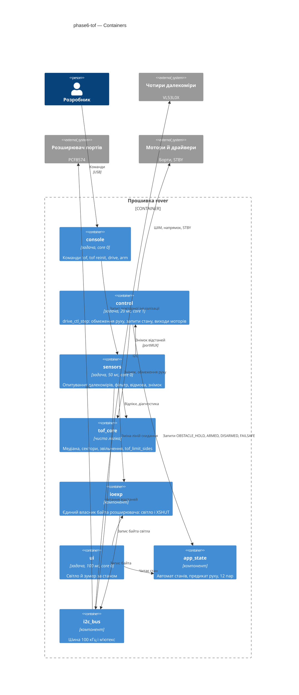

## 6. Runtime view

**Critical flow 1: зупинка перед перешкодою і виїзд назад**

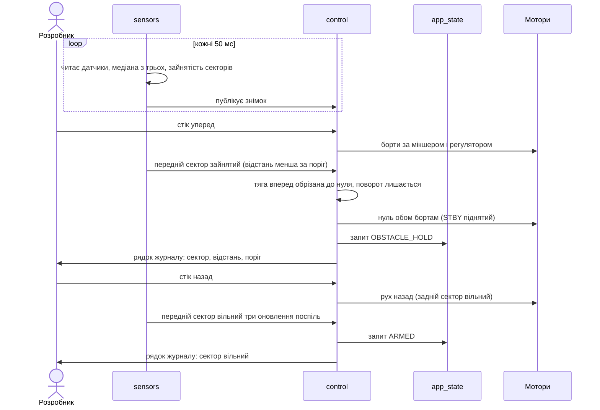

**Critical flow 2: вийнятий далекомір на ходу і повернення в DISARMED**

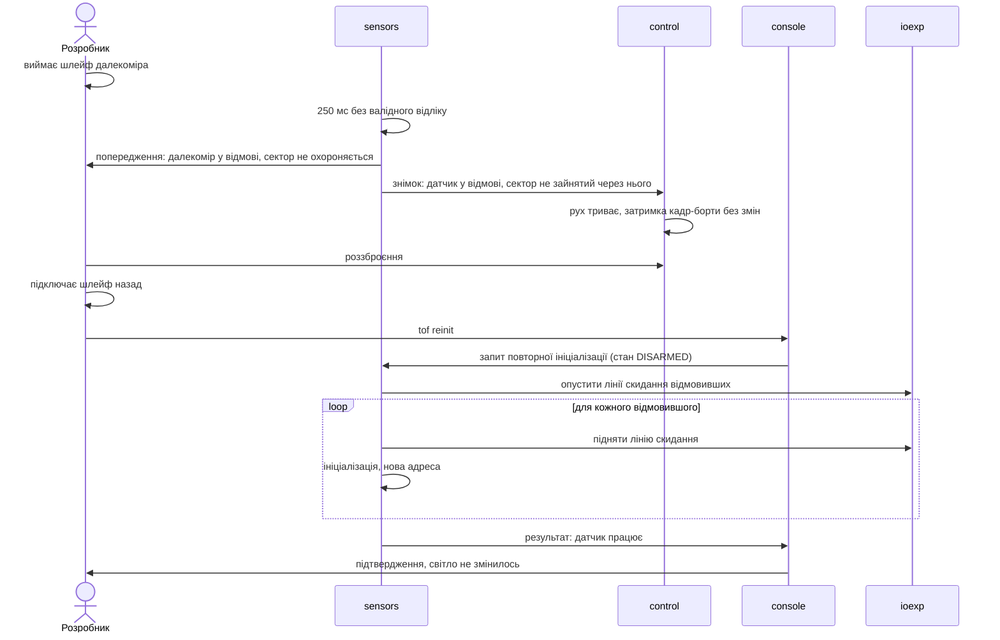

### Flow 3: старт датчиків і відсутні датчики

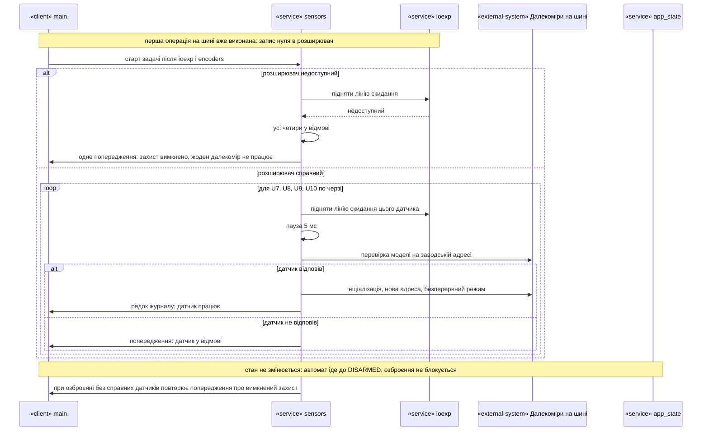

Старт іде в задачі `sensors`, а не в `app_main`, тож не затримує вихід у DISARMED. Якщо розширювач недоступний, лінії скидання піднять неможливо, і всі чотири датчики йдуть у відмову з одним попередженням. Інакше датчики піднімаються по одному в порядку U7, U8, U9, U10, і кожен або отримує нову адресу, або потрапляє у відмову з попередженням; жодна з цих відмов не переводить автомат у FAULT. Якщо справних датчиків немає зовсім, попередження повторюється при кожному озброєнні (AC-07).

### Flow 4: напрямки при зайнятому секторі

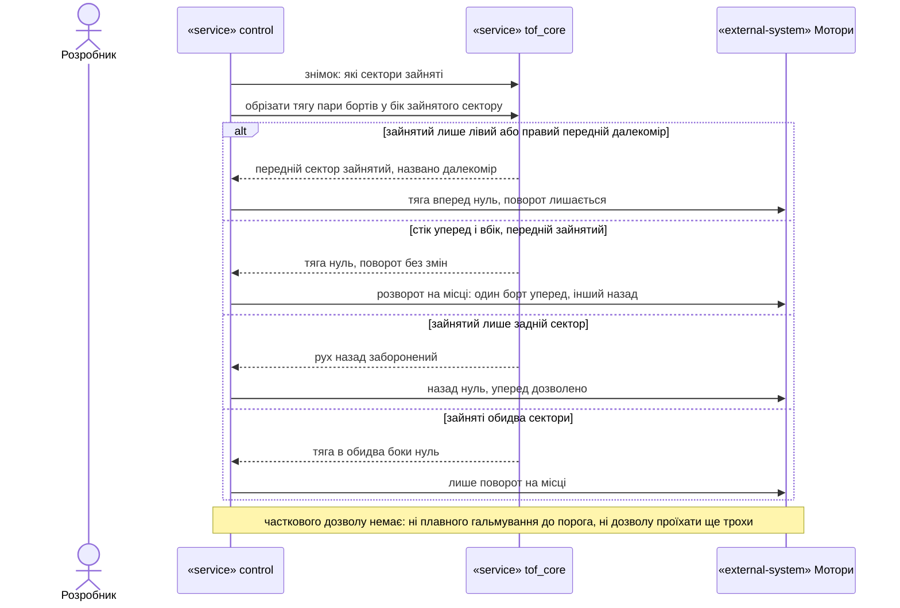

Крок `control` щотакту бере знімок і лише в бік зайнятого сектору обнуляє тягу пари бортів; поворот не чіпає. Перешкода лише збоку-спереду, яку бачить один діагональний далекомір, зупиняє рух уперед так само, як і прямий (AC-02). Стік уперед і вбік дає розворот на місці (AC-04). Зайнятий задній сектор забороняє лише рух назад (AC-05), зайняті обидва — залишають тільки поворот на місці.

### Flow 5: інваріанти безпеки в OBSTACLE_HOLD

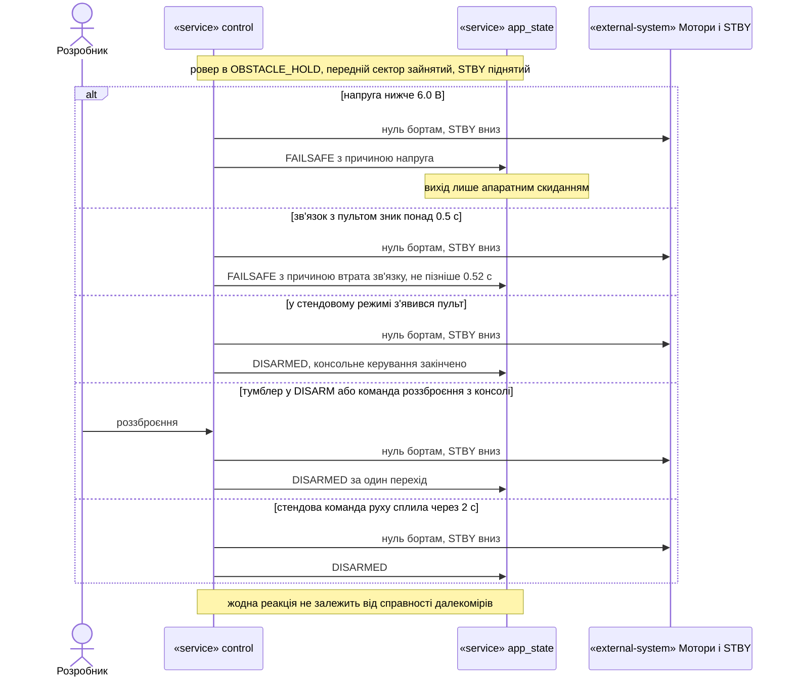

Усі п'ять причин зупинки, що діяли лише в ARMED, тепер діють і в OBSTACLE_HOLD: відсічка по напрузі й втрата зв'язку ведуть у FAILSAFE, поява пульта в стендовому режимі, тумблер DISARM, команда роззброєння і спливання вікна команди руху — у DISARMED одним переходом. У всіх випадках спершу вимикаються виходи і STBY, потім іде запит стану (AC-12).

### Flow 6: стендова команда руху і паритет підсистем

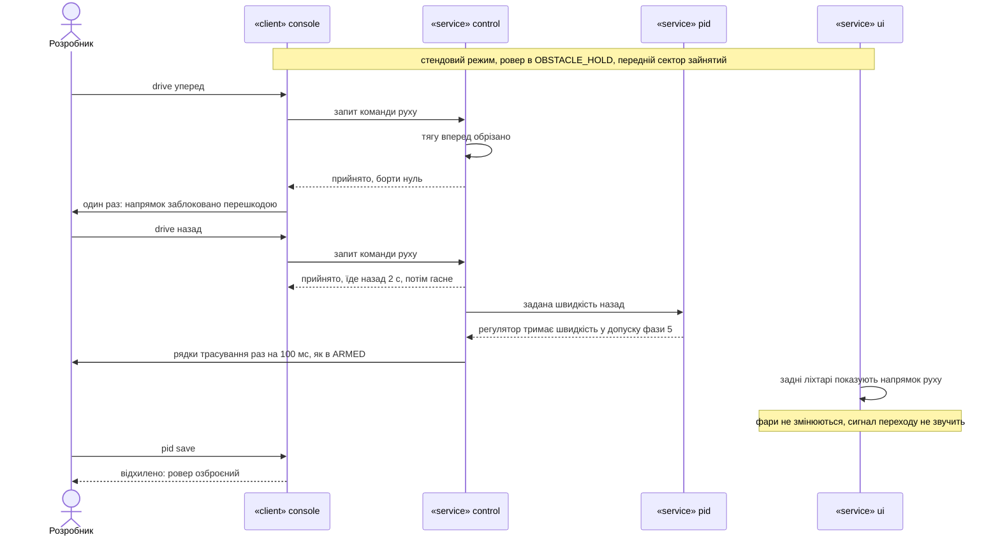

Консоль приймає `drive` і в OBSTACLE_HOLD та пропускає його через ту саму точку обмеження, що й пульт: уперед — борти лишаються нулем з одним поясненням на команду, назад — їде 2 с і гасне (AC-15). Регулятор, трасування і задні ліхтарі працюють як в ARMED, фари й сигнал переходу не чіпаються при переході між ARMED і OBSTACLE_HOLD, а збереження набору регулятора відхиляється, як в ARMED (AC-14).

### Flow 7: команди tof

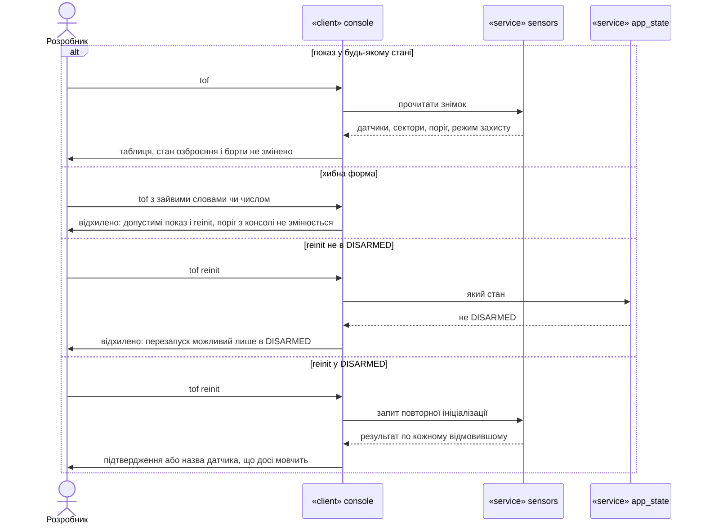

Показ читає лише знімок і працює в усіх станах (AC-10). Будь-яка інша форма команди відхиляється з переліком допустимих і поясненням, що поріг з консолі не змінюється (AC-11). Повторна ініціалізація поза DISARMED відхиляється ще в консолі й додатково перевіряється в `sensors` (AC-09); докладна послідовність у DISARMED — потік 2.

### Flow 8: завислий sensors і застарілий знімок

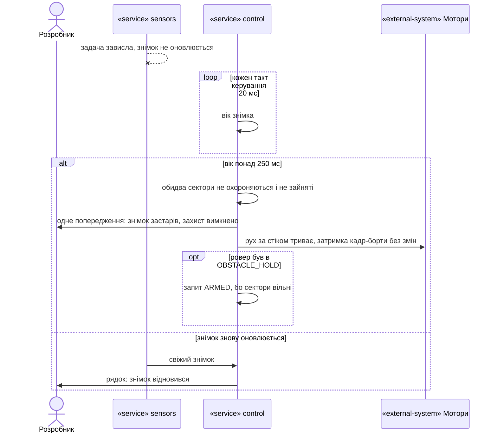

Якщо `sensors` завис, `control` не чекає на нього: за віком знімка понад 250 мс він вважає сектори такими, що не охороняються, пише одне попередження і далі їде за стіком; ровер, що стояв в OBSTACLE_HOLD через завислі дані, повертається в ARMED. Свіжий знімок знімає це одним рядком про відновлення (гілка AC-06, ADR-0003).

### Flow 9: спільний байт розширювача — світло і лінії скидання

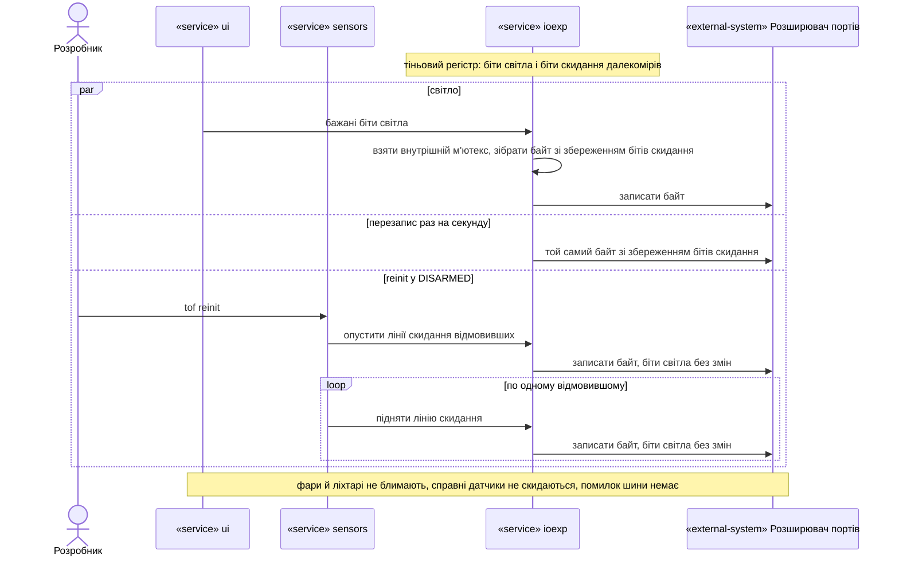

Усі три джерела запису — `ui`, щосекундний перезапис і повторна ініціалізація `sensors` — проходять через один мʼютекс `ioexp` і один тіньовий регістр, тож запис світла не опускає лінії скидання, а `tof reinit` не гасить і не запалює світло (AC-08, AC-16, ADR-0002).

### Coverage: US і AC → потік

| US | Потоки |
|---|---|
| US-01 Ровер зупиняється перед перешкодою | 1, 4 |
| US-02 Можна здати назад і розвернутися | 1, 4 |
| US-03 Ровер переживає відмову далекоміра | 2, 3, 8, 9 |
| US-04 Бачити далекоміри в консолі | 7 |
| US-05 Інваріанти безпеки діють і в утриманні | 5, 6, 9 |
| US-06 Перевірювана логіка | N/A, див. нижче |
| US-07 Межі роботи Агента | N/A, див. нижче |

| AC | Де показано |
|---|---|
| AC-01 | потік 1 |
| AC-02 | потік 4 (гілка діагонального датчика) |
| AC-03 | потік 1 (виїзд назад і звільнення) |
| AC-04 | потік 4 (стік уперед і вбік) |
| AC-05 | потік 4 (гілки заднього й обох секторів) |
| AC-06 | потоки 2, 8 |
| AC-07 | потік 3 |
| AC-08 | потоки 2, 9 |
| AC-09 | потік 7 (гілка reinit не в DISARMED) |
| AC-10 | потік 7 (показ) |
| AC-11 | потік 7 (хибна форма) |
| AC-12 | потік 5 |
| AC-13 | N/A: таблиця переходів перевіряється хостовим тестом, а не рунтайм-потоком |
| AC-14 | потік 6 |
| AC-15 | потік 6 |
| AC-16 | потік 9 |
| AC-17 | N/A: збірка й хостові тести Агента, не рунтайм ровера |
| AC-18 | N/A: статичні перевірки збірки (`check_*.sh`), не рунтайм ровера |
| AC-19 | N/A: правила роботи Агента, не рунтайм ровера |

**Flagged for design (не змінюємо тут):** потоки використовують лише учасників, оголошених у §5; нового учасника не додано. Рішення, які варто перевірити під час `tasks`: чи слід припиняти `tof reinit`, коли ровер озброєно посеред команди (потік 7 і ADR-0003), і чи треба виводити стан «захист діє» у `status`.

## 7. Deployment view

Прошивка працює на одному контролері; інфраструктури немає. Нова задача `sensors` додається до наявного розкладу.

| Задача | Пріор. | Ядро | Період | Призначення |
|---|---|---|---|---|
| `control` | 5 | 1 | 20 мс | рішення про рух і стан, виходи моторів |
| `sensors` | 3 | 0 | 50 мс | опитування далекомірів, знімок (нова) |
| `ui` | 2 | 0 | 100 мс | світло й зумер |
| `console` | 1 | 0 | на вводі | команди |

**Monitoring:**
- Журнал: вхід і вихід OBSTACLE_HOLD з сектором, відстанню й порогом; відмова й повернення датчика; знімок застарів і відновився; «захист вимкнено»; результат старту кожного датчика.
- Команда `tof`: відстані датчиків, секторів, поріг, режим захисту.
- Затримка «кадр пульта → борти» у журналі `control` (існуючий лічильник фази 3) із увімкненим опитуванням далекомірів.
- Вільна внутрішня памʼять у `status` (baseline 353635 байт, поріг ≥ 345000).

**Scaling thresholds:**
- N/A: одна плата, один ровер; запас памʼяті ≈ 8.6 кБ до порога 345000 байт (ризик у §11).

## 8. Crosscutting concepts

| Concept | Convention | Where defined |
|---|---|---|
| Logging | Один рядок на подію українською, `ESP_LOGW` для попереджень (відмова, застарілий знімок), `ESP_LOGI` для переходів; без рядків на кожен такт | `main/main.c`, `drive_hal.c` |
| Error handling | Відмова датчика — не помилка прошивки: стан у `tof_core`, попередження, жодного `ESP_ERROR_CHECK` на шляху опитування | цей SAD, §4 |
| Власність стану | Стан автомата змінює лише `control` через `app_state_request`; `sensors` лише публікує знімок | ADR-0001 цієї фази, ADR-0002 фази 1 |
| Власність байта розширювача | Лише `ioexp` пише в PCF8574; `ui` і `tof` змінюють свої розряди через нього | ADR-0002 цієї фази |
| «Ровер їде» | Предикат у `app_state_core`; прямі порівняння з ARMED лишаються лише там, де йдеться саме про озброєння | ADR-0004 цієї фази |
| Шина периферії | 100 кГц; кожна транзакція під `i2c_bus_lock`; таймаут датчика 10 мс; скидання шини після п'яти невдалих циклів | `i2c_bus_hal.h`, цей SAD §4 |
| Періодичні задачі | `vTaskDelayUntil`; 5 мс після XSHUT — `esp_rom_delay_us`; `vTaskDelay(1)` лише в очікуванні готовності регістра в `tof_hal.c` (виняток у `check_delays.sh`) | конституція п. 14, `check_delays.sh` |
| Калібрування | Єдина константа `TOF_OBSTACLE_MM` у `tof_calib.h` зі значенням із `docs/measured.md`; консоль її не змінює | конституція пп. 3, 13; `check_calib.sh` |
| Права консолі | Матриця «команда × стан» у `console_core`; `tof` — у всіх станах, `tof reinit` — лише DISARMED | spec §5 |
| Internationalisation | N/A: лише українська | — |

## 9. Architecture decisions

| # | Title | Status | Section |
|---|---|---|---|
| 0001 | Apply the obstacle limit inside the control step from a tof snapshot | Accepted | §4 |
| 0002 | Let ioexp own the whole expander byte including the sensor reset lines | Accepted | §4 |
| 0003 | Poll rangefinders in a separate sensors task and detect failure there | Accepted | §4 |
| 0004 | Treat OBSTACLE_HOLD as a driving state through one predicate | Accepted | §4 |

ADR files live under `docs/features/phase6-tof/adr/NNNN-<title>.md`.

## 10. Quality requirements

**QG-1. Зупинка перед перешкодою**
- **When:** озброєний ровер їде вперед, і відстань переднього сектору стає менша за поріг 170 мм.
- **Then:** обидва борти отримують нуль не пізніше ніж через 250 мс після першого відліку, меншого за поріг; ровер не торкається стіни. Орієнтовний бюджет (виведено з періодів, не вимога spec §6): друге оновлення для медіани з трьох ≤ 50 мс, такт керування 20 мс, затримка вимірювання датчика ≈ 33 мс, разом ≈ 100–150 мс з запасом до 250 мс.
- **How verify:** мітки часу журналу, приймання AC-01 (10 заїздів з 10 на стіку 100 %, 60 %, 30 %); хостові тести медіани й `tof_limit_sides`.

**QG-2. Інваріанти безпеки в OBSTACLE_HOLD**
- **When:** ровер в OBSTACLE_HOLD, і напруга падає нижче 6.0 В, або зв'язок з пультом зникає понад 0.5 с, або надходить роззброєння.
- **Then:** FAILSAFE з причиною «напруга» або «втрата зв'язку» (≤ 0.52 с, spec AC-12), роззброєння за один перехід у DISARMED, STBY внизу; таблиця переходів має рівно 12 пар із 49.
- **How verify:** хостові тести `test_drive.c` (паритет з ARMED) і `test_app_state.c`; приймання AC-12, AC-13 на залізі.

**QG-3. Живучість до відмови датчика**
- **When:** на ходу виймають шлейф далекоміра, або задача `sensors` перестає оновлювати знімок.
- **Then:** відмова виявляється за 250 мс, прошивка не перезавантажується, затримка «кадр пульта → борти» ≤ 20 мс максимум, перешкода перед справним датчиком усе ще зупиняє ровер; вільна памʼять ≥ 345000 байт.
- **How verify:** приймання AC-06, AC-07, AC-16 (по одному вийманню на кожен із чотирьох датчиків); хостовий тест віку знімка; `status`.

## 11. Risks and technical debt

| Risk / debt | Severity | Mitigation | Owner |
|---|---|---|---|
| Запис світла чи перезапис байта знову скидає лінії датчиків, якщо маска `ioexp` лишиться стара | High | ADR-0002; хостовий тест, що біти скидання переживають запис світла й перезапис; приймання AC-16 | Розробник |
| Місце «лише ARMED» пропущене в `drive`, `console`, `ui` або `pid`: у OBSTACLE_HOLD STBY падає чи ліхтарі гаснуть | High | ADR-0004: один предикат; хостові тести паритету по кожному пункту spec §1; пошук прямих порівнянь `== APP_STATE_ARMED` у рев'ю | Розробник |
| Зазор після зупинки в найгіршому випадку ≈ 42 мм, лише трохи вище 40 мм (зона без заміру) | Medium | Перевірка рулеткою при прийманні AC-01; поріг змінюється правкою однієї константи (запис у журналі вимірювань) | Розробник |
| Відмовивший передній датчик — сліпа зона: сектор вважається вільним (вимога документа 02) | Medium | Попередження в журналі, показ у `tof`, повернення командою в DISARMED; прийнято spec §3 | Розробник |
| Запас вільної памʼяті ≈ 8.6 кБ (353635 − 345000): задача `sensors` (стек 4096), пристрої шини, знімок | Medium | Заміряти `status` після старту; якщо нижче 345000 — зменшити стек або повернутися до власника | Агент |
| Повторна ініціалізація призупиняє опитування решти датчиків до 3 с (послаблено spec AC-08); якщо за цей час озброїти ровер, знімок застаріває і сектори не охороняються | Low | Перерваний reinit при виході з DISARMED, вік знімка, рядок журналу | Агент |
| Діагональні датчики бачать перешкоду вздовж свого променя, U7 = 118 мм при стіні на 100 мм (очікувалось ≈ 141) не пояснено | Low | Помилка в безпечний бік; одна константа порогу; не досліджується в цій фазі | Розробник |
| Open architectural decision: поведінка далекоміра ближче 40 мм (spec OQ-2) | Open question | Resolve before приймання фази 6 на залізі; замір P4 режим 1 долонею на 10, 20, 30 мм | Розробник |

**Accepted debt (acceptable in v1, plan to fix later):**
- Окремої індикації перешкоди немає (лише журнал); пульт про неї не знає — фаза 7.
- Спільний мʼютекс шини й один поріг на всі датчики без геометричної корекції.
- Завислу `sensors` ловить лише вік знімка; Task WDT її не перезавантажує (Decision override, §1).

## 12. Glossary

| Term | Meaning |
|---|---|
| Далекомір | Один із чотирьох датчиків відстані ровера (U7, U8, U9, U10) |
| Сектор | Передній (три передні далекоміри) або задній (один) напрямок, який стережуть далекоміри |
| Поріг перешкоди | Відстань 170 мм, ближче якої сектор зайнятий (`TOF_OBSTACLE_MM`) |
| Зайнятий сектор | Сектор із відстанню, меншою за поріг; рух у його бік заборонений |
| Утримання перед перешкодою | Стан OBSTACLE_HOLD: ровер озброєний, принаймні один сектор зайнятий |
| Відмова далекоміра | 250 мс без валідного відліку або відсутність відповіді на старті |
| Знімок далекомірів | Копія стану датчиків і секторів під `portMUX`, яку `control` читає щотакту |
| Ровер їде | Предикат «стан ARMED або OBSTACLE_HOLD»; до нього прив'язані відсічка, втрата звʼязку, регулятор і трасування |
| Лінія скидання (XSHUT) | Розряд розширювача, що тримає далекомір у скиданні; біти 0, 1, 2 і 4 |
