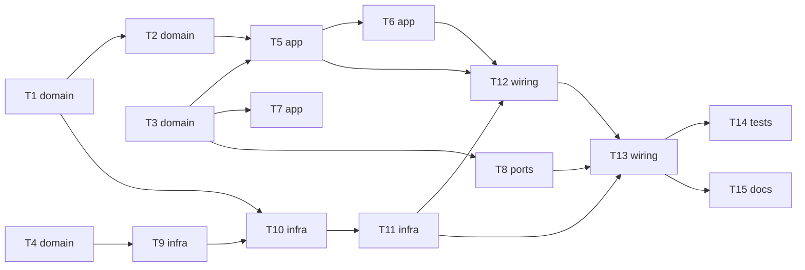

# Epic — phase6-tof

> **Spec:** [spec.md](../spec.md) · **Design:** [sad.md](../sad.md) · **ADRs:** [adr/](../adr/) · Data model і API — N/A (маршрут quick: сховища БД і мережевого API немає; потоки — `sad.md` §6)

## Goal

Озброєний ровер зупиняється перед перешкодою за чотирма далекомірами, виїжджає назад чи розвертається на місці й сам повертається до руху, а відмова або вийняття датчика не зупиняє і не вішає прошивку. Усі інваріанти безпеки ARMED діють і в OBSTACLE_HOLD (spec §2).

## Scope

- **In:** `components/tof/` (core і HAL, задача `sensors`), `components/ioexp/` (байт розширювача), `components/app_state/` (предикат і 12-та пара), `components/drive/` (крок керування і HAL), `components/ui/`, `components/rover_console/` (команда `tof`), `main/main.c`, хостові тести й перевірки, процедура приймання.
- **Out:** бокове покриття, активне гальмування, адаптивні пороги, консольна зміна порогу, автоматичне повернення датчика на ходу, індикація перешкоди на пульт (spec §3).

## Task map

Паралельні гілки старту: T1, T3, T4 (без залежностей). Спільні файли серіалізують пари T1–T2, T5–T6, T10–T11.

## Tasks

See [tracker.md](./tracker.md) for status. Machine contract: [tasks.json](../tasks.json).

| # | Task | Layer | Blocked by | DoD (short) |
|---|---|---|---|---|
| T1 | Створити tof_core: медіана, сектори, зайнятість, звільнення, відмова датчика і калібрувальну константу порогу | domain | — | `test/host/run_tests.sh` зелений, серед тестів — усі рядки «Edge cases» |
| T2 | Додати в tof_core обмеження тяги пари бортів і тексти: показ датчиків і рядок входу в утримання | domain | T1 | `test/host/run_tests.sh` зелений, серед тестів — усі рядки «Edge cases» |
| T3 | Додати в app_state предикат «ровер їде» і пару OBSTACLE_HOLD → DISARMED (12 пар із 49) | domain | — | `test/host/run_tests.sh` зелений: таблиця має рівно 12 пар із 49 |
| T4 | Розширити ioexp_core: біти ліній скидання далекомірів у тіньовому регістрі і збирання байта зі збереженням | domain | — | `test/host/run_tests.sh` зелений, серед тестів — усі рядки «Edge cases» |
| T5 | Вбудувати в drive_ctl_step знімок далекомірів: обмеження тяги після мікшера, запити ARMED ↔ OBSTACLE_HOLD, застарілий знімок | app | T2, T3 | `test/host/run_tests.sh` зелений, серед тестів — усі рядки «Edge cases»; тести фаз 1–5 не зламано |
| T6 | Перевести в drive_core усі перевірки «лише ARMED» на предикат: відсічка, втрата зв'язку, пульт, роззброєння, вікно команди, регулятор | app | T5 | `test/host/run_tests.sh` зелений, серед тестів — паритет усіх причин з потоку 5 |
| T7 | Навчити ui_core OBSTACLE_HOLD: задні ліхтарі авто, вхід у рух вмикає фари й сигнал, перехід між ARMED і OBSTACLE_HOLD їх не чіпає | app | T3 | `test/host/run_tests.sh` зелений, тести фази 2 не зламано |
| T8 | Додати в console_core команду tof (показ і reinit), матрицю дозволів і прийом drive в OBSTACLE_HOLD | ports | T3 | `test/host/run_tests.sh` зелений, матриця 2×7 і хибні форми перевірені |
| T9 | Додати в ioexp_hal операцію зміни лінії скидання і внутрішній мʼютекс запису байта | infra | T4 | `idf.py build` без помилок і нових попереджень |
| T10 | Створити tof_hal: драйвер VL53L0X (порт p4_tof.c), послідовність XSHUT з новими адресами, виняток у check_delays | infra | T1, T9 | `idf.py build` без помилок і нових попереджень |
| T11 | Додати в tof_hal задачу sensors: опитування раз на 50 мс, знімок під portMUX, відмова за 250 мс, tof reinit у DISARMED | infra | T10 | `idf.py build` без помилок і нових попереджень |
| T12 | Підключити далекоміри до drive_hal: знімок у кроці, запит OBSTACLE_HOLD ↔ ARMED без pid_hal_arm_begin, журнал, предикат у журналі й лічильнику затримки | wiring | T5, T6, T11 | `idf.py build` без помилок і нових попереджень |
| T13 | Підключити в main старт tof і колбеки консолі tof_show та tof_reinit | wiring | T8, T11, T12 | `idf.py build` без помилок і нових попереджень |
| T14 | Посилити хостові перевірки: повний прогін, статичні перевірки core, пінів, затримок і калібрування для фази 6 | tests | T13 | `test/host/run_tests.sh` зелений, ≤ 5 с |
| T15 | Написати acceptance.md: процедура приймання фази 6 на залізі для Розробника і шаблон записів у журнал вимірювань | docs | T13 | `acceptance.md` покриває всі апаратні AC і KPI з §7 |

## Risks / Hard rules

- Конституція п. 6: логіка в `*_core.c` без заголовків ESP-IDF; HAL перевіряється на залізі (T15), без моків.
- Конституція п. 7: STBY піднімає лише свідома команда руху в ARMED чи OBSTACLE_HOLD (перехід станів його не піднімає, spec A10), втрата кадрів > 0.5 с, перший запис на шину — нуль, VBAT < 6.0 В; усе це діє в OBSTACLE_HOLD (T5, T6).
- Конституція пп. 3, 13: `TOF_OBSTACLE_MM` береться лише з `docs/measured.md` (170 мм); Агент його не змінює.
- Конституція п. 14: 100 кГц, `vTaskDelayUntil`; виняток `vTaskDelay(1)` лише в очікуванні регістра `tof_hal.c`.
- Конституція п. 8: збірка без помилок і нових попереджень на кожній задачі.
- SAD §11: запис світла не повинен скидати лінії датчиків (T4, T9); пропущене місце «лише ARMED» (T6, T7, T8, T12); запас пам'яті ≈ 8.6 кБ (T11).
