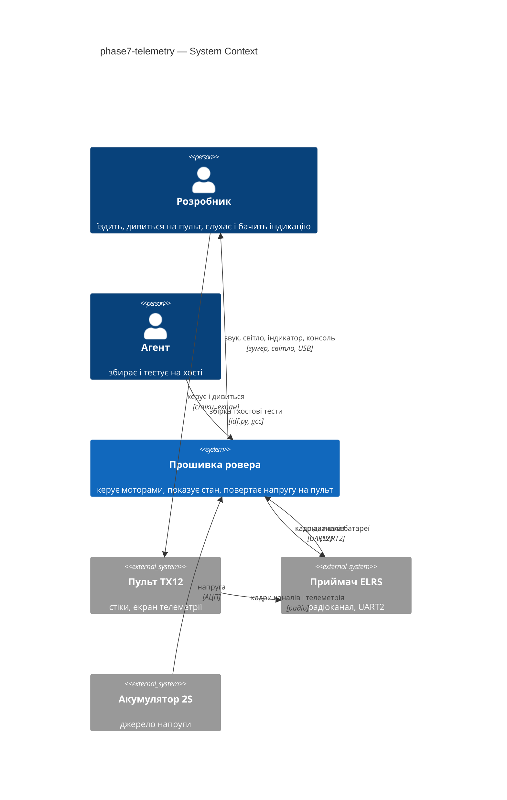
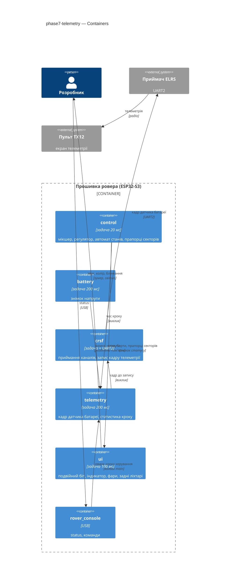
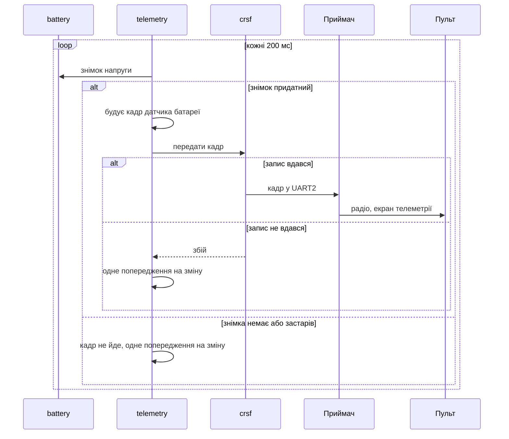
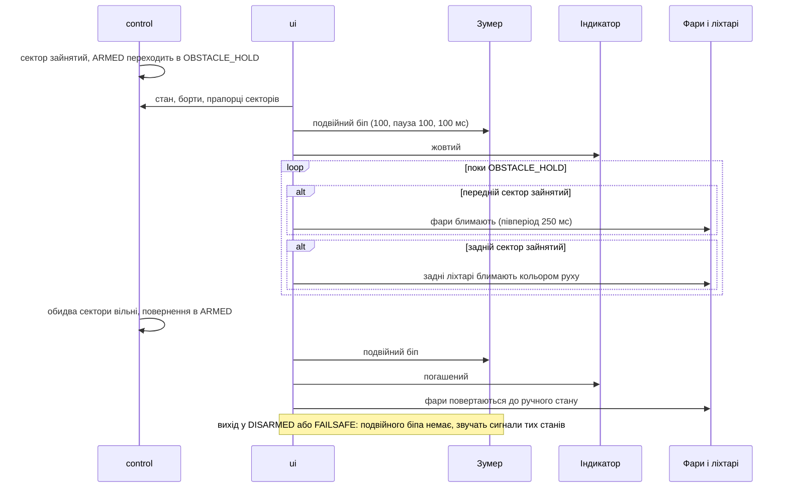

# Software Architecture Document — phase7-telemetry

## 1. Introduction and goals

**Intent.** Фаза 7 замикає зворотний зв'язок ровера з Розробником: пульт бачить напругу акумулятора, а утримання перед перешкодою (OBSTACLE_HOLD) стає чутним і видимим: подвійний біп на вході та на виході в ARMED, жовтий індикатор плати, блимання фар при зайнятому передньому секторі та задніх ліхтарів при зайнятому задньому. Прошивка також міряє час кроку керування (показує `status`), а проєкт отримує README, блок-схему та чекліст самоперевірки. Індикація й телеметрія лише відображають стан і ніколи не керують ровером.

**Top-3 quality goals (повні сценарії — §10):**

1. Безпека не страждає: інваріанти ARMED, відсічка, втрата звʼязку й роззброєння діють у тому ж темпі, що й без телеметрії та індикації (затримка «кадр пульта → борти» ≤ 20 мс).
2. Чесний зворотний зв'язок: на пульті лише справжня напруга (кадр не йде без придатного виміру), розв'язність 0.1 В; індикація утримання розрізняється на слух і на око (10 входів з 10).
3. Перевірюваність: уся нова логіка (кадр, статистика, послідовність біпа, блимання, пріоритети) тестується на хості; збірка без нових попереджень.

**Stakeholders.**

| Role | Interest | Sign-off owner? |
|---|---|---|
| Розробник | Бачить напругу на пульті, чує й бачить утримання, читає README і чекліст, записує приймання на залізі | Yes |
| Агент | Збирає проєкт, доводить логіку хостовими тестами; не прошиває, не вигадує констант, не комітить без вказівки | No |

**Decision override (2026-10-21, критик): розмір S попри два сигнали матриці (новий робочий модуль `telemetry` і нові внутрішні виклики) — rationale:** домінантний сигнал — обсяг коду: усе в одній прошивці без зовнішнього API і міграцій; нові виклики внутрішні (`crsf_hal_send`, запис виміру кроку, колбек консолі), як у фазах 2–6, що також пройшли як S; Розробник підтвердив S і маршрут quick (spec §1).

**Decision override (2026-10-21, запит Розробника): фаза 7 частково замінює рішення фази 6 (припущення A12 і частину ADR-0004 phase6-tof про беззвучний перехід ARMED ↔ OBSTACLE_HOLD) — rationale:** Розробник вимагає індикації утримання (spec §1). Правило «не вмикати фари примусово» з ADR-0004 лишається; правила «перехід без сигналу» і «DISARMED → OBSTACLE_HOLD дає сигнал як озброєння» заміщує ADR-0002 цієї фази.

## 2. Constraints

**Technical.**
- C (gnu17), ESP-IDF v6.1, FreeRTOS, ціль `esp32s3`, плата YD-ESP32-S3 N16R8 (`sdkconfig.defaults` — захищений файл).
- UART2 до приймача: 420000 бод 8N1 (журнал вимірювань, P5); RX = вхід CRSF, TX = лінія `/ELRS_TX` до J7 (нетліст) і вже налаштована `crsf_hal.c`; драйвер встановлено без передавального буфера. Формат кадру CRSF: синхробайт, довжина, тип, корисне навантаження, CRC8 (`crsf_crc8` у `crsf_core.c`).
- Кадр датчика батареї CRSF (документ 02 §7): напруга в одиницях 0.1 В, струм, ємність, відсоток; джерело напруги — `battery_get_snapshot` (калібрування двоточкове, |похибка| ≤ 42 мВ, журнал вимірювань).
- Індикатор плати: адресований світлодіод, порядок байтів GRB, рівень 40 (журнал вимірювань, P8); зумер — пасивний, найгучніша частота 1000 Гц (P9); обидва в `ui_calib.h`.
- Задача `ui` — 100 мс (core 0, пріоритет 2), задача `control` — 20 мс (core 1, пріоритет 5), `battery` — 200 мс; шина периферії 100 кГц (п. 14 конституції).
- Інваріанти безпеки (конституція, п. 7): STBY піднімається «тільки в стані ARMED і тільки свідомо» (п. 7), що з фази 6 розтлумачено для стану руху ARMED та OBSTACLE_HOLD (phase6-tof ADR-0004, spec OQ-3); втрата кадрів CRSF > 0.5 с → ШІМ 0, STBY вниз; перша операція на шині — запис 0x00 в розширювач; VBAT < 6.0 В → мотори не запускаються. Нова логіка їх не торкається.
- Таблиця переходів автомата лишається 12 пар із 49.

**Organisational.**
- Один розробник і один агент; прошивання лише Розробником через VS Code (`CLAUDE.md`); крок 7 у `docs/roadmap.md`, розмір S, маршрут quick.

**Conventions.**
- `docs/constitution.md`: core/HAL (п. 6), номери ліній лише в `board_pins.h` (п. 2), константи лише з журналу вимірювань (пп. 3, 13), `vTaskDelayUntil` (п. 14), збірка без нових попереджень (п. 8), коментарі й коміти українською (п. 9).
- Дані між задачами — знімок під `portMUX`; колбеки в консоль передає `main` через `console_ops_t`.
- Хостові тести: `test/host/run_tests.sh` збирає кожен `test_*.c` з усіма `components/*/*_core.c`; перевірки `check_core_headers.sh`, `check_pins.sh`, `check_delays.sh`, `check_calib.sh`.

**Regulatory / external.**
- N/A: немає мережі й персональних даних; радіоканал приймача й екран пульта — налаштування Розробника (spec OQ-1).

## 3. Context and scope

Розробник їздить пультом і читає консоль. Ровер вперше повертає йому інформацію радіоканалом (напруга акумулятора) і подає локальні сигнали стану утримання (звук, колір індикатора, блимання світла). Агент збирає проєкт і запускає хостові тести. Нове порівняно з фазою 6: у прошивці з'являється вихідний потік до приймача та складніша логіка `ui`.

<!-- brownfield: прочитано поточний код components/{ui,drive,battery,crsf,tof,telemetry}, main/main.c; карта docs/architecture-map.md застаріла (описує компоненти фаз 1–6 як заглушки), оновлення — справа survey -->

**External systems (in / out):**

| Actor or system | Type | Interaction |
|---|---|---|
| Розробник | Person | їздить пультом, читає екран телеметрії пульта, слухає зумер і дивиться на світло й індикатор, читає консоль |
| Агент | Person | збирає проєкт, запускає хостові тести |
| Пульт TX12 з модулем передавача | System (external) | отримує кадр датчика батареї через радіоканал і показує напругу |
| Приймач ELRS | System (external) | дає кадри каналів у UART2 і передає на пульт кадри телеметрії, які ровер пише в UART2 |
| Акумулятор 2S | System (external) | його напругу міряє АЦП |

**C4 Context (L1):**



## 4. Solution strategy

**Top strategic choices (the seeds for ADRs):**

1. **Окрема задача телеметрії з власником UART2 як транспортом** — `telemetry` будує кадр датчика батареї з чистої логіки й передає його функцією `crsf_hal_send` власника лінії; збій не торкається `control` (ADR-0001).
2. **Індикація — функція від стану й прапорців секторів у `ui_core`** — `control` публікує прапорці, які сама використала; `ui_core` ухвалює звук, колір і блимання, а виходи пише `ui_hal` (ADR-0002).
3. **Вимір кроку — дві відмітки в `control` і статистика в `telemetry_core`** — без нових блокувань; показ у `status` (ADR-0003).
4. **Документація як частина фічі** — README, `docs/architecture.md` (блок-схема) і `docs/self-check.md` (чекліст із посиланнями на докази); ніяких тверджень без доказу (spec AC-17, AC-18).

Другорядні рішення (без ADR): подвійний біп — часова послідовність у `ui_core` (звук 100, пауза 100, звук 100 мс на 1000 Гц; нова подія не стартує, поки звучить попередній подвійний біп; сигнали DISARMED і FAILSAFE його замінюють); жовтий — обидва канали індикатора на рівні 40; блимання — одна фаза від входу в OBSTACLE_HOLD, півперіод 250 мс; кадр телеметрії не надсилається без придатної напруги.

## 5. Building block view

Стиль — як у фазах 0–6: кожен компонент ділиться на `*_core.c` (чиста логіка, без ESP-IDF) і `*_hal.c` (виконання); рішення про рух приймає `drive_core`, `main` лише ініціалізує й передає колбеки консолі. Нові залежності: `telemetry` → `crsf`, `battery`; `drive` → `telemetry` (один виклик запису виміру); `ui` → `drive` (вже є), нічого нового від `tof`.

**Internal decomposition (нове й змінене):**

```
components/
├── telemetry/            (було: заглушка)
│   ├── telemetry_core.c  кадр датчика батареї, рішення «слати чи ні», детектор зміни «збій / відновлення» (HAL лише пише ESP_LOGW), статистика кроку, рядок status
│   ├── telemetry_hal.c   задача telemetry (200 мс), запис через crsf_hal_send, запис виміру кроку
│   └── include/          telemetry_core.h, telemetry_hal.h
├── crsf/                 + crsf_hal_send (запис кадру в UART2 власником лінії)
├── drive/                + drive_status_t.occ_front/occ_rear (копія ctl.occ_* без умови стану, її накладає ui_core: блимання лише в OBSTACLE_HOLD); дві відмітки часу навколо кроку control: перша після пробудження, друга безпосередньо перед esp_task_wdt_reset; telemetry_step_record викликає drive_hal між другою відміткою і reset
├── ui/                   ui_core: подвійний біп, жовтий, блимання, фаза утримання; ui_hal: жовтий колір індикатора; ui_hal_status_t.indicator_red → колір індикатора (enum)
├── rover_console/        status: рядок кроку керування; console_ui_status_t і формат status показують колір індикатора (ui_status у main.c мапить enum); console_ops_t.step_status
└── ...
main/main.c               + telemetry_start, колбек step_status, мапінг кольору індикатора в ui_status
README.md                 опис, збірка, інтерфейси
docs/architecture.md      блок-схема (Mermaid)
docs/self-check.md        чекліст самоперевірки з доказами
```

**C4 Container (L2):**



## 6. Runtime view

**Critical flow 1: телеметрія напруги**



**Critical flow 2: вхід у утримання, блимання, вихід**



## 7. Deployment view

<!-- N/A: один образ прошивки на одній платі, інфраструктури немає; додаються задача telemetry (core 0, пріоритет 2, стек 4096) і чотири-п'ять десятків рядків документації -->

**Monitoring:**
- `status`: час кроку керування (останній, середній, найбільший, перевищення періоду), вільна внутрішня памʼять, колір індикатора.
- Журнал монітора: одне попередження на зміну стану передачі телеметрії; діагностичні мітки затримки «кадр → борти» фази 3.

**Scaling thresholds:** N/A — навчальний ровер, одна плата.

## 8. Crosscutting concepts

| Concept | Convention | Where defined |
|---|---|---|
| Logging | `ESP_LOGI/W/E` українською, одне повідомлення на зміну, а не на кожен такт | конституція п. 9; ADR-0001 |
| Error handling | `esp_err_t`/`bool` без `abort()`; збій телеметрії й індикації ніколи не змінює стан автомата | конституція; spec AC-03 |
| Safety | індикація й телеметрія лише відображення; інваріанти п. 7 не торкаються | spec AC-14 |
| Concurrency | знімки під `portMUX`; запис у UART не з `control`; один мʼютекс `m_ui` у `ui_hal` | ADR-0001, ADR-0002 |
| Timing | періодичні задачі лише `vTaskDelayUntil`; час передається в core аргументом | конституція п. 14 |
| Constants | частота 1000 Гц і рівень 40 — з `ui_calib.h`; 200 мс і 250 мс — константи, джерела в spec §6 | конституція пп. 3, 13 |
| Testing | `*_core.c` покриваються хостовими тестами з підставним годинником; HAL — прийманням на залізі | конституція п. 6 |
| Observability | `status` (час кроку, колір індикатора) | ADR-0003 |

## 9. Architecture decisions

| # | Title | Status | Section |
|---|---|---|---|
| 0001 | Send battery telemetry as a CRSF battery frame from a telemetry task through the CRSF UART owner | Accepted | §4 |
| 0002 | Derive the hold indication in ui_core from the state and the control sector flags | Accepted | §4 |
| 0003 | Measure the control step in drive_hal and keep the statistics in telemetry_core | Accepted | §4 |

ADR-файли лежать у `docs/features/phase7-telemetry/adr/NNNN-<title>.md`.

## 10. Quality requirements

**QG-1. Безпека не страждає**
- **When:** ровер в ARMED або OBSTACLE_HOLD, телеметрія і індикація працюють, пульт втрачає звʼязок довше за допустиме, напруга падає нижче відсічки, або Розробник роззброює.
- **Then:** затримка «кадр пульта → борти» ≤ 20 мс максимум, зокрема з телеметрією й виміром такту; реакція моторів і STBY — як без індикації; таблиця переходів лишається 12 пар із 49.
- **Також (дослівно зі spec §6):** вплив виміру такту на період керування — 0 нових блокуючих викликів, період 20 мс тримається очікуванням до моменту (огляд коду; `check_delays.sh`); шина периферії 100 кГц (`check_bus_rules.sh`).
- **How verify:** діагностичні мітки часу фази 3 в журналі монітора; хостовий тест таблиці переходів; приймання AC-14 на залізі.

**QG-2. Чесний зворотний зв'язок**
- **When:** Розробник дивиться на пульт, слухає зумер і дивиться на індикатор під час входу в утримання й виходу в ARMED.
- **Then:** розбіжність напруги на пульті й у `status` ≤ 0.1 В; кадр не йде без придатного виміру; реакція індикації на перехід ≤ 200 мс; подвійний біп 100 мс + пауза 100 мс + 100 мс на 1000 Гц без накладання; півперіод блимання 250 мс усереднено (200 або 300 мс залежно від такту ui 100 мс).
- **Також (spec §6, §7):** період передачі телеметрії 200 мс (огляд коду; хостовий тест з підставним годинником); KPI «10 входів з 10 і 10 виходів в ARMED з 10 чутно як два біпи, індикатор жовтий у 10 з 10» (spec §7).
- **How verify:** хостові тести з підставним годинником; приймання AC-01, AC-06, AC-07, AC-10, AC-11 на залізі.

**QG-3. Перевірюваність**
- **When:** Агент завершує зміну в межах фази 7.
- **Then:** збірка — 0 помилок, 0 нових попереджень; хостовий прогін ≤ 5 с, 100 % тестів пройдено; вільна внутрішня памʼять після старту ≥ 345000 байт; 0 викликів звичайної затримки в періодичних задачах.
- **How verify:** вивід збірки, `test/host/run_tests.sh`, `check_delays.sh`, `status`.

## 11. Risks and technical debt

| Risk / debt | Severity | Mitigation | Owner |
|---|---|---|---|
| Кадр датчика батареї може не дійти до екрана пульта (співвідношення телеметрії модуля передавача, пошук датчика на пульті) | Medium | перевірка на прийманні (spec OQ-1); це налаштування пульта, а не прошивки | Розробник |
| Запис у UART2 з задачі `telemetry` одночасно з читанням у `crsf_rx` | Low | потокобезпека драйвера UART; запис ≤ 14 байт у FIFO; перевірка на залізі | Розробник |
| Дребезг біля порога перешкоди перетворює подвійні біпи на майже безперервний звук | Medium | правило «нова подія не стартує, поки звучить попередня»; спостереження при прийманні (spec OQ-3) | Розробник |
| Колір «жовтий» індикатора (сума червоного й зеленого на рівні 40) не вимірювався | Low | підбір рівнів при прийманні, запис у журнал вимірювань (spec OQ-4) | Розробник |
| Прапорці секторів із `control` (20 мс) читаються `ui` раз на 100 мс: зайнятість коротша за 100 мс невидна | Low | прийнято; логіка утримання від цього не залежить | Агент |
| Open architectural decision: час кроку керування на екрані пульта | Open question | наразі лише `status` (spec §3); окреме рішення, якщо Розробник захоче власний датчик; resolve before приймання фази 7 на залізі (due: приймання фази 7) | Розробник |

**Accepted debt (acceptable in v1, plan to fix later):**
- Струм, ємність і відсоток заряду в кадрі нульові (немає датчиків і виміряної кривої розряду).
- Карта `docs/architecture-map.md` застаріла; оновлення — через `survey`.

## 12. Glossary

| Term | Meaning |
|---|---|
| Телеметрія | кадр датчика батареї, який ровер раз на 200 мс шле на пульт: напруга з розв'язністю 0.1 В, решта полів нульові |
| Індикація утримання | подвійний біп на вході й на виході в ARMED, жовтий індикатор плати, блимання фар (передній сектор) і задніх ліхтарів (задній сектор) |
| Подвійний біп | два звуки по 100 мс із паузою 100 мс на 1000 Гц, що не накладається на інший подвійний біп |
| Час кроку керування | тривалість одного кроку `control` без очікування наступного періоду (статистика у `status`) |
| Утримання перед перешкодою | стан OBSTACLE_HOLD: ровер озброєний, принаймні один сектор зайнятий |
| Індикатор плати | вбудований RGB-світлодіод: червоний у FAILSAFE, жовтий в OBSTACLE_HOLD |
