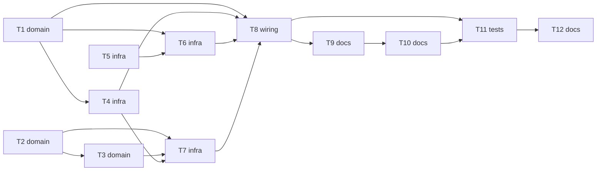

# Epic — phase7-telemetry

> **Spec:** [spec.md](../spec.md) · **Design:** [sad.md](../sad.md) · **ADRs:** [adr/](../adr/)

## Goal

Пульт бачить напругу акумулятора, Розробник чує й бачить утримання перед перешкодою (подвійний біп, жовтий індикатор, блимання фар і ліхтарів), `status` показує час кроку керування, а проєкт має README, блок-схему й чекліст (spec §2).

## Scope

- **In:** `components/telemetry/`, `components/ui/`, `components/crsf/` (передача кадру), `components/drive/` (прапорці секторів, відмітки часу), `components/rover_console/`, `main/`, `README.md`, `docs/architecture.md`, `docs/self-check.md`.
- **Out:** струм, ємність і відсоток; час кроку на пульті; гістерезис порога; налаштування індикації з консолі; заклинення борту (spec §3).

## Task map

## Tasks

See [tracker.md](./tracker.md) for status. Machine contract: [tasks.json](../tasks.json).

| # | Task | Layer | Blocked by | DoD (short) |
|---|---|---|---|---|
| T1 | Створити telemetry_core: кадр датчика батареї, рішення «слати чи ні», детектор зміни збою, статистика часу кроку й рядок status | domain | — | тести `test_telemetry.c` проходять, `telemetry_core.c` без заголовків ESP-IDF, збірка без нових попереджень |
| T2 | Навчити ui_core подвійному біпу на вході в OBSTACLE_HOLD і на виході в ARMED, жовтому індикатору й пріоритетам сигналів | domain | — | хостові тести ui проходять (оновлені й нові), `ui_core.c` без заголовків ESP-IDF, збірка без нових попереджень |
| T3 | Навчити ui_core блиманню фар при зайнятому передньому секторі й задніх ліхтарів при зайнятому задньому в OBSTACLE_HOLD | domain | T2 | хостові тести блимання проходять, збірка без нових попереджень |
| T4 | Додати в drive_status_t прапорці секторів і дві відмітки часу навколо кроку control з записом у telemetry_step_record | infra | T1 | збірка без нових попереджень; затримка «кадр → борти» в межах spec §6 (приймання T12); `check_delays.sh` чистий |
| T5 | Додати crsf_hal_send: запис готового кадру в UART2 власником лінії без блокування керування | infra | — | збірка без нових попереджень; `check_delays.sh` і `check_pins.sh` чисті; запис на залізі — T12 |
| T6 | Створити telemetry_hal: задача telemetry (200 мс) читає знімок напруги й передає кадр через crsf_hal_send | infra | T1, T5 | збірка без нових попереджень; `check_delays.sh` чистий; пульт показує напругу — T12 |
| T7 | Підключити в ui_hal прапорці секторів, жовтий колір індикатора й колір у ui_hal_status_t | infra | T2, T3, T4 | збірка без нових попереджень; жовтий і блимання перевіряє Розробник — T12 |
| T8 | Підключити в main старт telemetry і колбек step_status, показати колір індикатора й час кроку в status | wiring | T1, T4, T6, T7 | хостові тести консолі проходять, збірка без нових попереджень, `help` без змін у наборі команд |
| T9 | Написати README (опис, збірка, запуск, інтерфейси) і блок-схему в docs/architecture.md | docs | T8 | README і `docs/architecture.md` існують, діаграма відрендерилась без помилок |
| T10 | Скласти чекліст самоперевірки docs/self-check.md за таблицею документа 02 §5 із посиланнями на докази | docs | T9 | кожен рядок має статус і посилання на доказ або чесне «не перевірено на залізі» |
| T11 | Прогнати повну збірку, хостові тести й статичні перевірки, виправити порушення | tests | T8, T10 | збірка 0/0, хостові тести й перевірки чисті, звіт про числа — у handoff |
| T12 | Написати acceptance.md: процедура приймання фази 7 на залізі для Розробника | docs | T11 | файл існує, кожен крок прив’язаний до AC, жодного числа в журнал від Агента |

## Risks / Hard rules

- Телеметрія й індикація не змінюють інваріантів безпеки (конституція, п. 7) і не затримують керування: затримка «кадр пульта → борти» ≤ 20 мс максимум.
- `*_core.c` без заголовків ESP-IDF; жодного літерала номера лінії поза `board_pins.h`; жодної константи поза журналом вимірювань; `vTaskDelayUntil` у періодичних задачах; збірка без нових попереджень.
- T2 і T3 серіалізовані (спільні `ui_core.c`, `test_ui.c`).
