# Software Architecture Document — phase8-session-report

## 1. Introduction and goals

**Intent.** Дати Розробнику вимикач захисту від зіткнень на пульті (канал CH9) з індикатором на платі, повну діагностику «які датчики бачать перешкоду» в консолі та підсумок кожної сесії (озброєння → вихід), який ровер сам надсилає на сервер після роззброєння і не втрачає, коли мережі немає (spec §2).

**Top-3 quality goals (1-liners; full scenarios in §10):**

1. Безпека: мережа ніколи не впливає на керування — радіо тільки в DISARMED, озброєння має пріоритет, нуль нових кроків керування довших за період.
2. Збереженість даних: невідправлені звіти (≤ 2) переживають перезапуск; звіт FAILSAFE через напругу не губиться.
3. Захист секретів і сервера: паролі поза git/консоллю, сервер перевіряється власним сертифікатом.

**Stakeholders.**

| Role | Interest | Sign-off owner? |
|---|---|---|
| Розробник | вмикає захист з пульта, читає консоль, отримує звіти, дає креди | Yes |
| Агент | збирає прошивку, запускає хостові тести | No |
| Пульт (TX12) | передає канал CH9 | No |

- Decision override: запис у NVS (створення й видалення звіту, по одному `nvs_commit`) виконується в DISARMED або FAILSAFE і може затримати озброєння та подовжити поточний крок керування на тривалість запису (мілісекунди; як `pid save` у фазі 5) — rationale: запис у флеш зупиняє виконання коду з флешу на обох ядрах, і повністю уникнути цього не можна. Spec §6 «Вплив на керування» уточнено відповідно (2026-10-22).
- Decision override: `design` виконано до заміру положень CH9 (spec OQ-6 мав закритись до `design`) — rationale: Розробник підтвердив, що виконає замір, а архітектура від порога не залежить (одна константа «вище середини» в `crsf_core`); замір має бути записаний у `docs/measured.md` до `sdd:tasks` (п. 13 конституції).

## 2. Constraints

**Technical.**
- Мова C, ESP-IDF v6.1, ціль `esp32s3` (N16R8, 16 МБ флешу, octal PSRAM); нові драйвери (п. 5 конституції); Wi-Fi, `lwip`, `esp-tls`, `mbedtls`, `nvs_flash` є в дереві IDF; бібліотеки esp-mqtt у дереві немає (ADR-0002).
- Компоненти діляться на `*_core.c` (без заголовків IDF) і `*_hal.c` (п. 6); Wi-Fi-стек і мережева задача — на core 0, керування й CRSF — на core 1 (документ 02 §6.1).
- Таблиця розділів `partitions_singleapp.csv`: застосунок 1 МБ, NVS 24 КБ (0x6000); поточний образ ≈ 371 КБ. Wi-Fi, TLS і MQTT збільшать образ; очікується потреба в більшому розділі застосунку (дозвіл на правки захищених файлів — spec A22).
- Захищені файли (п. 10): дозволені правки лише `sdkconfig.defaults` і кореневого `CMakeLists.txt` (spec A22), тільки в межах цієї фази й з записом у журнал змін; `.vscode/` не чіпається; `kicad-rover/` не редагується (п. 11). Хостовий скрипт `test/host/check_protected.sh` запускається з `ALLOW_PROTECTED=1` на гілці фази.
- Корінь довіри: власний кореневий сертифікат сервера (надає Розробник); адреса, порт і ім'я користувача — з локального файлу налаштувань.

**Organisational.**
- Один розробник; без жорсткого терміна; приймання на залізі виконує Розробник (як у фазах 1–7).
- OQ-1 (SSID/паролі), OQ-2 (файл сертифіката) блокують `implement`; OQ-5 (TP3) — до приймання; OQ-6 (положення CH9) за spec §8 мав закритись до `design` (див. override у §1 ¶4).

**Conventions.**
- `docs/constitution.md`; пп. 2 (піни лише в `board_pins.h`), 3 і 13 (константи лише з `measured.md`), 7 (інваріанти безпеки), 8 (збірка без нових попереджень), 9 (мова: коментарі й коміти — українська), 14 (`vTaskDelayUntil`).
- Стиль компонентів — як у фазах 0–7 (`xxx_core.h`/`xxx_hal.h`, хостові тести `test/host/test_*.c`, `run_tests.sh`).

**Regulatory / external.**
- Дані звіту не містять персональних даних; MAC — ідентифікатор пристрою (spec §6.1). Окремих вимог немає: `<!-- N/A: домашній проєкт, регуляторних вимог немає -->`.

## 3. Context and scope

Ровер — автономна прошивка; зовні в нього: Розробник (пульт TX12 з приймачем ELRS, консоль USB, дивиться на індикатор і слухає зумер), радіоканал Wi-Fi з домашнім роутером, MQTT-сервер власника. Нових людей-акторів немає. Wi-Fi вмикається короткими сеансами після роззброєння; сервер лише отримує повідомлення.

<!-- brownfield: прочитано код (explorer, 2026-10-22): control — core 1, 20 мс, `vTaskDelayUntil`; автомат станів без колбеків (опитування `app_state_get`); NVS використовується PID (простір `pid`); немає жодного Wi-Fi/MQTT-коду; індикатор плати без зеленого; тільки CH1/CH2/CH5/CH8 читаються -->

**External systems (in / out):**

| Actor or system | Type | Interaction |
|---|---|---|
| Розробник | Person | перемикає CH9 на пульті, озброює/роззброює, читає консоль, дивиться на індикатор |
| Пульт TX12 + приймач ELRS | System (external) | передає канали, зокрема CH9, у кадрах CRSF |
| Домашній Wi-Fi роутер | System (external) | дає IP-зʼєднання під час сеансу передачі |
| MQTT-сервер власника | System (external) | приймає один документ на сесію, підтверджує прийом |

**C4 Context (L1):**

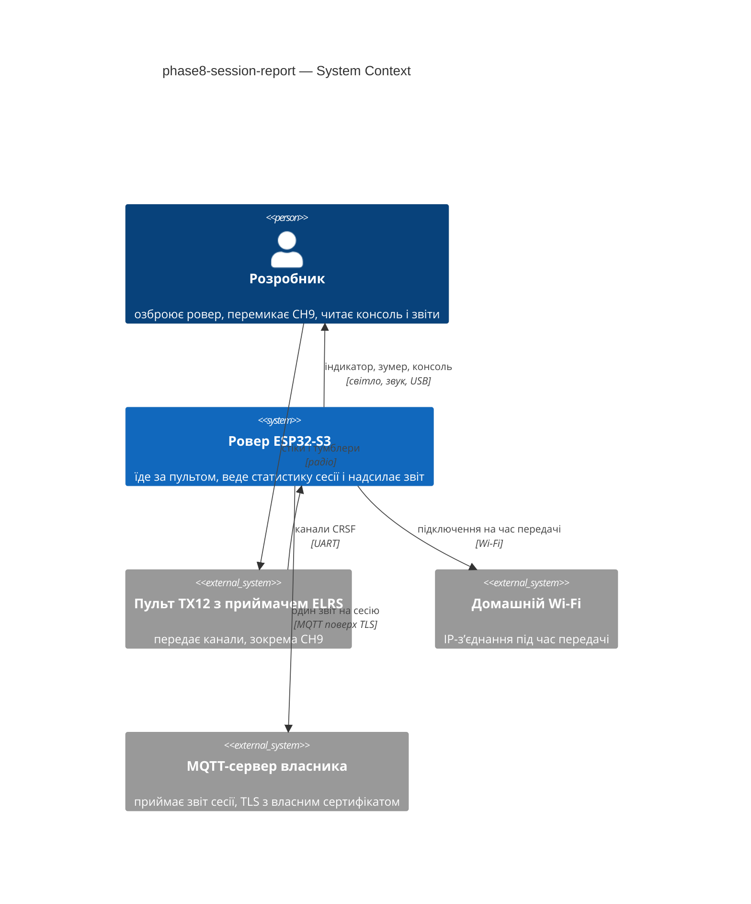

## 4. Solution strategy

Фаза не змінює базової архітектури; вона додає три речі. Нижче — стратегічні рішення, з яких ростуть ADR.

**Top strategic choices (the seeds for ADRs):**

1. **Статистику сесії рахуємо там, де вже є дані — у задачі керування — і передаємо копію підсумку в чергу.** Керування нічого не чекає: жодних нових мʼютексів, нуль нових кроків довших за 20 мс (QG-1). Чиста логіка сесії лежить у `session_core` і тестується на хості. → ADR-0001.
2. **Мережа живе в окремій низькопріоритетній задачі на core 0 і вмикається лише в DISARMED на час спроби (≤ 30 с).** Wi-Fi піднімається й повністю знімається на кожну спробу; озброєння перериває спробу. → ADR-0003. Власний мінімальний MQTT 3.1.1 поверх `esp-tls` (кодування пакетів — чиста логіка у `report_core`, перевірена хостовими тестами; бібліотеку esp-mqtt з реєстру не беремо). → ADR-0002.
3. **Невідправлені звіти (≤ 2) лежать у NVS у кільці з двох слотів** — звіт FAILSAFE через напругу переживає перезапуск, який є єдиним виходом із цього FAILSAFE (QG-2). → ADR-0004.
4. **Режим контролю перешкод — вхід кроку керування з CH9; рішення про зайнятість сектора приймає `drive_core`, `ui` лише відображає (зелений) стан, `tof_core` лише повідомляє датчики.** Захист вимикається без зміни жодного інваріанта п. 7. → ADR-0005.
5. **Секрети — у файлі поза git, сервер закріплений власним кореневим сертифікатом** (QG-3). → ADR-0006.

**Target surface.** `[cli]`, як у фазах 0–7: прошивка без графічного інтерфейсу; інтерфейс Розробника — консоль, індикатор плати, зумер і пульт. Окремої UI-архітектури немає.

Тактичні рішення без ADR (нижче порогу «2 з 3»): назва топіка й client id (ADR-0002), порядок байтів/рівень зеленого (`ui`: зелений канал на рівні 40, як перевірено P8), формат рядка списку датчиків у консолі, розрахунок пробігу й дисбаланс (spec A9, A10), версія/хеш з опису образу.

## 5. Building block view

Стиль — як у фазах 0–7: `*_core.c` (чиста логіка) + `*_hal.c` (виконання). Нових компонентів два: `session` (статистика та межі сесії) і `report` (документ, пакети MQTT, черга, HAL мережі й NVS). Змінюються `crsf`, `tof`, `drive`, `ui`, `rover_console`, `main`.

**Internal decomposition (нове й змінене):**

```
components/
├── session/                  (нове)
│   ├── session_core.c        межі сесії за станом, напруга старту/виходу/мінімум, лічильники утримань і датчиків,
│   │                         пробіг (лише при ненульовій потужності), час руху, середня/пікова швидкість бортів, дисбаланс,
│   │                         час із вимкненим контролем; результат — session_summary_t
│   ├── session_hal.c         черга довжини 2 між control і report (xQueueOverwrite-подібна політика), нічого мережевого
│   └── include/              session_core.h, session_hal.h
├── report/                   (нове)
│   ├── report_core.c         JSON документ звіту, пакети MQTT 3.1.1 (CONNECT/PUBLISH QoS 1/PUBACK/DISCONNECT),
│   │                         політика черги з двох слотів, правила спроби (порядок, зупинка при невдачі, ліміти часу)
│   ├── report_hal.c          задача report (core 0): Wi-Fi вгору/вниз, esp-tls із закріпленим сертифікатом, NVS (простір report),
│   │                         версія/git/IDF/MAC, перевірка DISARMED щонайменше раз на 100 мс (I/O з таймаутом 100 мс)
│   ├── report_secrets.example.h   шаблон (у git); report_secrets.h — локальний, у .gitignore
│   ├── certs/root_ca.pem     кореневий сертифікат власника (надає Розробник)
│   └── include/              report_core.h, report_hal.h
├── crsf/                     + CRSF_IDX_TOF_CONTROL = 8; crsf_tof_control_on(raw) — «вище середини»
├── tof/                      + маска датчиків нижче порога сектора; tof_fmt_hold_line перелічує всі такі датчики
├── drive/                    + tof_control_on у drive_ctl_in_t; occ_* залежать від режиму; публікація режиму; виклик session_step
│                             наприкінці кроку керування; події утримання → session
├── ui/                       + UI_IND_GREEN (зелений рівень 40), пріоритет червоний > жовтий > зелений; ui_hal: колір
├── rover_console/            + команда report (стан черги, негайна спроба в DISARMED), рядки status про режим і чергу
└── ...
main/main.c                   + session_hal_init, report_start; передача колбеків консолі
docs/measured.md              + (Розробник) положення CH9, TP3 під Wi-Fi
sdkconfig.defaults            + розмір розділу застосунку, прив'язка Wi-Fi-стека до core 0 (дозволено, spec A22)
```

**Документ звіту (поля; точні назви фіксує `api`):** `seq`, `duration_ms`, `end_reason`, `voltage_start_mv`, `voltage_end_mv`, `voltage_min_mv`, `holds{count,total_ms,min_mm,min_sensor,by_sensor[4]}`, `tof_control_off_ms`, `distance_cm`, `moving_ms`, `speed{left_avg_rpm,left_peak_rpm,right_avg_rpm,right_peak_rpm,imbalance_pct}` (відсутнє → `null`), `fw{version,git,idf,mac}`; розмір ≤ 1024 байти.

**C4 Container (L2):**

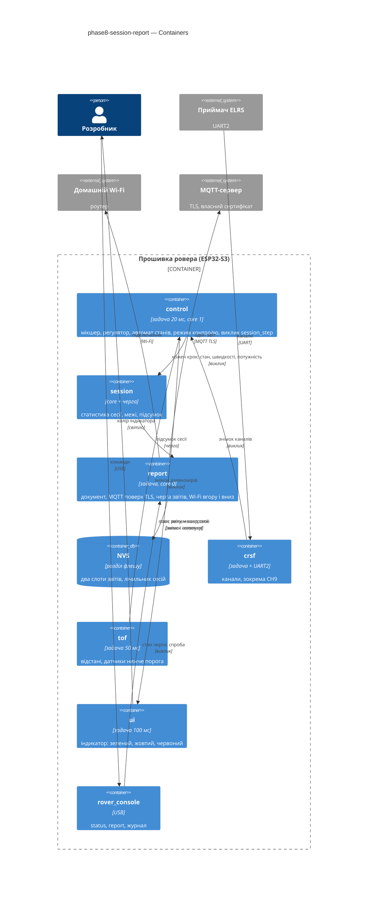

## 6. Runtime view

### Flow 1: звичайна сесія і доставка звіту

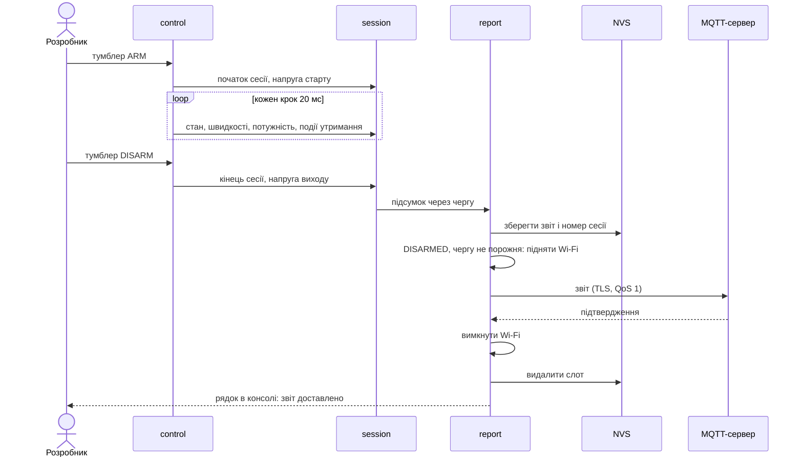

### Flow 2: озброєння перериває спробу передачі

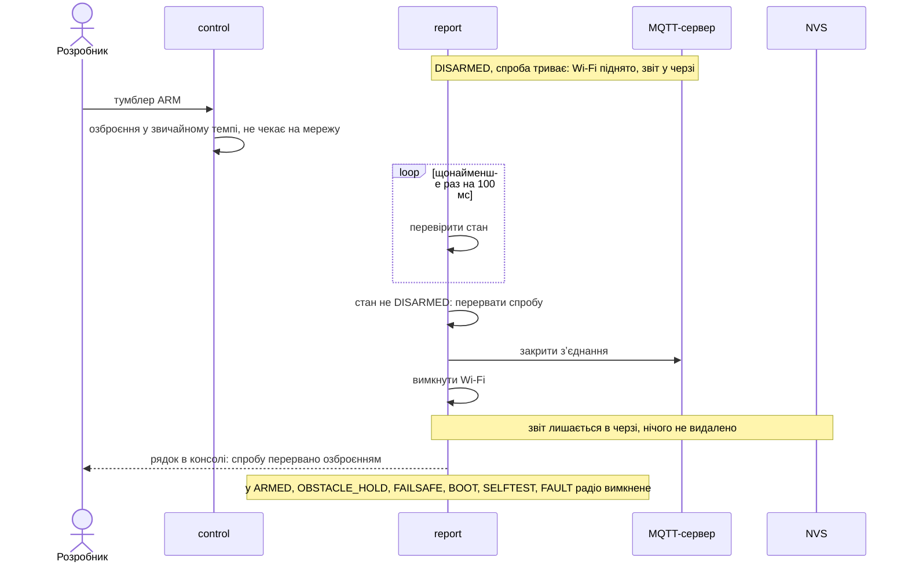

### Flow 3: FAILSAFE: втрата зв'язку і напруга

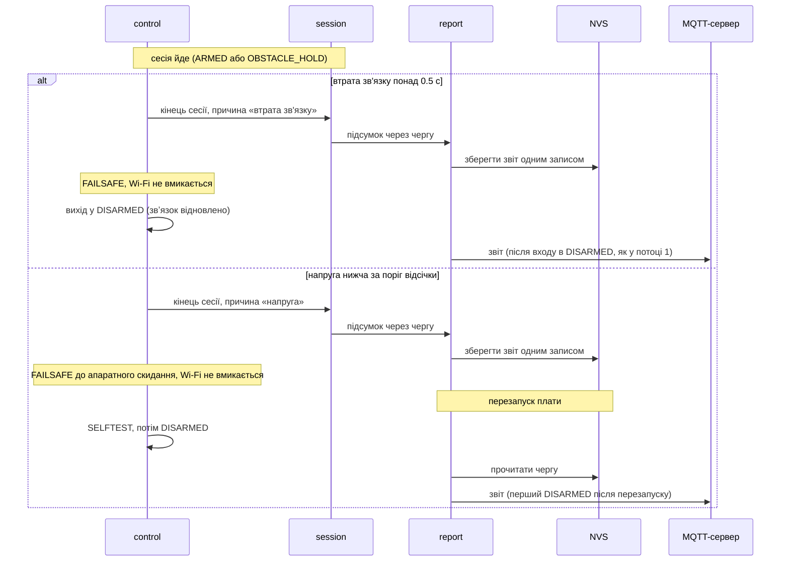

### Flow 4: невдача передачі, черга з двох звітів, недовірений сертифікат

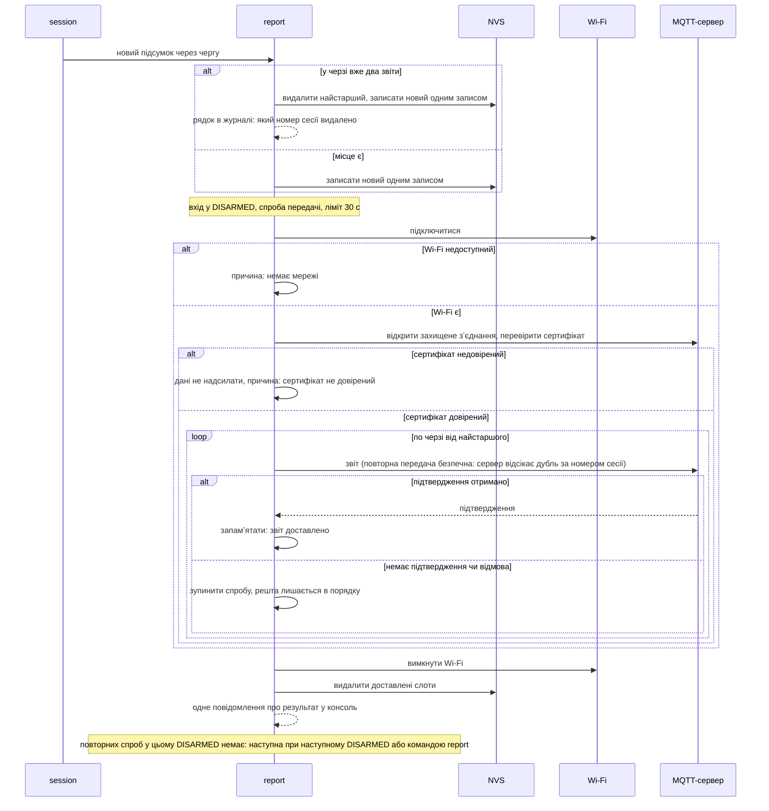

### Flow 5: тумблер CH9 і режим контролю перешкод

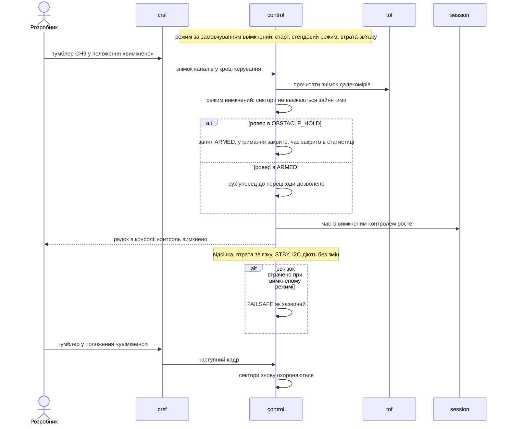

### Flow 6: зелений індикатор і пріоритет кольорів

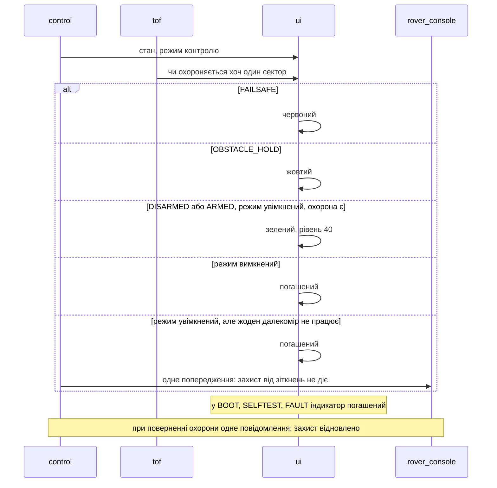

### Flow 7: рядок консолі зі всіма датчиками перешкоди

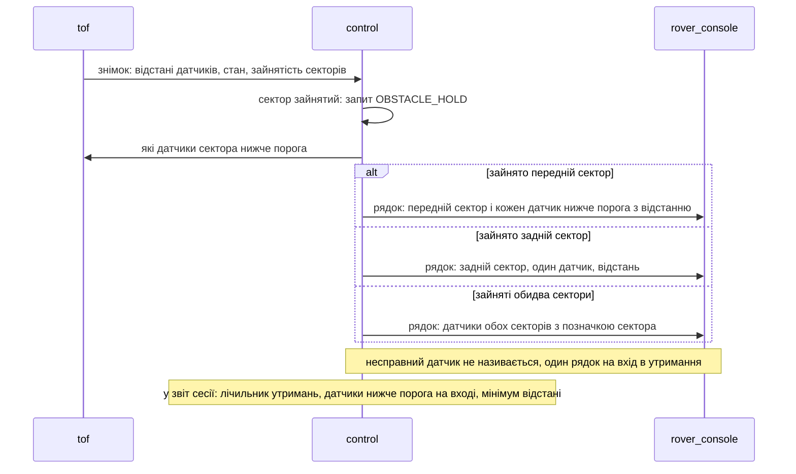

### Flow 8: команда report і відсутні налаштування мережі

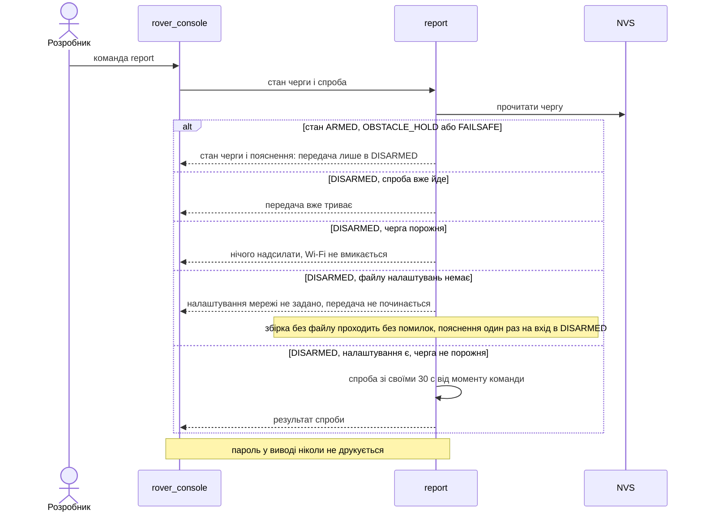

### Flow 9: накопичення статистики сесії

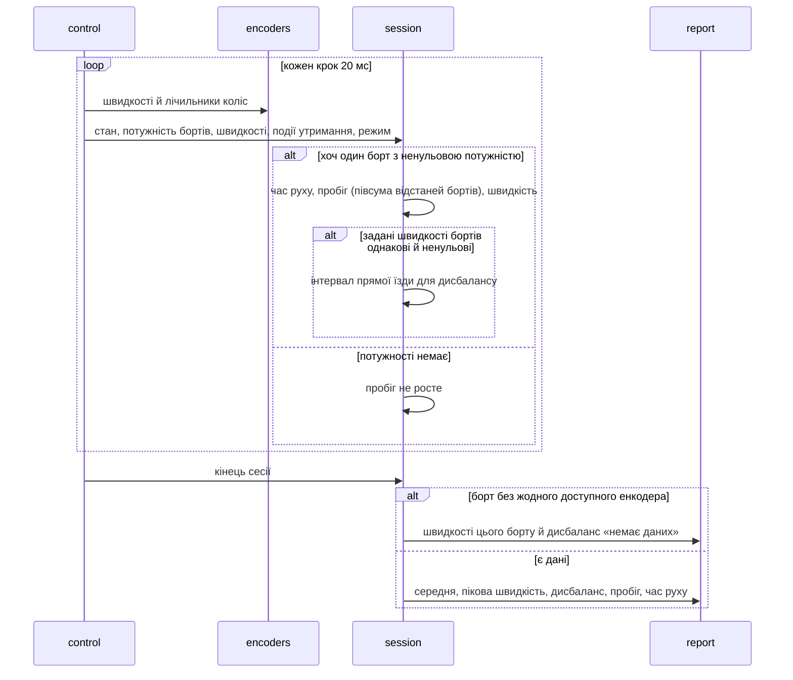

**Покриття спеки.** Користувацькі історії: US-01 → потік 5; US-02 → 6; US-03 → 7; US-04 → 1, 3; US-05 → 4, 8; US-06 → 2; US-07 → 9; US-08 → 4 (сертифікат), 8 (пароль не друкується); US-09 → не runtime (хостові тести й збірка).
Критерії: AC-01…04 → 5; AC-05…07 → 6; AC-08, 09 → 7; AC-10, 11, 25 → 1 (і поля звіту у 9); AC-12, 13 → 3; AC-14…16 → 4; AC-17 → 8; AC-18, 19 → 2; AC-20, 21 → 9; AC-22 → 4; AC-23 → не runtime (перевірка пошуком по репозиторію й виводу); AC-24 → 8; AC-26 → не runtime (хостові тести й збірка).

**Прапорці для `design`/`api`:** (1) участники взяті з §5 (control, session, report, NVS…), не з узагальненого словника: у прошивці немає сервісів і клієнтів у вебсенсі; (2) формат документа звіту й топік потребують контракту `api` (асинхронна подія); (3) потік 4 описує повторну передачу без повторів у межах одного DISARMED: ідемпотентність забезпечує сервер за номером сесії.

## 7. Deployment view

Один пристрій: прошивка в образі застосунку; розділ NVS 24 КБ; Wi-Fi на core 0 лише в DISARMED ≤ 30 с на спробу. Зовні — домашня мережа й MQTT-сервер власника.

**Monitoring:**
- Журнал консолі: початок/кінець спроби, причина невдачі, видалення зайвого слота, доставка.
- `status`: режим контролю, довжина черги, результат останньої спроби, вільна памʼять, час кроку керування.
- Сервер: число отриманих сесій; пропуск у `seq` означає втрату.

**Scaling thresholds:**
- Черга 2 звіти; третій витісняє найстарший.
- Розмір звіту ≤ 1024 байти; NVS-споживання ≈ 2.2 КБ із 24 КБ.
- Образ застосунку: поточний ≈ 371 КБ; після Wi-Fi/TLS очікується > 1 МБ — зміна розділу застосунку (захищений `sdkconfig.defaults`, дозволено).

## 8. Crosscutting concepts

| Concept | Convention | Where defined |
|---|---|---|
| Logging | `ESP_LOG*` з тегом компонента, українські повідомлення; пароль ніколи не друкується; одне повідомлення на подію | constitution п. 9; spec A19, A20 |
| Error handling | збій мережі/NVS не змінює автомат, моторів і світла; звіт лишається в черзі; причина одним рядком на спробу | spec A20 |
| Safety gating | Wi-Fi лише в DISARMED; озброєння перериває спробу; запис NVS поза тактом керування; інваріанти п. 7 без змін | constitution п. 7; ADR-0003, ADR-0005 |
| Core/HAL split | вся логіка сесії, документа, пакетів MQTT, черги й режиму — в `*_core.c` без заголовків IDF; хостові тести | constitution п. 6 |
| Time | uptime у мс від старту плати; абсолютного часу немає (сервер ставить власну мітку) | spec §3 |
| ID strategy | номер сесії — зростаючий `uint32` у NVS; client id `rover-<mac>` | ADR-0002, ADR-0004 |
| Topic / delivery | топік `rover/<mac>/session`, QoS 1, `retain` вимкнено; дублікат відсікає сервер за `seq` | ADR-0002 |
| Secrets | `report_secrets.h` поза git + шаблон; сертифікат у `certs/` | ADR-0006 |
| Units in names | поля JSON англійською з одиницею в назві (`_mv`, `_ms`, `_rpm`, `_cm`) | spec A12 |

## 9. Architecture decisions

| # | Title | Status | Section |
|---|---|---|---|
| 0001 | Accumulate session statistics in the control task and hand off a summary through a bounded queue | Accepted | §4 |
| 0002 | Implement a minimal MQTT 3.1.1 publisher in report core over esp-tls | Accepted | §4 |
| 0003 | Bring Wi-Fi up and down per delivery attempt in a dedicated core 0 task that yields to arming | Accepted | §4 |
| 0004 | Persist unsent reports in NVS as a two-slot ring written by the report task | Accepted | §4 |
| 0005 | Gate ToF occupancy in drive core by the CH9 switch with default on | Accepted | §4 |
| 0006 | Keep network secrets in an ignored header and pin the owner root certificate | Accepted | §4 |

ADR files live under `docs/features/phase8-session-report/adr/NNNN-<title>.md`.

## 10. Quality requirements

**QG-1. Безпека: мережа не впливає на керування**
- **When:** ровер роззброєний зі звітом у черзі, мережа працює; або Розробник озброює під час спроби.
- **Then:** 0 нових кроків керування довших за період 20 мс під час спроби (виняток — моменти запису в памʼять плати, див. §1 ¶4); озброєння не затримується (той самий виняток); Wi-Fi вимкнено після 100 % спроб (успішних, невдалих і перерваних озброєнням); спроба ≤ 30 с від входу в DISARMED до вимкнення Wi-Fi; вільна внутрішня памʼять після вимкнення Wi-Fi не менша за значення до спроби мінус 4096 байт; поріг ≥ 345000 байт зберігається; реакція індикації на тумблер контролю ≤ 200 мс від зміни значення каналу до зміни світла індикатора; стан озброєння перевіряється під час спроби щонайменше раз на 100 мс (пропозиція агента, spec A21: закриття зʼєднання не пізніше 200 мс після запиту озброєння).
- **How verify:** `status` (час кроку і памʼять) до і після спроби; мітки журналу; перевірка радіо в усіх станах (spec AC-19).

**QG-2. Збереженість даних**
- **When:** мережі немає, сервер відхиляє дані, перезапуск після FAILSAFE через напругу.
- **Then:** ≤ 2 звіти в черзі; ≤ 2 записи в памʼять плати на сесію (створення і видалення після доставки; запис = один `nvs_commit` разом із метаданими); розмір звіту ≤ 1024 байти; точність пробігу ±5 % на 1 м; точність напруги у звіті ±0.1 В щодо `status`.
- **How verify:** 0 заголовків ESP-IDF у `*_core.c` нових компонентів і ≥ 1 хостовий тест на кожне правило A1–A10 і A17 (п. 6); хостові тести політики черги й документа; приймання на залізі (метр по рулетці, відключення роутера, `reboot`).

**QG-3. Захист секретів і сервера**
- **When:** сервер пред'являє недовірений сертифікат; Розробник дивиться журнал, `status`, звіт, репозиторій.
- **Then:** 0 входжень паролів у git, консоль, журнал, `status`, звіт; дані не надсилаються без довіреного сертифіката; збірка без файлу налаштувань проходить без помилок і нових попереджень.
- **How verify:** пошук по репозиторію й виводу; хостовий скрипт на `.gitignore`; `idf.py build` без секретів; перевірка з підміненим сертифікатом.

## 11. Risks and technical debt

| Risk / debt | Severity | Mitigation | Owner |
|---|---|---|---|
| Wi-Fi біля приймача ELRS 2.4 ГГц може погіршити радіоканал пульта під час спроби (DISARMED) | Medium | спроби ≤ 30 с лише в DISARMED; приймання: лічильники `crc_fail` і `rc_ok` до/під час спроби | Розробник |
| Запис флешу (два `nvs_commit` на сесію) зупиняє виконання коду з флешу на обох ядрах: крок керування й озброєння можуть затриматись на тривалість запису | Medium | запис лише в DISARMED/FAILSAFE (двигуни вимкнені), видалення після доставки — після вимкнення Wi-Fi; override у §1 ¶4; замір тривалості запису на залізі при прийманні | Агент |
| Власний MQTT-клієнт: помилки сумісності виявляться лише на залізі; немає підписки/ретраїв | Medium | хостові тести на еталонних байтах; приймання з реальним сервером; перехід на esp-mqtt змінює лише `report_hal` | Агент |
| Образ після Wi-Fi/TLS перевищить розділ застосунку 1 МБ | Medium | збільшити розділ у `sdkconfig.defaults` (дозволено, spec A22) і зафіксувати в журналі змін; перевірити розмір після першої збірки | Агент |
| Помилково призначений CH9 на TX12 (значення 992 = «вимкнено») вимкне захист | Medium | OQ-6: Розробник записує два положення в `measured.md`; `status` показує режим і «значення за замовчуванням» | Розробник |
| Open architectural decision: TP3 під Wi-Fi не виміряно (документ 01 §5.4–5.5) | Open question | Розробник мірить і записує в `docs/measured.md` до приймання; до того передача лише на повному акумуляторі/живленні, що тримає межу — owner: Розробник, due: before acceptance | Розробник |
| Open architectural decision: положення CH9 на TX12 не виміряно | Open question | Розробник записує в `docs/measured.md`; до того специфікація використовує «вище середини» (override у §1 ¶4) — owner: Розробник, due: before sdd:tasks | Розробник |

**Accepted debt (acceptable in v1, plan to fix later):**
- Немає синхронізації часу: звіти без абсолютних дат; сервер ставить мітку отримання.
- Секрети вшиті в образ; зміна пароля — перезбірка (ADR-0006).
- Wi-Fi піднімається з нуля на кожну спробу (кілька секунд); оптимізація — окрема фаза, якщо заважатиме.

## 12. Glossary

| Term | Meaning |
|---|---|
| Режим контролю перешкод | перемикач CH9: ввімкнений — сектори зупиняють ровер; вимкнений — далекоміри лише міряють |
| Сесія | від входу в ARMED з DISARMED до виходу з ARMED/OBSTACLE_HOLD у DISARMED або FAILSAFE |
| Звіт сесії | один документ із підсумком сесії, ≤ 1024 байти |
| Черга звітів | ≤ 2 невідправлені звіти в памʼяті плати |
| Пробіг | сума модулів зміщення центру ровера на інтервалах ненульової потужності |
| Дисбаланс бортів | різниця середніх швидкостей лівого й правого бортів у відсотках на інтервалах прямої їзди |
| Утримання перед перешкодою | стан OBSTACLE_HOLD |
| Захищені файли | канонічні файли проєкту, що не змінюються без згоди Розробника (п. 10) |
