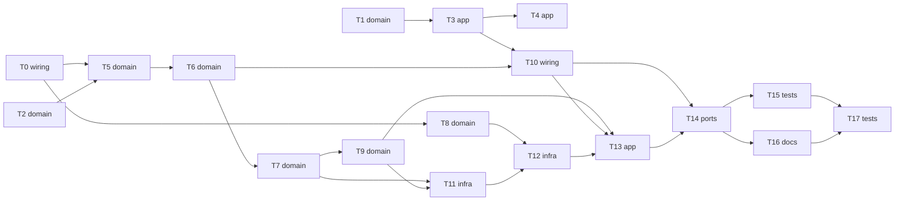

# Epic — phase8-session-report

> **Spec:** [spec.md](../spec.md) · **Design:** [sad.md](../sad.md) · **Contracts:** [cli.md](../contracts/cli.md), [events.md](../contracts/events.md), [api-sync-report.md](../contracts/api-sync-report.md) · **ADRs:** [adr/](../adr/)

## Goal

Дати Розробнику вимикач захисту від зіткнень на пульті (CH9) з зеленим індикатором, повний перелік датчиків перешкоди в консолі та підсумок кожної сесії, який ровер після роззброєння надсилає на сервер (Wi-Fi лише в DISARMED) і не втрачає (до двох звітів у NVS) — spec §2.

## Scope

- **In:** `crsf` (CH9), `tof` (маска й рядок), `drive` (режим і події, виклик session), `ui` (зелений), нові `session` і `report`, `rover_console` (`report`, `status`), `main`, `sdkconfig.defaults`/CMake (за дозволом), README і самоперевірка.
- **Out:** керування ровером чи оновлення прошивки через мережу; безперервна телеметрія під час руху; абсолютний час сесій; консольна зміна режиму контролю; заміри Wi-Fi (spec §3).

## Task map

## Tasks

See [tracker.md](./tracker.md) for status. Machine contract: [tasks.json](../tasks.json).

| # | Task | Layer | Blocked by | DoD (short) |
|---|---|---|---|---|
| T0 | Створити каркаси компонентів session і report: CMake, заголовки й порожні заглушки core/hal, що збираються без попереджень | wiring | — | `idf.py build` проходить без нових попереджень |
| T1 | Додати в crsf_core канал CH9 і функцію «контроль перешкод увімкнено» зі значенням за замовчуванням | domain | — | хостові тести CRSF проходять, у `crsf_core.c` немає заголовків ESP-IDF |
| T2 | Додати в tof_core маску датчиків нижче порога й розширити рядок утримання переліком усіх таких датчиків | domain | — | хостові тести tof проходять; `tof_core.c` без заголовків ESP-IDF |
| T3 | Додати в drive_core вхід «режим контролю» і подавити зайнятість секторів, коли режим вимкнено, з подіями зміни режиму й охорони | app | T1 | хостові тести drive (з новими) проходять; тести фази 6 без змін у поведінці |
| T4 | Додати в ui зелений індикатор за режимом контролю й охороною з пріоритетом червоний > жовтий > зелений | app | T3 | хостові тести ui проходять; `ui_core.c` без заголовків ESP-IDF |
| T5 | Створити session_core: межі сесії за станом, причина завершення, напруга, утримання за датчиками, час із вимкненим контролем, номер і тривалість | domain | T0, T2 | хостові тести session проходять; `session_core.c` без заголовків ESP-IDF |
| T6 | Додати в session_core пробіг, час руху, середню й пікову швидкість бортів і дисбаланс із явним «немає даних» | domain | T5 | хостові тести session (з новими) проходять; `session_core.c` без заголовків ESP-IDF |
| T7 | Створити report_core: документ звіту сесії у форматі events.md з явними null і межею 1024 байти | domain | T6 | хостові тести report проходять; `report_core.c` без заголовків ESP-IDF |
| T8 | Створити mqtt_core: кодування CONNECT, PUBLISH (QoS 1), DISCONNECT і розбір CONNACK та PUBACK для MQTT 3.1.1 | domain | T0 | хостові тести mqtt проходять; `mqtt_core.c` без заголовків ESP-IDF |
| T9 | Створити report_queue_core: кільце з двох слотів, порядок передачі, вихід зі спроби при першій невдачі й правила дозволу передачі за станом | domain | T7 | хостові тести queue проходять; `report_queue_core.c` без заголовків ESP-IDF |
| T10 | Підʼєднати session до drive_hal: виклик session_step наприкінці кроку керування, подачу підсумку в чергу й логування подій режиму | wiring | T3, T6 | `idf.py build` без нових попереджень; `status` показує час кроку без нових перевищень на стенді |
| T11 | Створити report_store_hal і налаштування мережі: NVS-кільце звітів одним записом, версія й git образу, локальний файл секретів, сертифікат, зміни сборки | infra | T7, T9 | запис/читання кільця перевірено на залізі (T17) і хостовими тестами логіки (T9) |
| T12 | Створити report_net_hal: підключення Wi-Fi, TLS із закріпленим сертифікатом і обмін MQTT з таймаутом 100 мс на крок | infra | T8, T11 | `idf.py build` без нових попереджень |
| T13 | Створити report_hal: задачу report на core 0 з спробою передачі при вході в DISARMED, скасуванням озброєнням і записом результатів | app | T9, T10, T12 | `idf.py build` без нових попереджень |
| T14 | Додати в консоль команду report та поля status про режим контролю й звіти, з підключенням у main | ports | T10, T13 | хостові тести console проходять; `console_core.c` без заголовків ESP-IDF |
| T15 | Додати хостові перевірки: гігієна секретів у git, повний прогін збірки й тестів, захищені файли дозволені лише в межах фази | tests | T14 | усі `check_*.sh` і `run_tests.sh` проходять; `idf.py build` без нових попереджень |
| T16 | Оновити README, архітектурну діаграму й самоперевірку: режим CH9, індикатор, звіт сесії, налаштування мережі, відомі обмеження | docs | T14 | документи не обіцяють більше, ніж перевірено; кожен пункт self-check має посилання на доказ |
| T17 | Скласти чекліст приймання на залізі для Розробника: CH9, індикатор, список датчиків, доставка, черга, переривання озброєнням, FAILSAFE, замір запису в памʼять | tests | T15, T16 | кожен пункт має очікування й місце запису доказу |

## Risks / Hard rules

- Конституція пп. 6–9, 14: core/HAL, інваріанти безпеки, збірка без нових попереджень, українські коментарі, `vTaskDelayUntil`.
- Правки захищених файлів — лише `sdkconfig.defaults` і кореневого `CMakeLists.txt`, за дозволом, з записом у `protected-changes.md` (spec A22).
- Spec §6: 0 нових кроків керування довших за 20 мс під час спроби (виняток — запис у NVS, SAD §1 ¶4); Wi-Fi вимкнено після 100 % спроб; секрети лише поза git.
- OQ-5 (TP3 під Wi-Fi) і OQ-6 (положення CH9) — виміри Розробника; до заміру CH9 прошивка вважає «вище середини» увімкненим (SAD override).
