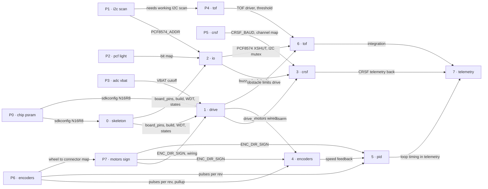

# Roadmap — ESP32-ELRS-Rover

> **Декомпозиція, а не обіцянка.** Ідея розбита на інкрементальні кроки: що кожен крок собою являє, звідки походить, наскільки великий, і в якому порядку їх проходити. **Без дат** (крім історії завершеного), **без оцінок пріоритету** — порядок і є пріоритетом. *Рішення* для кожного кроку живе у його специфікації `docs/features/<slug>/spec.md`, не тут. Джерело вимог — `docs/02-FIRMWARE-CONTEXT.md`, розділ 7.

## Destination

Ровер на ESP32-S3 їде за стіками пульта ELRS танковим приводом з регулюванням швидкості, зупиняється при втраті звʼязку, розряді батареї чи перед перешкодою й повертає телеметрію на пульт.

## Pre-phases (P0–P7) — outside SDD

<!-- Це НЕ кроки SDD: діагностичні прошивки, вимірювальні інструменти. Для них немає ні специфікації, ні плану, ні задач; не проходять рев'ю якості коду. Живуть у `tools/bringup/` (перемикач BRINGUP_TEST). Результат — число в `docs/measured.md`; передфаза пройдена, лише коли число записане там. -->

Це діагностичні прошивки. Вони **не проходять цикл SDD**: у них немає специфікації, плану й задач. Їхній єдиний результат — числа в `docs/measured.md`, які закривають «?» у розділі 9 документа 02 (`docs/02-FIRMWARE-CONTEXT.md`, §7.0).

| ID | Передфаза | Залізо | Що закриває | Стан |
|---|---|---|---|---|
| P0 | тулчейн, чіп, PSRAM | плата з U3, USB | `sdkconfig` під N16R8 | пройдено |
| P1 | скан I²C | + U6, далекоміри від'єднані | `PCF8574_ADDR` | пройдено |
| P2 | виходи PCF8574 і світло | + фари J2/J3, ліхтарі J5/J6 | карта бітів §2.1 | пройдено |
| P3 | ADC батареї, двоточкове калібрування | акумулятор або блок на J1 | `VBAT_SCALE`, `VBAT_OFFSET`, `VBAT_CUTOFF_MV` | одна точка з двох знята (8.26 В), друга потрібна до фази 1 |
| P4 | далекоміри і перепризначення адрес | + U7…U10 на шлейфах | `TOF_OBSTACLE_MM`, драйвер VL53L0X (§10.3) | пройдено (послідовність 10/10, драйвер підтверджено); `TOF_OBSTACLE_MM` — на шасі |
| P5 | приймання CRSF | + приймач у J7 | `CRSF_BAUD`, карта каналів §1.3 | пройдено (420000, карта каналів підтверджена, CH8 = фари) |
| P6 | енкодери, обертання рукою | + мотори на шлейфах | `ENC_PULSES_PER_REV`, `ENC_NEEDS_PULLUP` | пройдено (2772 імп/оберт, підтяжки не потрібні) |
| P7 | мотори на мінімальному ШІМ і знак енкодера | усе, колеса в повітрі | `ENC_DIR_SIGN[4]`, прив'язка §2.2 | пройдено (знак +1, −1, +1, −1); FR повільний, причину перевірити |

Без прошивки вимірюються `WHEEL_DIAMETER_MM` і `WHEEL_BASE_MM` (штангенциркуль, лінійка); `MOTOR_MAX_PWM` лишається 0.75 до фази 5.

### Gates

Яка фаза не починається, доки не пройдено які передфази (`docs/02-FIRMWARE-CONTEXT.md`, §7.0):

| Фаза | Не починати, доки не пройдено |
|---|---|
| Фаза 0 — скелет | P0 |
| Фаза 1 — мотори | P0, P3, P7 |
| Фаза 2 — I²C, світло | P1, P2 |
| Фаза 3 — ELRS | P5 |
| Фази 4–5 — енкодери, PID | P6, P7 |
| Фаза 6 — далекоміри | P4 |

Фаза 7 власних воріт не має, її обмежують залежності від фаз 3, 5 і 6 (див. граф).

## Steps

<!-- Фази прошивки: проходять цикл SDD, одна фаза = одна фіча зі своїм слагом і специфікацією в docs/features/<slug>/. Слаг у колонці Step. -->

| # | Step | Source | Size | Status |
|---|---|---|:---:|---|
| 0 | `phase0-skeleton` — прошивається, консоль відповідає, WDT зареєстрований, стан BOOT друкується | `docs/02-FIRMWARE-CONTEXT.md` §7, «Фаза 0 — скелет» | S | shipped — [spec](features/phase0-skeleton/spec.md) |
| 1 | `phase1-drive` — `drive 0.3 0` крутить борти, `disarm` зупиняє, при VBAT < 6.0 В мотори не стартують | `docs/02-FIRMWARE-CONTEXT.md` §7, «Фаза 1 — живлення і мотори» | M | shipped — [spec](features/phase1-drive/spec.md) |
| 2 | `phase2-io` — світло й зумер керуються з консолі, при старті світла немає | `docs/02-FIRMWARE-CONTEXT.md` §7, «Фаза 2 — I²C, PCF8574, світло, зумер» | S | shipped — [spec](features/phase2-io/spec.md) |
| 3 | `phase3-crsf` — стіки пульта рухають мотори, вимкнення пульта зупиняє за 500 мс | `docs/02-FIRMWARE-CONTEXT.md` §7, «Фаза 3 — ELRS / CRSF» | S | shipped — [spec](features/phase3-crsf/spec.md) |
| 4 | `phase4-encoders` — чотири лічильники дають стабільні оберти зі знаком і без зривів | `docs/02-FIRMWARE-CONTEXT.md` §7, «Фаза 4 — енкодери» | S | spec'd — [spec](features/phase4-encoders/spec.md) |
| 5 | `phase5-pid` — борт тримає задану швидкість під навантаженням, коефіцієнти міняються з консолі | `docs/02-FIRMWARE-CONTEXT.md` §7, «Фаза 5 — PID» | M | idea |
| 6 | `phase6-tof` — ровер зупиняється перед перешкодою, дозволяє здати назад, переживає відмову сенсора | `docs/02-FIRMWARE-CONTEXT.md` §7, «Фаза 6 — далекоміри й протизіткнення» | L | idea |
| 7 | `phase7-telemetry` — пульт бачить напругу батареї, є README, блок-схема й заповнений чекліст | `docs/02-FIRMWARE-CONTEXT.md` §7, «Фаза 7 — телеметрія, інтеграція, документація» | S | idea |

## Not yet specified

<!-- Туману немає: усі вісім фаз сформульовані в документі достатньо точно, щоб їх різати. -->

| Area | What we'd have to learn | Blocks | How it gets sharpened |
|---|---|:---:|---|
| — | — | — | — |

## Out of scope

- — (джерела нічого не виносять за межі проєкту)

## Open decisions

| # | Question | Type | Owner | Blocks |
|---|---|:---:|:---:|:---:|
| D2 | `CRSF_BAUD`: 420000 чи 416666 (§10.2) | prototype | human | 3 |
| D4 | Драйвер VL53L0X: порт API ST, компонент спільноти чи мінімальний власний (рекомендація документа — власний, §10.3) | prototype | agent | 6 |

## Decisions so far

- `PCF8574_ADDR` = `0x20`, на шині рівно один пристрій → [`docs/measured.md`](measured.md)
- Конституція проєкту з 14 пунктів (core/HAL, заборона вигадувати константи, інваріанти безпеки) → [`docs/constitution.md`](constitution.md)
- Передфази P0–P7 поза циклом SDD, один проєкт `tools/bringup` з перемикачем → [`docs/02-FIRMWARE-CONTEXT.md`](02-FIRMWARE-CONTEXT.md) §7.0
- Поточна архітектура: 1 реальний компонент і 9 заглушок → [`docs/architecture-map.md`](architecture-map.md)
- Прозвонка моторних шлейфів пройдена (піни 1–2 обмотка ≈ 12 Ом, ізоляція до пінів 3–6) → [`docs/measured.md`](measured.md)
- D3 закрито: вихід енкодера не відкритий колектор, усі чотири енкодери рахують без підтяжок, переробка плати не потрібна (`ENC_NEEDS_PULLUP` = 0, P6, 2026-10-17) → [`docs/measured.md`](measured.md)

## Dependency graph

## Execution path

Хвилі йдуть послідовно, одна фаза за раз, без паралельних ліній (рішення власника). Передфази з колонки Gates мають бути пройдені до початку відповідної хвилі.

| Wave | Steps | Zone per step (why parallel-safe) | Unlocks |
|:---:|---|---|---|
| 1 | 0 | 0: `main/`, `components/board/` | 1, 2 |
| 2 | 1 | 1: `components/drive/`, `components/battery/`, `main/` | 3, 4 |
| 3 | 2 | 2: `components/ioexp/`, `components/ui/` | 3, 6 |
| 4 | 3 | 3: `components/crsf/` | 7 |
| 5 | 4 | 4: `components/encoders/` | 5 |
| 6 | 5 | 5: `components/pid/` | 7 |
| 7 | 6 | 6: `components/tof/` | 7 |
| 8 | 7 | 7: `components/telemetry/`, `README.md` | — |

## Shipped

| Step | Shipped | Link |
|---|---|---|
| 0 `phase0-skeleton` | 2026-10-18 | [changelog](features/phase0-skeleton/changelog.md) |
| 1 `phase1-drive` | 2026-10-18 | [changelog](features/phase1-drive/changelog.md) (AC-13, AC-15, AC-22 чекають OQ-1) |
| 2 `phase2-io` | 2026-10-18 | [changelog](features/phase2-io/changelog.md) (AC-14, AC-15 на залізі не перевірені: розширювач запаяний) |
| 3 `phase3-crsf` | 2026-10-18 | [changelog](features/phase3-crsf/changelog.md) (AC-14 і NFR ≤ 50 мс на залізі не показані; T13–T18 на залізі не прогнані) |
